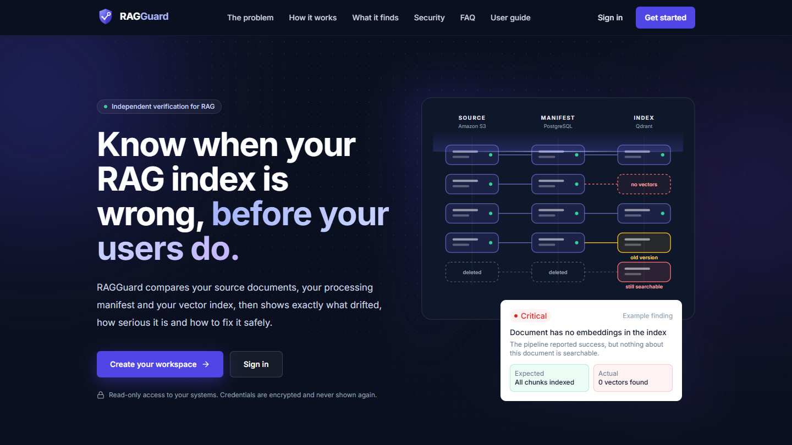
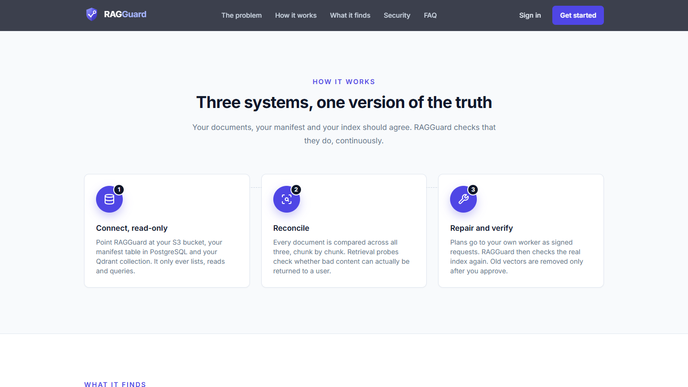

# Getting started

RAGGuard tells you when your RAG index is wrong, before your users do. It compares the documents you meant to index, the record your pipeline keeps of what it indexed, and the vectors that are really searchable, and it shows you exactly what drifted, how serious it is and how to fix it safely. This chapter explains what problem RAGGuard solves, who it is for, what you need before you start, and how to get from a new account to your first audit result. It also tours the public landing page and explains how to read the rest of this guide.

**On this page**

- [What RAGGuard is](#what-ragguard-is)
- [The problem it solves: silent RAG failures](#the-problem-it-solves-silent-rag-failures)
- [What RAGGuard does and does not do](#what-ragguard-does-and-does-not-do)
- [Who it is for](#who-it-is-for)
- [Before you start](#before-you-start)
- [Three ways RAGGuard can run](#three-ways-ragguard-can-run)
- [What demo data means](#what-demo-data-means)
- [Ten-minute quick start](#ten-minute-quick-start)
- [The landing page](#the-landing-page)
- [How to read this guide](#how-to-read-this-guide)
- [Tips and common mistakes](#tips-and-common-mistakes)
- [Related chapters](#related-chapters)

---

## What RAGGuard is

RAGGuard is an independent checker for a **RAG** system. RAG stands for retrieval-augmented generation: an application answers questions by first searching an index of your documents, then giving the best matches to a language model. The index is only useful if it is correct.

RAGGuard reads three places and compares them. It always reads. It never writes to them.

| Word in RAGGuard | System | What it represents |
|---|---|---|
| **Source** | Amazon S3 (or an S3-compatible store) | What exists right now: your documents |
| **Manifest** | A table in PostgreSQL | What your pipeline believes it did: one row per document |
| **Index** | Qdrant | What is actually searchable: your vectors |

Comparing them is called an **audit**. An audit produces:

- **Issues**: each disagreement it found, with evidence. There are 11 types.
- A **status** for every document, and one **health score** for the whole index.
- **Repair plans**: a list of what to fix, with estimated cost.

When you ask for a repair, RAGGuard does not change your systems. It sends a signed request to **your own worker** and then checks the real index again to see whether the fix worked. Removing old vectors needs your explicit approval.

Every term in bold is explained in [Concepts you need](02-concepts.md).

---

## The problem it solves: silent RAG failures

A RAG system can go wrong while every background job reports success. The application keeps running and nobody sees an error, but users get incomplete, outdated or wrong answers. The landing page lists six ways this happens:

| What goes wrong | What it looks like |
|---|---|
| Documents that were never embedded | The file sits in storage, but nothing about it is searchable. |
| Updated documents with old vectors | The source changed. The index keeps serving the previous version with full confidence. |
| Deleted documents that stay searchable | Withdrawn or deleted content can still be returned to your users. |
| Half-indexed documents | Only some chunks made it in, so answers are quietly incomplete. |
| Duplicates and empty vectors | Retries double-count chunks. Zero vectors can never be retrieved. |
| Drift nobody planned | The embedding model, the chunking or the permissions changed. Old documents did not. |

**An example.** Your ingestion job processes a new HR policy and records the status `success`. A crash halfway through means no vectors reached Qdrant. The job is green, the dashboard is green, and the assistant never mentions the policy. RAGGuard sees a document in S3, a manifest row that claims success, and zero vectors in the index. It reports **Missing embeddings** as **Critical**, because the pipeline said it worked.

---

## What RAGGuard does and does not do

| RAGGuard does | RAGGuard does not |
|---|---|
| Read your S3 bucket, manifest table and Qdrant index, read-only | Write to, change or delete anything in those systems |
| Find 11 kinds of disagreement, each with evidence | Parse documents, create embeddings or host a vector database |
| Show how serious each issue is and whether bad content can really be retrieved | Run a chatbot |
| Plan repairs and estimate their cost | Carry out repairs itself: your worker does that |
| Send signed repair requests to your worker and verify the result against the real index | Remove vectors without your approval |
| Notify you in the app and by email after every audit, alert you through a Slack-compatible webhook, and run audits from scripts through API keys | Connect to Slack, Jira or PagerDuty directly (marked **Not available yet** in the interface) |

---

## Who it is for

RAGGuard is for teams who run a production RAG pipeline over Amazon S3, PostgreSQL and Qdrant and need to know three things: whether the index is trustworthy, which exact documents are wrong and why, and what it will cost to fix them.

| If you are... | You will mostly use... |
|---|---|
| An engineer connecting RAGGuard | [Connect your data sources](04-data-sources.md), [Settings](14-settings.md), [Integrations](12-integrations.md) |
| An on-call engineer investigating an alert | [Overview](05-overview.md), [Integrity issues](07-integrity-issues.md), [Documents](10-documents.md) |
| An owner of the data pipeline | [Repair plans](08-repair-plans.md), [Impact analysis](09-impact-analysis.md), [Audit history](11-audit-history.md) |
| A security or compliance owner of a multi-tenant product | [Isolation](20-isolation.md), [Integrity issues](07-integrity-issues.md) |
| Someone automating checks in CI | [Integrations](12-integrations.md) (API keys), [Alerts](13-alerts.md) |

RAGGuard works with S3-compatible stores such as MinIO, Cloudflare R2 and Supabase Storage, with PostgreSQL including Supabase, and with Qdrant self-hosted or on Qdrant Cloud.

---

## Before you start

You need two things that already exist in your own environment, plus an account. A third, the manifest, is optional.

### 1. An S3 bucket with your documents

- A bucket (or a folder inside one, set with **Key prefix**) that holds the documents your users should be able to search.
- A read-only access key for it. On AWS, the key needs `s3:ListBucket` on the bucket and `s3:GetObject` on its objects.
- Object keys that RAGGuard can split into a tenant and a document id. The default **Key pattern** expects `tenant/path/to/document.pdf`, for example `customer-a/policies/leave-policy.md`. For a bucket with no tenants, set the pattern to `^(?P<document_id>.+)$`.
- A way to know when a file changes. The simplest is a SHA-256 stored with each object under the metadata key `sha256`. Alternatives are **Content hash** `compute` (RAGGuard downloads and hashes) or `etag` (quick start, less reliable).

### 2. A PostgreSQL manifest table (optional)

**Skip this if your pipeline records nothing.** Audits work without a manifest: RAGGuard compares your files with the vector index directly (see [The manifest is optional](04-data-sources.md#the-manifest-is-optional-and-your-vectors-can-live-in-pgvector)). This is the table your ingestion pipeline writes after it processes each document. By default RAGGuard looks for `rag_document_manifest` in the `public` schema, and you can change both. You can also map your own column names.

- **Minimum:** a `document_id` column. It is the only mandatory column, and any other column your table lacks is simply skipped.
- **Recommended:** `tenant_id`, `source_uri`, `source_hash`, `source_version`, `processing_status`, `expected_chunk_count`, `indexed_chunk_count`, `indexed_version` and `updated_at`. Add the pipeline columns (`parser_version`, `chunking_version`, `chunk_size`, `chunk_overlap`, `embedding_model`, `embedding_model_version`, `embedding_dim`, `preprocessing`) and `acl_hash` if you have them.
- Optional: a second table with one row per chunk (`tenant_id`, `document_id`, `chunk_id`, `chunk_index`, `chunk_hash`), which lets RAGGuard name exactly which chunks are missing.
- A database role that can only `SELECT`. RAGGuard also opens every transaction read-only.

### 3. A vector index: a Qdrant collection, or a pgvector table

Vectors in PostgreSQL with pgvector (Supabase, Neon, AWS RDS) work too: choose **pgvector** on Data Sources and give it the table.

- A Qdrant URL that RAGGuard can reach. For Qdrant Cloud it looks like `https://your-cluster.cloud.qdrant.io:6333`. Add an API key if the cluster requires one.
- **Minimum payload on every vector:** `document_id` and `source_hash` (the same value your pipeline stored in the manifest), plus `tenant_id` if you have more than one tenant.
- **Recommended:** `chunk_id` and `chunk_index` (so partial indexes can be found), and the pipeline fields `embedding_model`, `embedding_dim`, `chunking_version` and the like (so drift can be found).
- If your payload uses other names, a **Payload field map** translates them.

### What the three must agree on

RAGGuard can only compare what lines up. For each document:

- The **tenant** and the **document id** must be the same in S3, the manifest and the index.
- The **hash** your pipeline records must be the same value RAGGuard reads from S3, in the manifest and in each vector's payload.

If they do not match, every document looks stale, missing or orphaned. The **Test connection** button on [Data Sources](04-data-sources.md) checks this for you with a sample.

### What each kind of check needs

| To detect... | RAGGuard needs... |
|---|---|
| Missing embeddings | The S3 file and no vectors for it. The manifest only decides the severity: **Critical** if it claims success. |
| Stale versions | A hash or version on the vectors (or a hash in the manifest) to compare with S3. |
| Partial indexes | A chunk table, or `expected_chunk_count` in the manifest, or `chunk_index` values on the vectors. |
| Orphan vectors | Vectors whose document is gone from S3. |
| Wrong-tenant vectors | A `tenant_id` on the vectors and a tenant in the S3 key. |
| Pipeline drift | A **Target pipeline** in [Settings](14-settings.md), and fingerprint fields on the vectors or in the manifest. |
| Empty embeddings | **Detect empty embeddings** switched on in the Qdrant settings. |
| Documents still being processed | `updated_at` and `processing_status` in the manifest, or a recent S3 modified time. |

### Network and account

- In hosted mode RAGGuard only connects to **public** addresses. Hosts on a private network or on localhost are refused. Your S3 endpoint, Qdrant URL and database must be reachable from the internet.
- You need an email address and a password of 10 to 128 characters to create an account. See [Sign in and find your way around](03-interface-and-sign-in.md).
- A current web browser.

---

## Three ways RAGGuard can run

The person who runs the server chooses a mode. You can tell which one you are using from what you see first.

| Mode | What you see first | Sign-in | Connections |
|---|---|---|---|
| **Hosted** | The landing page, then the sign-in and Create account screens | Email and password. Each account gets a private workspace. | You enter them yourself in **Data Sources** |
| **Live** (single-user) | The app straight away, or an **API key required** screen if the server is protected | None | The server's environment variables. **Data Sources** is read-only. |
| **Demo** (single-user) | The app straight away, with an amber **Demo data** banner | None | A built-in synthetic knowledge base |

Everything in this guide applies to all three, except sign-in, the account menu's **Sign out** and the connection forms, which only exist in hosted mode.

---

## What demo data means

**Demo data** is a synthetic knowledge base that RAGGuard can run on its own: invented documents in several tenants, with faults put in on purpose. It lets you explore every screen without connecting anything. On a demo server:

- An amber banner on every page says **Demo data.** This server is running a synthetic knowledge base so you can explore the product. Nothing here comes from your own systems.
- The environment card at the bottom of the sidebar shows **DEMO**, with an amber dot.
- **Settings > General** has a **Reset demo data** button that regenerates the data and clears the results.

The screenshots and the video that go with this guide come from a hosted test workspace connected to test systems that hold synthetic documents with deliberately injected faults. They are examples of what the screens look like. The numbers you see on your own data will be different, and wherever this guide quotes a number it says "for example".

---

## Ten-minute quick start

If your systems are ready, you can reach your first result in about ten minutes. The audit itself takes as long as your corpus needs. Each step names the chapter that explains it in detail.

1. **Open RAGGuard and create your account.** Press **Create your workspace** on the landing page, type your email and a password of at least 10 characters, and press **Create account**. You land on the Overview, which asks you to connect your data. See [Sign in and find your way around](03-interface-and-sign-in.md).
2. **Connect your source and your index.** Open **Data Sources**. For Amazon S3 and for your vector index (Qdrant, or pgvector: choose it under **Where are your vectors stored?**) press **Configure**, fill in the form, press **Test connection**, read the result lines, then press **Save**. A manifest is optional. See [Connect your data sources](04-data-sources.md). The **Run audit** button stays disabled, with the tooltip "Connect your data sources first", until the source and the index are saved.
3. **Run your first audit.** Press **Run audit** in the top bar, or **Run first audit** on the Overview. A notice appears when the audit starts and another when it finishes. See [Sign in and find your way around](03-interface-and-sign-in.md#the-run-audit-button) and [Reconciliation](06-reconciliation.md).
4. **Read the results.** Start on the [Overview](05-overview.md): the health score, the number of open issues and the worst problems. Then open **Integrity Issues** to read each issue's evidence ([Integrity issues](07-integrity-issues.md)), **Isolation** to check that no customer's documents are indexed under another customer ([Isolation](20-isolation.md)), and **Documents** to see every document's state ([Documents](10-documents.md)).
5. **Fix what you found.** Create a repair plan from the issues you want fixed, send it to your worker, verify it and approve cleanup ([Repair plans](08-repair-plans.md)). Your worker must be set up first ([Integrations](12-integrations.md)). To see what a pipeline change would affect before you make it, use [Impact analysis](09-impact-analysis.md).
6. **Keep watching.** Set up [Alerts](13-alerts.md), create an API key to run audits from CI or a scheduler ([Integrations](12-integrations.md)), and tune the grace period and target pipeline in [Settings](14-settings.md). Every audit is recorded in [Audit history](11-audit-history.md).

For one continuous worked example, read [End-to-end journey](15-end-to-end-journey.md). For common tasks, see [Practical use cases](16-use-cases.md).

---

## The landing page

If you open a hosted RAGGuard server without being signed in, the page at the root address (`/`) is a public landing page. It says only things that are true of the product: there are no customer logos and no statistics. Single-user servers have no landing page; they open the app directly. A signed-in user who opens the root address goes to the Overview.

*The top of the landing page: headline, the two buttons, the three-rail illustration and the "Example finding" card.*

### The top bar and the hero

| Element | What it says | Where it goes |
|---|---|---|
| Logo | The RAGGuard mark | The top of the landing page |
| Menu links **The problem**, **How it works**, **What it finds**, **Security**, **FAQ** | Section names. Hidden on narrow screens. | Scroll to that section of the same page |
| Menu link **User guide** | Hidden on narrow screens. | The Help pages (`/help`): the video walkthrough and every chapter of this guide. You can read them without an account. |
| **Sign in** | | The Sign in screen (`/login`) |
| **Get started** | | The Create account screen (`/signup`). Shown only when sign-ups are open. |
| Tag line | "Independent verification for RAG" | |
| Headline | "Know when your RAG index is wrong, before your users do." | |
| Sub-heading | RAGGuard compares your source documents, your processing manifest and your vector index, then shows exactly what drifted, how serious it is and how to fix it safely. | |
| **Create your workspace** | | The Create account screen. Shown only when sign-ups are open. |
| **Sign in** (hero) | | The Sign in screen |
| Promise line | "Read-only access to your systems. Credentials are encrypted and never shown again." | |
| Illustration | Three rails labelled SOURCE (Amazon S3), MANIFEST (PostgreSQL) and INDEX (Qdrant), with documents traced across them. One has "no vectors", one has "old version", one is "still searchable" after being "deleted". It is an illustration, not real data. | |
| **Example finding** card | A **Critical** badge, "Document has no embeddings in the index", "The pipeline reported success, but nothing about this document is searchable.", **Expected** "All chunks indexed", **Actual** "0 vectors found". An example of what an issue looks like. | |

### The sections

*The "How it works" and "What it finds" sections of the landing page.*

| Section | Heading | What it says |
|---|---|---|
| The problem | "Your pipeline says success. Your users get the wrong answer." | The six silent failures in the table earlier in this chapter. |
| How it works | "Three systems, one version of the truth" | Three numbered steps: **1 Connect, read-only** (point RAGGuard at S3, the manifest table and Qdrant; it only lists, reads and queries), **2 Reconcile** (every document is compared across all three, chunk by chunk, and retrieval probes check whether bad content can really be returned), **3 Repair and verify** (plans go to your own worker as signed requests, then RAGGuard checks the real index again; old vectors are removed only after you approve). |
| What it finds | "11 kinds of silent failure, each with evidence" | One card per issue type with a one-line meaning and the systems it involves: Missing embeddings, Partial index, Stale document version, Superseded vectors active, Orphan vectors, Duplicate chunks, Metadata mismatch, Pipeline drift, Empty embeddings, Tenant mismatch, Orphan manifest row. |
| What you get | "Everything you need to act on it" | Six benefits: a health score, evidence for every finding, cost estimates before you fix, blast radius, safe and verified repairs, and alerts and automation. |
| Security | "Safe to point at production" | Six promises: read-only by design, credentials stay secret, workspaces are isolated, private networks are blocked, repairs are signed and removals approved, and hardened sessions. |
| Works with | "The tools you already run" | Amazon S3 (and S3-compatible stores), PostgreSQL (including Supabase) and Qdrant (self-hosted or Qdrant Cloud). |
| FAQ | "Questions, answered" | Five questions, each of which expands when you click it: does RAGGuard change my data, what do I need to connect, how does it know what my index should contain, can I run audits from CI or on a schedule, and how are my credentials protected. |
| Closing call to action | "See what your index is really serving." | The two buttons again, and the line "Questions first? Read the FAQ." |
| Footer | The RAGGuard mark and a one-line description | **Sign in**, **Create account** (only when sign-ups are open), **FAQ** and **User guide**. |

### Where the buttons and links go

| Button or link | Destination |
|---|---|
| Every **Sign in** | The Sign in screen, address `/login` |
| **Get started**, **Create your workspace**, **Create account** | The Create account screen, address `/signup` |
| **Read the FAQ**, footer **FAQ**, menu **FAQ** | The FAQ section of the landing page |
| Menu **User guide**, footer **User guide** | The Help pages, address `/help` |

If the server has closed sign-ups, the landing page shows only the **Sign in** buttons and the Create account choices disappear everywhere. See [Sign in and find your way around](03-interface-and-sign-in.md#create-account).

---

## How to read this guide

- **Bold text** is a label exactly as it appears on screen: a button, a menu item, a field, a column heading or a status. Where the menu and the page title differ in capitals (for example the menu item **Data Sources** and the page title "Data sources"), this guide uses whichever you are looking at.
- `Code style` is a value you type, a column name, an address or a status code.
- **Menu paths** such as **Settings > General** mean: open **Settings**, then the **General** tab.
- Numbers that come from an audit are **examples**. Your numbers depend on your data.
- Anything the interface marks **Not available yet** is described as exactly that. This guide never promises it.
- The screenshots show structure. They are not a record of your data.

**The chapters in order**

| Chapter | Read it to learn... |
|---|---|
| [1. Getting started](01-getting-started.md) | What RAGGuard is and how to start (this chapter) |
| [2. Concepts you need](02-concepts.md) | Every term, with an example |
| [3. Sign in and find your way around](03-interface-and-sign-in.md) | The sign-in screens, the sidebar, the top bar, search and the three states of every page |
| [4. Connect your data sources](04-data-sources.md) | Connecting S3, PostgreSQL and Qdrant |
| [5. Overview](05-overview.md) | The dashboard: every card and chart |
| [6. Reconciliation](06-reconciliation.md) | Running audits and the three-way comparison |
| [7. Integrity issues](07-integrity-issues.md) | Reading, filtering and ignoring issues |
| [8. Repair plans](08-repair-plans.md) | Planning, triggering, verifying and cleaning up |
| [9. Impact analysis](09-impact-analysis.md) | What a change or a failure would touch |
| [10. Documents](10-documents.md) | Every document and its state |
| [11. Audit history](11-audit-history.md) | Every audit, and the activity log |
| [12. Integrations](12-integrations.md) | The repair webhook and API keys |
| [13. Alerts](13-alerts.md) | Getting told about new problems |
| [14. Settings](14-settings.md) | Pipeline target, audit policy, security and account |
| [15. End-to-end journey](15-end-to-end-journey.md) | One continuous worked example |
| [16. Practical use cases](16-use-cases.md) | Recipes for common situations |
| [17. Reference: every value](17-reference.md) | Every label, status and setting in one place |
| [18. Troubleshooting](18-troubleshooting.md) | What to do when something looks wrong |
| [19. The video walkthrough](19-video-walkthrough.md) | The narrated demo, scene by scene |
| [20. Isolation](20-isolation.md) | Whether your index keeps customers apart: the checks, the drill and the evidence report |

**Suggested reading orders**

- **First look (15 minutes):** this chapter, the ten-minute quick start, then [Overview](05-overview.md).
- **Setting up:** chapters 1 to 4, then 6 and 14.
- **Fixing a problem:** chapters 7, 8 and 10, with [Concepts you need](02-concepts.md) open beside them.
- **Automating:** chapters 12 and 13.

---

## Tips and common mistakes

- **Connect your source and your index before you expect results.** **Run audit** stays disabled until both are saved. The manifest is optional.
- **Make the hash match.** The most common reason every document looks stale is that the hash your pipeline stores is not the one RAGGuard reads from S3. Use the same value in all three places.
- **Check the key pattern.** If most documents show as missing or orphaned, the tenant and document id RAGGuard derives from S3 keys probably differ from the ones in your manifest and index. **Test connection** shows an example key and what RAGGuard made of it.
- **Do not judge a fresh upload.** A document changed in the last few minutes shows as **Pending**, not broken. That is the grace period working.
- **Use a read-only database role** and a read-only S3 key. RAGGuard does not need more, and the connection test warns you about a role that can write.
- **Expect empty screens before the first audit.** Most pages say "No audit has run yet" and offer a **Run audit** button.

---

## Related chapters

- [Concepts you need](02-concepts.md): the words used throughout
- [Sign in and find your way around](03-interface-and-sign-in.md): create your account and learn the frame
- [Connect your data sources](04-data-sources.md): step by step connection of the three systems
- [End-to-end journey](15-end-to-end-journey.md): the whole workflow in one story
- [Contents](README.md): the full list of chapters
