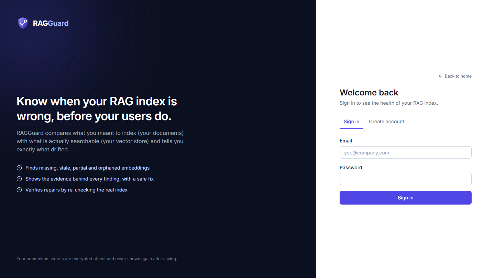
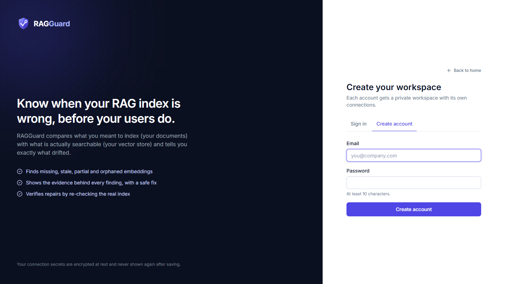
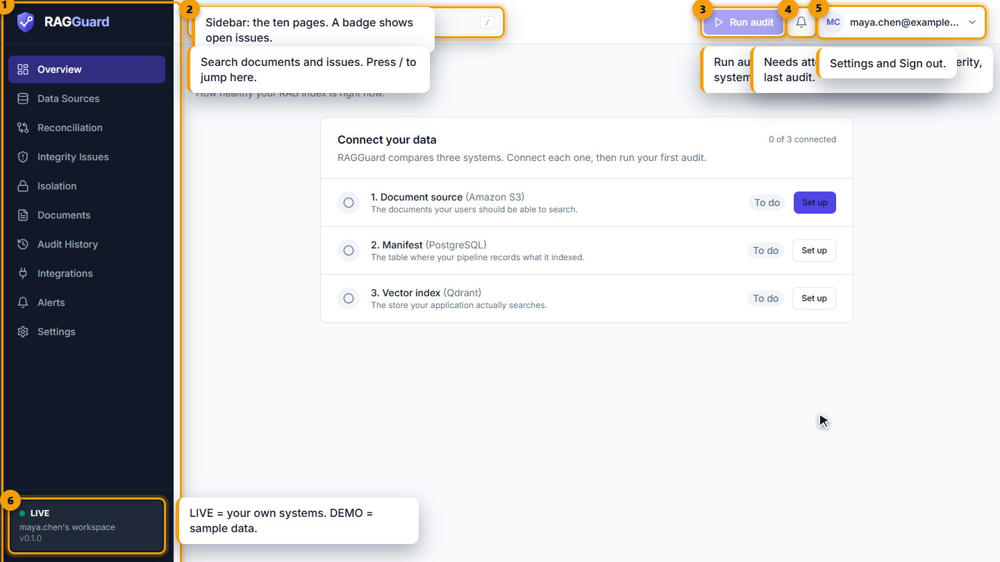
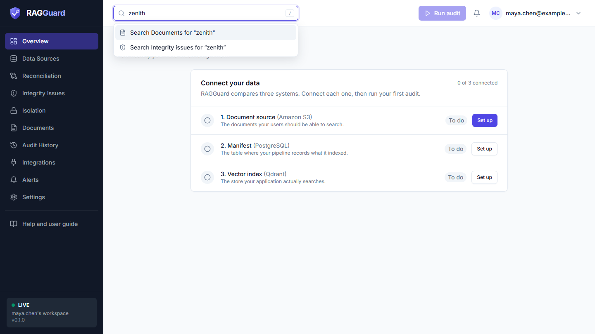
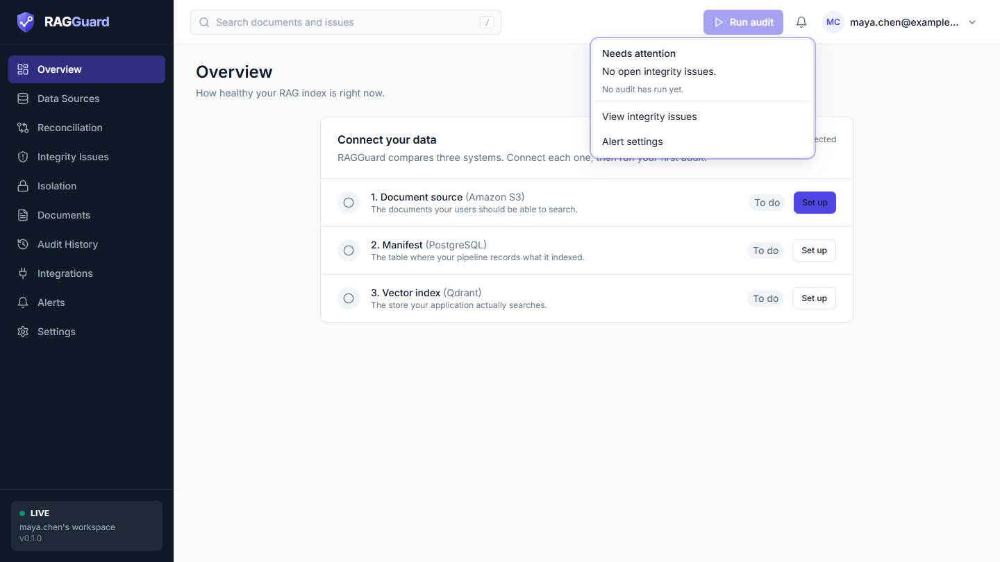
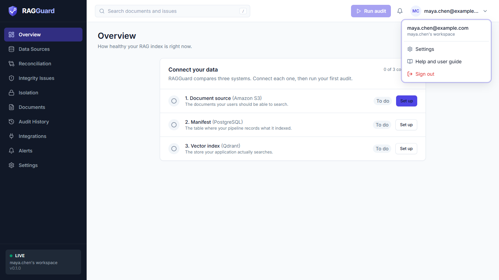
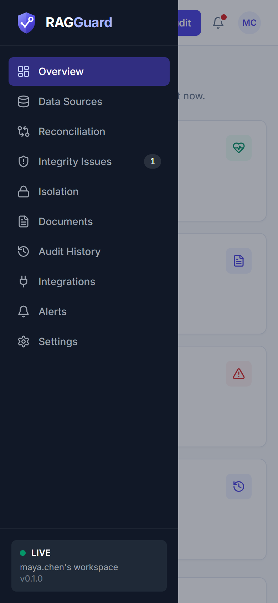

# Sign in and find your way around

This chapter covers everything you meet before and around the pages themselves: the sign-in and Create account screens, the messages they can show, the frame that surrounds every page (the sidebar, the top bar, search, the **Run audit** button, the notifications bell and the account menu), how the interface behaves on a phone, the keyboard shortcuts, and the three states every page can show: loading, empty and error. Read it once and every other chapter will feel familiar.

**On this page**

- [Which screen you see first](#which-screen-you-see-first)
- [Sign-in screens](#sign-in-screens)
  - [Sign in](#sign-in)
  - [Create account](#create-account)
  - [When sign-ups are closed](#when-sign-ups-are-closed)
  - [The panel on the left](#the-panel-on-the-left)
  - [Staying signed in, and signing out](#staying-signed-in-and-signing-out)
  - [This server isn't fully set up yet](#this-server-isnt-fully-set-up-yet)
  - [API key required](#api-key-required)
- [The frame of the app](#the-frame-of-the-app)
  - [The sidebar](#the-sidebar)
  - [The environment card](#the-environment-card)
  - [The top bar](#the-top-bar)
  - [Search](#search)
  - [The Run audit button](#the-run-audit-button)
  - [The notifications bell](#the-notifications-bell)
  - [The account menu](#the-account-menu)
  - [The demo banner](#the-demo-banner)
  - [Notices that pop up](#notices-that-pop-up)
  - [When a background audit finishes](#when-a-background-audit-finishes)
- [Phones and small windows](#phones-and-small-windows)
- [Keyboard and accessibility](#keyboard-and-accessibility)
- [The states every page can show](#the-states-every-page-can-show)
- [Tips and common mistakes](#tips-and-common-mistakes)
- [Related chapters](#related-chapters)

---

## Which screen you see first

What you see when you open RAGGuard depends on the mode of the server (see [Concepts you need](02-concepts.md#server-modes-and-demo-data)).

| Situation | First screen | Section |
|---|---|---|
| Hosted server, not signed in, address `/` | The landing page | [Getting started](01-getting-started.md#the-landing-page) |
| Hosted server, not signed in, address `/login` | The Sign in form | [Sign in](#sign-in) |
| Hosted server, not signed in, address `/signup` | The Create account form (or the Sign in form when sign-ups are closed) | [Create account](#create-account) |
| Hosted server, not signed in, any other address (for example `/issues`) | The Sign in form. After you sign in, you land on the page you asked for. | [Sign in](#sign-in) |
| Hosted server whose operator has not finished the setup | "This server isn't fully set up yet" | [This server isn't fully set up yet](#this-server-isnt-fully-set-up-yet) |
| Single-user server protected by a shared key | "API key required" | [API key required](#api-key-required) |
| Single-user server without a key, or a demo server | The app, on the Overview | [The frame of the app](#the-frame-of-the-app) |
| Hosted server, signed in | The app, on the page you asked for | [The frame of the app](#the-frame-of-the-app) |

If you are already signed in and open `/login` or `/signup`, RAGGuard sends you to the Overview.

---

## Sign-in screens

### Sign in

*The Sign in screen: the left panel on wide screens, and on the right the heading, the two tabs, the two fields and the button.*

The Sign in form has one screen with two modes. On the right of the screen you see, from top to bottom:

| Element | What it is |
|---|---|
| **Back to home** | A link to the landing page, at the top right. |
| Heading **Welcome back** | With the line "Sign in to see the health of your RAG index." |
| Tabs **Sign in** and **Create account** | Switch between the two modes. Shown only when sign-ups are open. |
| **Email** | Your email address. The box is focused when the screen opens. It shows the example `you@company.com` until you type. |
| **Password** | Your password, hidden as you type. Password managers recognise it as a current password. |
| **Sign in** button | Sends your details. It shows a spinner while it works. |

**To sign in:** type your email and password, then press **Enter** or the **Sign in** button.

**What is checked before anything is sent.** Both fields are checked on your computer first. If either is wrong, the message appears in red under that field and nothing is sent.

| Field | Problem | Message |
|---|---|---|
| Email | Empty, or not in the form `name@domain.ext` with no spaces | Enter a valid email address. |
| Password | Empty | Enter your password. |

**What the server can answer.** These appear in a red box above the button:

| Message | Meaning |
|---|---|
| Invalid email or password. | The email or password is wrong. RAGGuard gives the same answer when the email is unknown, so nobody can use the screen to find out which emails have accounts. |
| Too many sign-in attempts. Wait a few minutes and try again. | You are limited to 8 attempts per account and 30 per network in 15 minutes. |

If the network fails you see the browser's own error text instead, for example "Failed to fetch".

### Create account

*The Create account screen: the same layout as Sign in, with the heading "Create your workspace" and a hint under the password.*

Open it from **Create your workspace** or **Get started** on the landing page, from the **Create account** tab, or from the address `/signup`.

| Element | What it is |
|---|---|
| Heading **Create your workspace** | With the line "Each account gets a private workspace with its own connections." |
| **Email** | Your email address. It is lower-cased and trimmed, so `Alice@Example.com` and `alice@example.com` are the same account. |
| **Password** | The hint under the box reads "At least 10 characters." |
| **Create account** button | Creates the account, signs you in and opens the app. |

**To create an account:** type an email and a password, then press **Create account**. You do not need to confirm your email. You are signed in at once and land on the Overview, which asks you to connect your data. Your workspace is named after the first part of your email: for `alice@example.com` it is "alice's workspace".

**Password rules.** The password must:

- be 10 to 128 characters long,
- not be a very common password (for example `password123`),
- contain at least 4 different characters, so `aaaaaaaaaaaa` is refused,
- not contain the part of your email before the `@`, when that part is 4 or more characters.

**Messages.**

| Where | Message | When |
|---|---|---|
| Under **Email** | Enter a valid email address. | The email is empty or not valid. |
| Under **Password** | Enter your password. | The password is empty. |
| Under **Password** | Use at least 10 characters. | The password is shorter than 10 characters. |
| Red box | Password must be at most 128 characters. | The password is longer than 128 characters. |
| Red box | That password is too easy to guess. | A very common password, or fewer than 4 different characters. |
| Red box | Password must not contain your email name. | The password contains the first part of your email. |
| Red box | An account with that email already exists. | The email is taken. Use the **Sign in** tab instead. |
| Red box | Too many sign-ups from your network. Try again later. | More than 5 sign-ups from one network in an hour. |

Switching between the **Sign in** and **Create account** tabs clears error messages but keeps what you typed.

### When sign-ups are closed

The operator of a hosted server can close registration. When they have:

- The Sign in and Create account tabs disappear. Only the Sign in form is shown, and `/signup` shows the same form.
- Under the form you read "New sign-ups are closed on this server."
- The landing page hides **Create your workspace**, **Get started** and **Create account**.
- If someone still sends a registration, the server answers "Registration is closed on this server."

People who already have an account can still sign in.

### The panel on the left

On wide screens (1024 pixels and up) both forms sit beside a dark panel that repeats the product's promise. It says "Know when your RAG index is wrong, before your users do.", explains that RAGGuard compares what you meant to index with what is actually searchable, and lists three things it does: "Finds missing, stale, partial and orphaned embeddings", "Shows the evidence behind every finding, with a safe fix" and "Verifies repairs by re-checking the real index". At the bottom it says "Your connection secrets are encrypted at rest and never shown again after saving." On narrower screens the panel is hidden and the RAGGuard mark appears above the form instead.

### Staying signed in, and signing out

- You stay signed in for as long as you use RAGGuard at least once every 7 days. That is the default, and the operator can change it.
- If your session ends, any action takes you back to the sign-in screen.
- To sign out, open the [account menu](#the-account-menu) and choose **Sign out**. You go back to the landing page.
- Changing your password signs out your other devices ([Settings](14-settings.md)).
- RAGGuard has no email verification and no password reset today, so keep your password safe.

### This server isn't fully set up yet

You may see a screen with a warning icon and the heading **This server isn't fully set up yet**. It says "The operator needs to finish the deployment configuration before accounts can be used." and lists what is missing. For example, the list can say that the secret key used to encrypt connection secrets is not set or is too short, that the database is not reachable, or that the database schema is out of date. This is not something you can fix as a user. Ask the person who runs the server. When they say it is done, press **Check again**.

### API key required

A single-user server can be protected by one shared key. If yours is, you see a screen with a key icon:

| Element | What it is |
|---|---|
| Heading **API key required** | With the line "This server is protected. Enter its API key to continue. It is kept in memory only and is forgotten when you close the tab." |
| **API key** | The key, hidden as you type. |
| **Continue** button | Checks the key. |

If the box is empty you see "Enter the API key." If the server refuses the key you see "That key was not accepted." The key is kept only in the page's memory, never in your browser's storage, so it is also forgotten when you reload the page. If a later request is refused, you are asked for the key again.

---

## The frame of the app

Once you are in, every page sits inside the same frame: a dark sidebar on the left, a top bar, and the page itself.

*The frame of the app. Marker 1 is the sidebar, 2 the search box, 3 the Run audit button, 4 the notifications bell, 5 the account menu and 6 the environment card at the bottom of the sidebar.*

| Marker | Part | Section |
|---|---|---|
| 1 | Sidebar | [The sidebar](#the-sidebar) |
| 2 | Search box | [Search](#search) |
| 3 | Run audit button | [The Run audit button](#the-run-audit-button) |
| 4 | Notifications bell | [The notifications bell](#the-notifications-bell) |
| 5 | Account menu | [The account menu](#the-account-menu) |
| 6 | Environment card (shows LIVE) | [The environment card](#the-environment-card) |

### The sidebar

The sidebar holds the RAGGuard mark at the top, ten menu items, and the environment card at the bottom. The current page is highlighted. On screens narrower than 1024 pixels the sidebar is hidden and opens as a drawer (see [Phones and small windows](#phones-and-small-windows)).

| Menu item | Page title | Address | What the page is for | Chapter |
|---|---|---|---|---|
| **Overview** | Overview | `/` | "How healthy your RAG index is right now." | [Overview](05-overview.md) |
| **Data Sources** | Data sources | `/data-sources` | "The three systems RAGGuard compares." Connect and test S3, PostgreSQL and Qdrant. | [Connect your data sources](04-data-sources.md) |
| **Reconciliation** | Reconciliation | `/reconciliation` | "Compare your source documents, your manifest and your vector index." Run audits. | [Reconciliation](06-reconciliation.md) |
| **Integrity Issues** | Integrity issues | `/issues` | "Everything that makes your index disagree with your source." Issues, repair plans and impact analysis. | [Integrity issues](07-integrity-issues.md), [Repair plans](08-repair-plans.md), [Impact analysis](09-impact-analysis.md) |
| **Isolation** | Isolation | `/isolation` | "Tenant isolation means one customer's content never shows up for another customer. This page shows whether your index keeps tenants apart." Whether any customer's documents are indexed under another customer, with a practice drill and an evidence report. | [Isolation](20-isolation.md) |
| **Documents** | Documents | `/documents` | "Every document RAGGuard has compared, and what state its index is in." | [Documents](10-documents.md) |
| **Audit History** | Audit history | `/audit-history` | "Every audit that has run, and everything that changed in your index because of them." | [Audit history](11-audit-history.md) |
| **Integrations** | Integrations | `/integrations` | "Connect RAGGuard to the rest of your stack." The repair webhook and API keys. | [Integrations](12-integrations.md) |
| **Alerts** | Alerts | `/alerts` | "Get told when an audit finds something new." | [Alerts](13-alerts.md) |
| **Settings** | Settings | `/settings` | "Your workspace, the pipeline you expect, and your account." | [Settings](14-settings.md) |

The menu uses capitals in two words (for example **Data Sources**) where the page title does not (for example "Data sources"). They are the same page.

**The open-issues badge.** Next to **Integrity Issues** a small round badge shows how many issues are open right now, for example `14`. It disappears when there are none, and it is not shown until the workspace is connected and the count has loaded. Screen readers hear "14 open issues".

**Page addresses and shared views.** The address bar always describes what you are looking at. Filters, tabs, search text and the open issue, document or audit are kept in the address, so you can bookmark a view, send the link to a colleague, or refresh the page without losing your place. Examples: `/issues?severity=critical`, `/documents?status=broken` and `/audit-history/<run id>`. Opening an issue changes the address to `/issues/<issue id>`.

### The environment card

At the bottom of the sidebar a small card tells you what you are looking at.

| Line | Shows |
|---|---|
| Coloured dot and a label | **LIVE** with a green dot on a hosted or live server, **DEMO** with an amber dot on a demo server. |
| Second line | Your workspace name on a hosted server, for example "alice's workspace". On a single-user server it reads "Synthetic demo data" (demo) or "Single-user server". |
| Third line | The version of RAGGuard: the letter `v` followed by the version number. If it is not known, a dash. |

**LIVE** means the data comes from systems you connected. **DEMO** means it is invented. The hosted service always shows **LIVE**.

### The top bar

The top bar runs across the top of every page. From left to right: a menu button (only on narrow screens), the search box, and on the right the **Run audit** button, the notifications bell and the account menu.

### Search

*The search box after typing a word: one dropdown line for each place you can search.*

The search box is in the top bar and says "Search documents and issues" (just "Search" on small screens). It does not show results itself. It sends you to the page where you want to look, with your word already typed into that page's search.

**To search:**

1. Click the box, or press `/` anywhere on the page.
2. Type a word, for example part of a document name.
3. A dropdown opens with two choices:
   - Search **Documents** for “your word”
   - Search **Integrity issues** for “your word”
4. Choose one by clicking it, or press the arrow keys and **Enter**. **Enter** on its own picks the first choice, **Documents**.

You land on the **Documents** or **Integrity Issues** page with the search box on that page already filled in. The top search box empties itself.

**What each search matches.**

| Choice | Matches (case does not matter, any part of the text counts) |
|---|---|
| **Documents** | The document id, for example `leave-policy`. |
| **Integrity issues** | The issue title or the document id. The page's **Status** filter starts on **Open**, so resolved and ignored issues are not included unless you change it. |

**Keyboard use.**

| Key | What it does |
|---|---|
| `/` | Moves your cursor into the search box, unless you are already typing in a field. |
| Down arrow, Up arrow | Move the highlighted choice. They wrap round at the ends. |
| Enter | Opens the highlighted choice. Does nothing when the box is empty. |
| Escape | Closes the dropdown and leaves the box. |

Clicking anywhere else also closes the dropdown. A small `/` hint is drawn inside the box on screens 640 pixels wide or more.

### The Run audit button

The indigo **Run audit** button in the top bar starts an audit of **everything**: every tenant and every document (a full audit; see [Concepts you need](02-concepts.md#audit)). The same button logic is used by every **Run audit** button in the interface (on the Overview, on Reconciliation and in a document's panel), so they all behave the same way. To audit only one tenant or only some documents, use the **Scoped audit** button on [Reconciliation](06-reconciliation.md).

**What the button looks like.**

| State | What you see | Why |
|---|---|---|
| Ready | A play icon and **Run audit** (**Audit** on screens narrower than 640 pixels) | You can start an audit. |
| Disabled | The same button, greyed. Hover over it or tab to it and the tooltip says "Connect your data sources first". | A hosted workspace has not saved all three systems yet. |
| Running | A spinner and **Audit running** (**Running** on small screens). Not clickable. | An audit is in progress, started by you, a colleague, a script or a schedule. |

On a single-user server the button is never disabled because the connections come from the server.

**What happens when you press it.**

1. A notice appears at the bottom right: "Running audit…" with "Comparing source, manifest and index".
2. RAGGuard starts the audit. The notice is then replaced by one of the notices below.
3. Every page that shows audit results refreshes when the audit ends.

Only one audit can run at a time in a workspace. If another one is running, the button shows **Audit running** and you cannot start a second.

There are two ways a server can run an audit, and you may notice the difference:

- **In the background** (most servers). The server answers straight away and you see "Audit started". The button keeps showing **Audit running**, the Overview and Reconciliation pages update on their own every few seconds, and when it ends you get the notice described in [When a background audit finishes](#when-a-background-audit-finishes).
- **Inside the request** (serverless hosting, which includes the hosted service). The "Running audit…" notice stays until the audit is done, which can take up to the server's time budget (270 seconds by default), and then it becomes "Audit complete". You should leave the page open until then.

**The notices you can get from the button.**

| Notice | Second line | When |
|---|---|---|
| Running audit… | Comparing source, manifest and index | Straight after you press the button. |
| Audit started | It continues in the background; this page updates as it finishes. | The server runs audits in the background. |
| Audit complete | Usually none. When the server returns totals the line says "No integrity issues found." or "N integrity issue(s) found." | The audit had already finished when the server answered. |
| Audit failed | Open Audit History for the reason. | The audit ran and ended in failure. |
| Couldn't start the audit | The server's reason, for example "An audit is already running." | The server refused or could not finish. Other examples: "Finish setup first: connect S3 source documents ... in Settings." (the three connections are not all saved; in the interface they are on **Data Sources**) and the time-budget message "The audit ran out of time while reading ...". |

[Audit history](11-audit-history.md) records every audit, including failed ones, with the reason. [Troubleshooting](18-troubleshooting.md) explains the common messages.

### The notifications bell

*The bell menu: how many issues are open, how many of each severity, and when the last audit ran.*

The bell shows what needs attention right now. A **red dot** sits on the bell when at least one open issue is Critical or High. Screen readers hear "Notifications, N critical or high issues". Click the bell to open the menu.

| Line | What it says |
|---|---|
| **Needs attention** | The menu heading. |
| "No open integrity issues." | There are no open issues. |
| "N open issue(s)" | The number of open issues, in bold. |
| Severity badges | One badge for each severity that has issues, in this order and shown only when the count is above zero: "N critical" (red), "N high" (amber), "N medium" (blue), "N low" (grey). |
| "Last audit 5 min ago (completed)" | When the most recent audit of any kind finished (or started, if it has not finished), and its status: completed, failed or running. |
| "No audit has run yet." | There are no audits. |
| "Connect your data sources to see alerts." | Shown instead of all the lines above when the numbers are not available: the workspace is not connected yet, or the numbers are still loading or could not be loaded. |
| **View integrity issues** | Opens the **Integrity Issues** page. |
| **Alert settings** | Opens the **Alerts** page. |

The numbers come from the same data as the Overview, so they refresh at the same moments. The bell is not a live feed.

### The account menu

*The account menu: who you are, your workspace, Settings, Help and user guide, and Sign out.*

At the far right of the top bar is your avatar: a round badge with your initials (for `alice@example.com`, `AL`; for `kishore.k@example.com`, `KK`), followed on wider screens (768 pixels and up) by your email and a small arrow. On a single-user server there is no email, so the badge reads `RG` and the name reads "Operator".

| Menu line | What it does |
|---|---|
| Your email, and below it your workspace name | Information only. On a single-user server it reads "Operator" and "Demo workspace" or "Single-user server". |
| **Settings** | Opens the **Settings** page. |
| **Help and user guide** | Opens the Help pages inside the product, address `/help`: the video walkthrough and every chapter of this guide. See [The video walkthrough](19-video-walkthrough.md#where-the-video-is). |
| **Sign out** (in red) | Ends your session and returns you to the landing page. Only shown on a hosted server. If signing out fails you see the notice "Couldn't sign out" with the reason. |

### The demo banner

On a demo server, an amber box at the top of every page says: "Demo data. This server is running a synthetic knowledge base so you can explore the product. Nothing here comes from your own systems." It is shown only on demo servers, never on a hosted or live server.

### Notices that pop up

Short notices (often called toasts) appear at the bottom right of the window. Each has a close button. Green ones report success, red ones report a problem, and a spinner one means work is in progress. You will see them after **Run audit**, after copying a value ("Copied to clipboard"), after ignoring or reopening an issue and after creating a repair plan. They disappear by themselves, and they are also announced to screen readers.

### When a background audit finishes

If an audit is running in the background, RAGGuard watches for its end. Whatever page you are on, when the audit finishes you get a notice and the page's numbers refresh:

| Notice | Second line | Meaning |
|---|---|---|
| Audit finished | "N open issue(s)." | The audit completed. The number is the open issues across the workspace now. |
| Audit failed | The error recorded for the run, or "See Audit History for details." | The audit failed. Open [Audit history](11-audit-history.md) for the reason. |

This works only while RAGGuard is open in your browser and has seen the audit running. If you close the tab during an audit, the notice does not appear, but the results are still saved.

---

## Phones and small windows

*The app on a 390-pixel-wide phone, with the navigation drawer open.*

The interface adapts to the window width.

| Window width | What changes |
|---|---|
| Under 1024 pixels | The sidebar is hidden. A menu button (three lines, labelled "Open navigation") appears at the left of the top bar. Pressing it slides the navigation in from the left as a drawer, with the same ten items and the environment card. The drawer is at most 85% of the screen wide. It closes when you choose a page, press **Escape**, or tap the dark area outside it. |
| Under 768 pixels | In the account menu only your initials show: the email and arrow are hidden. |
| Under 640 pixels | The search box says "Search" and the `/` hint is hidden. The button reads **Audit** or **Running**. |
| Any narrow window | Cards stack in one column. Tables scroll sideways inside their card instead of stretching the page. The side panels for issues and documents fill the screen. |

Every action available on a wide screen is available on a phone.

---

## Keyboard and accessibility

RAGGuard is built to be used with a keyboard and a screen reader.

| What | How it works |
|---|---|
| **Skip link** | Press `Tab` once when a page loads. A **Skip to content** link appears at the top left. Press **Enter** to jump over the sidebar and top bar to the page. |
| **Focus** | The element you are on always has a visible outline. `Tab` moves forward and `Shift` + `Tab` moves back. |
| **Search** | Press `/` to focus it. See [Search](#search). |
| **Menus** (bell and account) | Open with **Enter** or **Space**. Move with the arrow keys, choose with **Enter**, close with **Escape**. |
| **Tabs** (for example **Audit runs** and **Activity log**) | Move between tabs with the left and right arrow keys. |
| **Dialogs and side panels** | The issue, document and plan panels, confirmation dialogs and forms trap the keyboard focus while open. **Escape** closes them, and the focus returns to where you were. The page behind is hidden from screen readers while a dialog is open. The only dialog **Escape** cannot close is the one that shows a new API key once: you must press **I've copied it**. |
| **Table rows** | Rows that open something can be reached with `Tab`. Press **Enter** or **Space** to open them. |
| **Sortable columns** | Column headings that sort are buttons. A screen reader announces the sort direction. |
| **Tooltips on disabled buttons** | The disabled **Run audit** button is wrapped so you can reach it with `Tab` and hear the reason. |
| **Charts** | Every chart has a hidden table with the same numbers for screen readers. |
| **Colour** | Colour is never the only signal: every badge also says its meaning in words. |
| **Notices** | Success and error notices are announced. Page banners are announced politely, and urgent ones immediately. |
| **Reduced motion** | The moving progress bar stops moving if your system asks for reduced motion. |

---

## The states every page can show

Every page that loads data handles the same three situations in the same way: loading, empty and error. Learning them once saves time everywhere.

### Loading

While data is on its way, the page shows grey, softly pulsing blocks in the shape of the final content: a row of cards, a table with empty rows, a chart area. Nothing jumps when the real data arrives. Screen readers hear that the page is loading. If you see a loading state for a long time, check your connection.

### Empty

When there is nothing to show, the page says so and, where it can, tells you what to do next. An empty state has a round icon, a title, a sentence of explanation and often a button. Empty does not mean broken. Typical examples:

| Page | Title | What to do |
|---|---|---|
| Overview | No audit has run yet | Press **Run first audit**. |
| Documents | No audit has run yet | Press **Run audit**. |
| Audit history | No audits yet | Press **Go to Reconciliation** and run one. |
| Integrity issues | No open issues | Nothing to fix: "Your index matches your source." |
| Isolation | No isolation result yet | Press **Run full audit**. |
| Integrity issues with a filter or search | No issues match these filters | Press **Clear filters**. |
| Documents with a filter or search | No documents match these filters | Press **Clear filters**. |

Wording differs by page, and the chapter for each page lists its own empty states.

### Error

When a request fails, the page shows a red warning icon, the heading **We couldn't load this**, the reason in plain words, and a **Try again** button that repeats the request. Where it can, RAGGuard shows the error only in the card or list that failed, so one broken card does not blank the whole page. Typical reasons are a lost connection, a server problem, or one of your own systems being unreachable. Connection passwords are removed from any message before it is shown.

### Connect your data sources first

One error is special. When a page needs your three systems and they are not all connected, you see a blue sparkle icon and the heading **Connect your data sources first**, with the text "RAGGuard needs your S3 source, manifest database and Qdrant index before it can compare them." and a **Go to Data Sources** button. Several pages show their own version of the same prompt, for example Documents and Integrity Issues: "RAGGuard needs your S3 source, manifest database and Qdrant index before it can find integrity issues." The Overview shows the **Connect your data** card instead, with three steps (see [Overview](05-overview.md#the-connect-your-data-card)). Reconciliation says "Connect your data first". Isolation also says "Connect your data first", with the text "Isolation is checked from a full audit of your S3 documents, your PostgreSQL manifest and your Qdrant index. Connect all three, then run your first audit." Audit history says "No audits yet" and offers the same button. All of them lead to [Connect your data sources](04-data-sources.md).

### Page not found

If you open an address that does not exist, you see a compass icon and **Page not found**, with the line "That address doesn't match anything in RAGGuard." and a **Back to Overview** button. Other people's links to a missing issue, document or audit show a similar message inside the page: **Issue not found**, **Document not found** or **Audit not found**.

### While the app itself loads

When you first open RAGGuard, before it knows who you are, you see only a small grey placeholder in the middle of the window. If that very first request fails, the error state appears on its own with **Try again**.

---

## Tips and common mistakes

- **The Run audit button is greyed out.** All three connections must be saved first (hosted mode). Hover over the button to read the reason, then open **Data Sources**.
- **I pressed Run audit and nothing seems to happen.** On serverless hosting the audit runs inside your request and can take minutes. Leave the page open. On other servers wait for the "Audit finished" notice.
- **My search found nothing.** The top bar searches **Open** issues only, and searches document ids on the **Documents** page, not tenants or file contents. Use the **Status** filter on the Issues page to include resolved or ignored issues.
- **The page keeps its filters when I come back.** That is deliberate: filters live in the address. Press **Clear filters** to start again.
- **The numbers look out of date.** The Overview, the bell and the sidebar badge are not live. They refresh when you open a page, after you act, and every few seconds while an audit runs. Reload the page to be sure.
- **I forgot my password.** RAGGuard has no password reset today. Ask the operator of the server what they can do.

---

## Related chapters

- [Getting started](01-getting-started.md): the landing page and the quick start
- [Concepts you need](02-concepts.md): audits, issues, severity and the other words used here
- [Connect your data sources](04-data-sources.md): what the **Go to Data Sources** buttons lead to
- [Overview](05-overview.md): the first page you see after signing in
- [Isolation](20-isolation.md): the page right after **Integrity Issues** in the sidebar
- [Audit history](11-audit-history.md): every audit that **Run audit** starts
- [Troubleshooting](18-troubleshooting.md): messages and what to do about them
