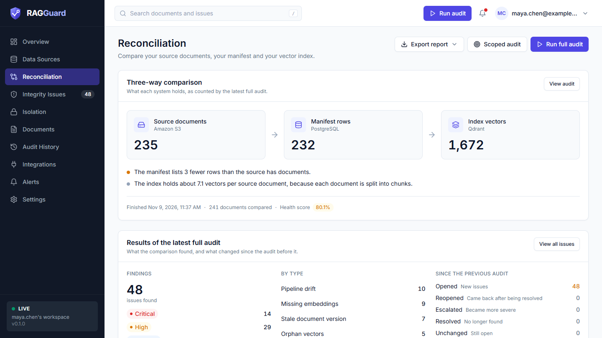
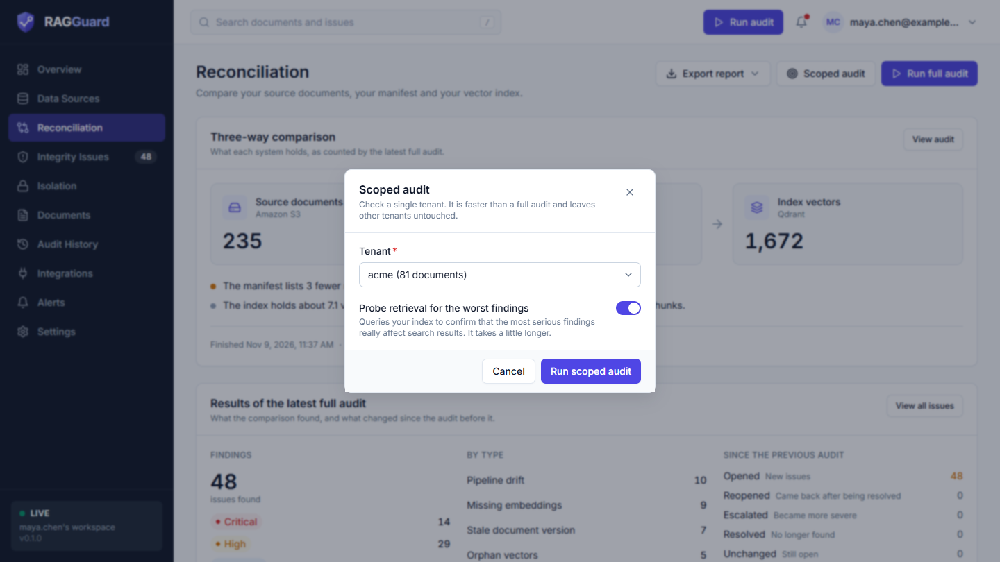
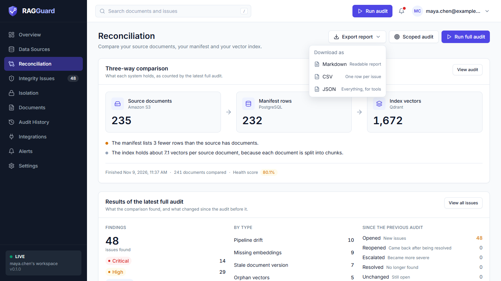
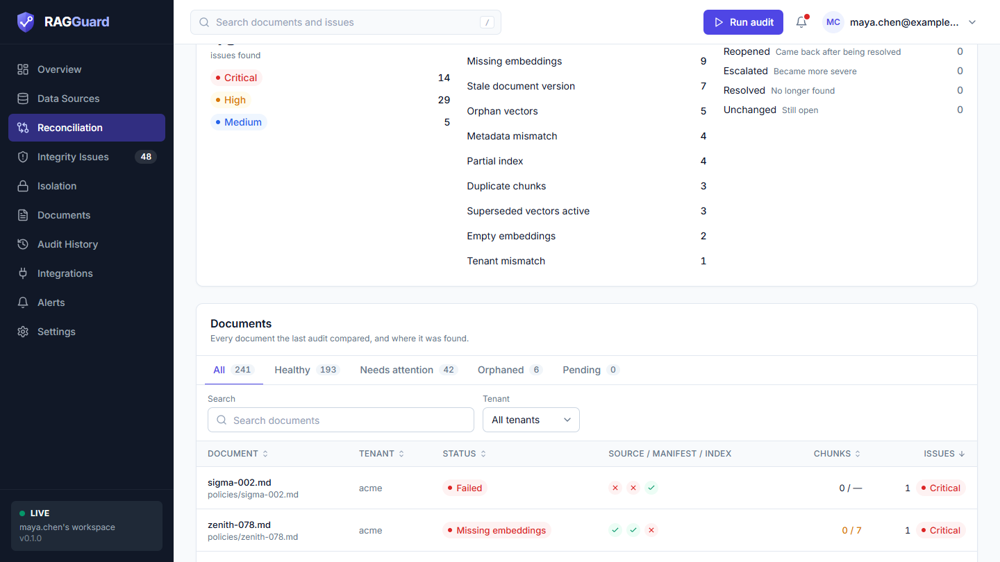

# Reconciliation

Reconciliation is the page where you run audits and see the result of the comparison in one place. An audit reads your source documents (Amazon S3), your manifest (a PostgreSQL table where your ingestion pipeline recorded what it processed) and your vector index (Qdrant), always read-only, and checks that the three agree. This page shows how many items each system holds, how many problems the audit found, what changed since the audit before it, and every document with the place it was found. It also lets you export a report. If you are new to these words, read [Concepts you need](02-concepts.md) first.

## On this page

- [Purpose and who needs it](#purpose-and-who-needs-it)
- [How to open it](#how-to-open-it)
- [The page at a glance](#the-page-at-a-glance)
- [Step-by-step tasks](#step-by-step-tasks)
- [The three buttons in the header](#the-three-buttons-in-the-header)
- [While an audit is running](#while-an-audit-is-running)
- [Three-way comparison](#three-way-comparison)
- [Results of the latest full audit](#results-of-the-latest-full-audit)
- [The Documents table](#the-documents-table)
- [States you may see](#states-you-may-see)
- [Tips and common mistakes](#tips-and-common-mistakes)
- [Related chapters](#related-chapters)

## Purpose and who needs it

Use Reconciliation when you want to answer one question: "Do my source, my manifest and my index agree right now?" It is the main working page for anyone who owns the RAG pipeline: a data engineer who wants to check a fresh ingestion run, an AI engineer who suspects the assistant is giving out-of-date answers, or a team lead who needs a report.

Three words you will see all the time:

- **Audit**: one run of the comparison. It reads the three systems and writes down what it found. Nothing in your systems is changed.
- **Full audit**: compares everything, for every tenant. A tenant is one customer, team or business unit whose documents are kept apart.
- **Scoped audit**: compares only part of your data. On this page the part is one tenant. (The Documents page can also re-audit a single document, see [Documents](10-documents.md).)

## How to open it

- Click **Reconciliation** in the left menu.
- The address is `/reconciliation`. The Documents table keeps its tab, search and tenant choice in the address (`view`, `q` and `tenant`), so you can bookmark or share a filtered view.

## The page at a glance

*The top of the Reconciliation page: the three header buttons, the Three-way comparison and the Results of the latest full audit.*

From top to bottom:

1. **Header**: the title "Reconciliation", the sentence "Compare your source documents, your manifest and your vector index." and three buttons: **Export report**, **Scoped audit** and **Run full audit**.
2. **Audit in progress** card (only while an audit is running).
3. **Three-way comparison**: three tiles with the counts of the latest full audit, one-line differences, and a footer line.
4. **Results of the latest full audit**: findings, by severity, by type and since the previous audit.
5. **Documents**: a table of every document the last audit compared.

Everything on this page except the Documents table describes the latest **full** audit. A scoped audit updates the documents and issues it covers, but it does not replace the comparison and results cards (see [Scoped audit](#scoped-audit)).

## Step-by-step tasks

### Run your first full audit

1. Make sure all three systems are connected. If they are not, the page shows "Connect your data first" and the buttons are disabled. See [Connect your data sources](04-data-sources.md).
2. Click **Run full audit**. The button changes to **Audit running** with a spinner and a notice appears in the corner.
3. Wait. The page checks for progress every 3 seconds and updates itself when the audit ends. The audit runs on the server, not in your browser, and a notice tells you when it finishes, whichever page you are on.
4. When it finishes, read the Three-way comparison, then the Results card. If the Findings number is above zero, click **View all issues** and continue in [Integrity issues](07-integrity-issues.md).

### Check one tenant

1. Click **Scoped audit**.
2. Choose the tenant. Leave **Probe retrieval for the worst findings** on unless you want the fastest possible run.
3. Click **Run scoped audit**.
4. When it ends, open the Documents table below and filter by that tenant to see the new state of its documents.

### Export a report

1. Click **Export report**.
2. Choose **Markdown**, **CSV** or **JSON**.
3. Your browser saves a file named `rag-integrity-report.md`, `rag-integrity-report.csv` or `rag-integrity-report.json`. A notice "Report downloaded" confirms it.

### Find out why two counts differ

1. Read the one-line differences under the three tiles.
2. In the Documents table, click the **Needs attention** tab and sort by **Issues** (the default).
3. Look at the three round icons in each row. A red cross shows where a document is missing. The table in [Reading the three presence icons](#reading-the-three-presence-icons) tells you what each pattern means.
4. Click a row to open the document and see the exact reason.

## The three buttons in the header

### Run full audit

Starts a full audit: every tenant, every document, plus checks that apply to a whole collection (vectors that carry no document id, and an embedding size that does not match your target pipeline).

| What you see | What it means |
|---|---|
| **Run full audit** with a play icon | Ready to start. |
| **Audit running** with a spinner, button disabled | An audit is running, started by you, a colleague, the top bar button, an API call or a schedule. Only one audit can run at a time in a workspace. |
| Button disabled, tooltip "Connect your data sources first" | At least one of your three systems is not set up. |

A full audit uses the server's default for retrieval probes, which is normally on (up to 25 probes per audit). There is no probe switch on this button; use **Scoped audit** if you want to choose. The **Run audit** button in the top bar starts exactly the same full audit.

The notices you may see:

| Notice | Meaning |
|---|---|
| "Running audit…" with "Comparing source, manifest and index" | The request was sent. |
| "Audit complete" with "No integrity issues found." or "N integrity issues found." | The audit finished while you waited. (On some hosting setups the audit runs inside the request.) |
| "Audit started" with "It continues in the background; this page updates as it finishes." | The audit runs on the server. |
| "Audit finished" with "N open issues." | A background audit finished while you were on any page. |
| "Audit failed" with "Open Audit History for the reason." (or the reason itself) | The audit stopped with an error. See [Audit history](11-audit-history.md). |
| "Couldn't start the audit" with a message | The request was refused, for example because another audit is running or a connection is broken. |

If an audit runs out of time you get a message that starts "The audit ran out of time while reading ..." and names the step. On hosting with a request time limit the budget is 270 seconds. The advice in that message is to audit one tenant at a time (use **Scoped audit**), to narrow the source, for example with the S3 key prefix in [Settings](14-settings.md), or to run the command line tool `ragi audit` on a machine without a time limit.

If the server process running an audit stops, the audit is marked failed ("abandoned: the process running it stopped", with the last step it reached) the next time the app checks, so the button never stays disabled forever. The app treats a run as abandoned once it has been "running" for the time budget plus 90 seconds, or for 15 minutes when there is no time budget.

### Scoped audit

Opens the **Scoped audit** dialog.

*The Scoped audit dialog.*

| Control | What it does |
|---|---|
| Heading and text | "Scoped audit": "Check a single tenant. It is faster than a full audit and leaves other tenants untouched." |
| **Tenant** (required) | A drop-down with the tenants from the last audit, each shown as the tenant name and its document count, for example "acme (120 documents)". The first tenant is preselected; if you chose another one earlier in the same visit, that choice is kept. A tenant that no audit has seen yet is not in the list; run a full audit first. |
| **Probe retrieval for the worst findings** (switch, on by default) | When on, RAGGuard also queries your index to confirm that the most serious findings really affect search results. It takes a little longer. See below. |
| **Cancel** | Closes the dialog. |
| **Run scoped audit** | Starts the audit and closes the dialog. Disabled until a tenant is chosen. Pressing Enter in the dialog does the same. |

If there are no tenants yet, the dialog says "There are no tenants to choose from yet. Run a full audit first, then come back to audit a single tenant."

**What a scoped audit changes.** It reads only that tenant, so it is faster. Only issues inside that tenant can be opened, updated or resolved; other tenants are untouched. It does not run the whole-collection checks. The Three-way comparison and the Results card keep showing the latest full audit. The Documents table and the Integrity Issues page do show the new state of that tenant. The run appears in Audit History as a "scoped" audit.

**What probing does.** Some findings are about content that should not be searchable any more: vectors of a deleted document (Orphan vectors), vectors with the wrong tenant (Tenant mismatch), vectors from an old version (Stale document version) and old vectors next to new ones (Superseded vectors active). A probe takes the stored vector of one affected chunk, asks your index "what is closest to this?", filtered to the owning tenant exactly as a real query would be, and records whether the bad vector comes back and at what rank. That turns "this old content exists" into "this old content is returned to users". When a probe confirms it, an Orphan vectors finding is raised to Critical and a Superseded vectors active finding is raised to High. A Tenant mismatch finding is already Critical, and a Stale document version finding keeps its severity but gets the probe result as extra evidence. The probe is not a replay of real traffic; it stands in for "a user asks something that matches this chunk". By default at most 25 probes are made per audit, each asking for the top 10 results. The result is shown in the issue panel under Evidence, see [Integrity issues](07-integrity-issues.md#evidence). Turning the switch off skips all of this and makes the audit a little faster.

### Export report

Opens a menu titled "Download as" with three choices. Each downloads a file named `rag-integrity-report` with the matching extension.

*The Export report menu.*

| Choice | Hint in the menu | What the file contains |
|---|---|---|
| **Markdown** | Readable report | A document you can paste into a ticket or a wiki. It has a title "RAG integrity report", the time it was generated (UTC), "Documents checked", "Health score" and "Open issues" with a count per severity. Then a "Collection-level issues" section if there are any, and an "Inconsistent documents" section. Each document is a heading with its tenant, document id and status, a line such as "Chunks: 8 indexed / 12 expected. Source: s3://..." (with "?" when the expected count is unknown and "gone" when the source is missing), and one bullet per issue with its severity, type, detail and recommended fix. If nothing is wrong it says "None. The index agrees with the source." |
| **CSV** | One row per issue | A spreadsheet-friendly table with the columns `tenant_id`, `document_id`, `status`, `severity`, `issue_type`, `recommended_action`, `detail`, `indexed_chunks`, `expected_chunks` and `source_uri`. Whole-collection issues are not in the CSV because they do not belong to a document. |
| **JSON** | Everything, for tools | The full report for programs: `generated_at`, a `summary` (documents, counts by status, health score, open issues by severity, by type, resolved and ignored), `collection_issues`, and `documents`, each with its status, worst severity, source URI, last verified time, chunk counts and an `issues` list (id, type, severity, title, detail and recommended action). |

Good to know about every format:

- The report reflects the **current** state of your workspace, not one particular audit. It lists documents that have at least one **open** issue. Healthy documents and ignored or resolved issues are left out.
- It covers all tenants. (The endpoint behind the button is `GET /api/report`. It also accepts `tenant` and `include_healthy=true`; see [Integrations](12-integrations.md) for how to call the API with a key.)
- The button shows a spinner while it prepares the file. A failure shows "Couldn't export the report" with the reason.
- The button is disabled, with a tooltip, when it cannot work: "Run an audit first to create a report" or "Loading the latest audit". In a hosted workspace that has not connected its three systems yet, the button is not shown at all.

## While an audit is running

A card with the heading **Audit in progress** appears at the top of the page. It says "Comparing your source, manifest and index" (adding "for tenant NAME" for a scoped audit), "Started 2 min ago." and "This page updates when it finishes." Under the text is a sliding bar. The bar has no percentage because the audit cannot know in advance how much it will find; the bar only tells you that it is working.

The rest of the page keeps showing the last finished audit, so you can keep reading while you wait. The header buttons are locked: **Run full audit** shows **Audit running** with a spinner and **Scoped audit** is disabled with the tooltip "An audit is already running". While it runs the page asks for fresh data every 3 seconds, and when the audit ends all the numbers refresh.

## Three-way comparison

The card is titled **Three-way comparison**, with the line "What each system holds, as counted by the latest full audit." Its button **View audit** opens the full record of that audit in Audit History ([Audit history](11-audit-history.md)).

### The three tiles

Each tile shows a name, the system it comes from and a big number. Small arrows between them only show the direction in which data flows: documents are written into the manifest, then into the index.

| Tile | System | What the number is | What good looks like |
|---|---|---|---|
| **Source documents** | Amazon S3 | The number of documents the audit found in your bucket, after your key prefix and key pattern are applied. This is what *should* be searchable. | It matches what you believe you have. |
| **Manifest rows** | PostgreSQL | The number of rows in your manifest table: what the pipeline *says* it processed. | About the same as the source. |
| **Index vectors** | Qdrant | The number of vectors (also called points) read from your index. Every vector counts, including old-version, duplicate and orphan vectors. | Several vectors per document, because each document is cut into chunks, one vector per chunk. |

If you turned on **Only audit documents found in the source (S3)** in [Settings](14-settings.md), the manifest and index tiles count only the documents that were found in S3; leftovers for deleted files are ignored by design.

A dash instead of a number means the audit did not record that count.

### The one-line differences

Below the tiles, up to two sentences describe differences. They are computed only from the three numbers, so they are hints, not proof. Each has a coloured dot.

| Sentence | Dot | Meaning and next step |
|---|---|---|
| "The manifest lists as many rows as the source has documents." | green | The counts match. This does not prove that each row belongs to a document, but it is the normal case. |
| "The manifest lists N fewer rows than the source has documents." | amber | Some source documents have no manifest row. They were probably never picked up by the pipeline. Look in the Documents table for rows with a red cross under Manifest. |
| "The manifest lists N more rows than the source has documents." | amber | The manifest holds rows for documents that no longer exist in S3, or the same document more than once. Look for rows with a red cross under Source. |
| "The index is empty while the source has N documents." | red | Nothing is searchable. Check that the index connection points at the right collections, then run the ingestion pipeline. |
| "The index holds about X.X vectors per source document, because each document is cut into chunks." | grey | Information only. It is the number of vectors divided by the number of documents. Compare it with what you expect from your chunk size. A sudden drop or jump between audits is worth a look. |

Counts can hide problems: a missing document and an extra row cancel each other out. The Results card and the Documents table are the real answer.

### The footer line

| Part | Meaning |
|---|---|
| **Finished** with a date and time | When the audit ended, in your browser's time. |
| **N documents compared** | The number of different documents found in any of the three systems (counted once, even if present in all three). |
| **Health score** with a coloured badge | The share of documents that are healthy or still pending, as a percentage with one decimal. Healthy and pending documents count as good. Green at 90% and above, amber from 70% up to 90%, red below 70%. |

## Results of the latest full audit

The card is titled **Results of the latest full audit**, with the line "What the comparison found, and what changed since the audit before it." The button **View all issues** opens [Integrity issues](07-integrity-issues.md). The card has up to three columns. If the audit recorded no results at all, the card is hidden.

### Findings

A big number with the words "issue found" or "issues found": the number of problems this audit found. A finding is one problem of one type on one document (or one whole collection).

- If it is zero, the card shows a green line: "Source, manifest and index agree." That is the goal.
- Otherwise a list shows one badge per severity that has findings, with the count on the right: **Critical**, **High**, **Medium**, **Low** (and **Info** if there are any). Click a badge to open the issue list filtered to that severity.

| Severity | Colour | Meaning in short |
|---|---|---|
| Critical | red | Users can be served wrong, deleted or another customer's content, or the pipeline reported success but wrote nothing. Act first. |
| High | amber | Content is missing, out of date or unusable. |
| Medium | blue | The index is correct but untidy or only suspected to be incomplete. |
| Low | grey | Records are out of step, with little effect on users. |

The exact rules for each issue type are in [Integrity issues](07-integrity-issues.md#the-11-issue-types).

The Findings number counts what this one audit found. The Integrity Issues page lists issues across all audits with their status, so the numbers can differ: for example an issue you ignored is still found by every audit.

### By type

One row per issue type that has findings, with its name and count, sorted from the most to the fewest. Click a row to open the issue list filtered to that type. The 11 names are Missing embeddings, Partial index, Stale document version, Superseded vectors active, Orphan vectors, Duplicate chunks, Metadata mismatch, Pipeline drift, Empty embeddings, Tenant mismatch and Orphan manifest row. This column is hidden when there are no findings.

### Since the previous audit

Five counters compare this audit with what was already known before it. A number is coloured only when it is above zero: amber for the first three, green for Resolved.

| Counter | Hint (shown on wide screens) | Meaning |
|---|---|---|
| **Opened** | New issues | Problems seen for the first time. |
| **Reopened** | Came back after being resolved | A problem that had been fixed is back. Look for what changed in your pipeline. |
| **Escalated** | Became more severe | An open issue rose in severity, for example after a probe confirmed it is returned in search. An escalated issue is also still open, so it is counted in Unchanged too. |
| **Resolved** | No longer found | Problems that disappeared. This is your repair work paying off. |
| **Unchanged** | Still open | Open problems seen again. |

On the very first audit everything found counts as Opened.

## The Documents table

The card is titled **Documents**, with the line "Every document the last audit compared, and where it was found." It appears once at least one audit exists.

*The Documents table: status tabs, search, tenant filter and the Source, Manifest and Index icons.*

### Tabs

Each tab shows a count. The counts are computed from the documents loaded after your search and tenant choice, up to 500.

| Tab | Shows | Meaning |
|---|---|---|
| **All** | Every document | |
| **Healthy** | Documents with no findings | The three systems agree about them. |
| **Needs attention** | Documents with findings that are degraded (only Medium or Low findings) or broken (at least one High or Critical finding) | Open these first. |
| **Orphaned** | Documents that are gone from the source but still have vectors in the index | Deleted or withdrawn content that can still be searched. |
| **Pending** | Documents changed or being processed within the grace period | They are probably still being ingested, so they are not judged yet. The grace period is 10 minutes unless you changed it under Audit policy in [Settings](14-settings.md). |

A leftover manifest row with no source and no vectors is not "Orphaned" (that tab needs vectors). It appears under Needs attention as an Orphan manifest row.

### Filters

| Control | What it does |
|---|---|
| **Search** (placeholder "Search documents") | Finds documents whose id contains the text. It waits a moment after you stop typing. The small cross inside the box clears it. |
| **Tenant** | "All tenants" or one tenant, taken from the latest audit. |
| **Clear filters** | Appears when a tab other than All, a search or a tenant is active. Resets all three. |

### Columns

Click a column title to sort; click again to reverse. The first sort is by **Issues**, most first. The table shows 25 rows per page; the **Rows** drop-down offers 10, 25, 50 and 100, and the arrows move between pages ("Page 1 of 4"). Press Enter on a row, or click it, to open the document panel ([Documents](10-documents.md)).

| Column | What it shows |
|---|---|
| **Document** | The file name in bold and the full document id under it (for example a folder path). Hover to see the full text. |
| **Tenant** | The tenant that owns the document. |
| **Status** | A coloured badge for the embedding status: **Healthy** (green), **Stale** (amber), **Missing embeddings** (red), **Processing** (blue), **Failed** (red). See the note below. |
| **Source / Manifest / Index** | Three round icons, see below. Cannot be sorted. |
| **Chunks** | Indexed chunks over expected chunks, for example "8 / 8". A chunk is one searchable piece of a document. The first number is how many distinct current chunks are in the index; the second is what the manifest says should be there. A dash for the second number means the manifest does not record an expected count. The text turns amber when fewer chunks are indexed than expected; hover for "N indexed of M expected". |
| **Issues** | The number of issue types found on this document with its worst severity as a badge, or a grey 0. |

**About the Status badge.** The tabs use the audit status of the document (healthy, degraded, broken, orphaned, pending). The badge in the Status column uses the five embedding states, which are worked out like this: Pending documents show **Processing**. A document with a Missing embeddings issue shows **Missing embeddings**. Otherwise a document with a Stale document version issue shows **Stale**. Otherwise a healthy document shows **Healthy**; a broken or orphaned document shows **Failed**; a degraded document shows **Stale**. So "Failed" here does not mean that a job failed; it means the document is broken or orphaned for a reason other than missing or stale vectors. Read the Issues column and open the document to see the real reason.

### Reading the three presence icons

Every row has three small circles in the order Source, Manifest, Index. A green circle with a tick means the document is present there; a red circle with a cross means it is missing. Hover over a circle to read, for example, "Manifest: missing". "Index: present" means at least one vector of any kind was found, even an outdated one.

| Source | Manifest | Index | What it usually means |
|---|---|---|---|
| tick | tick | tick | Normal. Check the Chunks and Issues columns for subtler problems. |
| tick | tick | cross | The pipeline has a record but nothing is searchable: Missing embeddings (Critical if the pipeline reported success), or the document is still being processed (Pending). |
| tick | cross | cross | The pipeline never picked the document up: Missing embeddings with no manifest row. |
| tick | cross | tick | Vectors exist for a document the pipeline has no record of: a Metadata mismatch. |
| cross | tick | tick | The document was deleted from S3 but is still searchable and still in the manifest: Orphan vectors. |
| cross | cross | tick | Deleted everywhere except the index: Orphan vectors. |
| cross | tick | cross | Only a leftover manifest row: Orphan manifest row. |

When a document exists in S3 under one tenant but its vectors are tagged with another tenant, the vectors show up as a row with a cross under Source and a tick under Index in the wrong tenant: a Tenant mismatch, treated as Critical.

## States you may see

| State | What you see | What to do |
|---|---|---|
| Not set up (hosted workspace) | "Connect your data first": "Reconciliation compares your S3 documents, your PostgreSQL manifest and your Qdrant index. Connect all three to run your first audit." and a **Go to Data Sources** button. Export report is hidden and the audit buttons are disabled. | Connect all three systems, see [Connect your data sources](04-data-sources.md). |
| Loading | A "Three-way comparison" card with three grey placeholder tiles, and a placeholder table. | Wait a moment. |
| Error | "We couldn't load this" with the reason and **Try again**. If the cause is an unfinished setup it says "Connect your data sources first" and offers **Go to Data Sources**. | Click Try again, or finish the setup. See [Troubleshooting](18-troubleshooting.md). |
| No audit has run | The comparison area says "No full audit has finished yet": "Run a full audit to count what your source, manifest and index each hold and to list every difference." with a **Run full audit** button. The Documents table is hidden and **Export report** is disabled ("Run an audit first to create a report"). | Run a full audit. |
| Only scoped audits so far (or every full audit failed) | The same "No full audit has finished yet" message shows, while the Documents table already lists the documents that were audited. | Run a full audit to fill the comparison. |
| Audit running | The "Audit in progress" card above the last results. | Wait; the page updates itself. |
| Documents table empty, no filters | "No documents yet": "Documents appear here after the first audit finds them in your source, manifest or index." | Check that your source and index connections point at the right places. |
| Documents table empty, filters on | "No documents match": "Try a different search or clear the filters." | Use **Clear filters**. |
| More than 500 documents | A note under the table: "Loaded the first 500 of N. Narrow the filters to see the rest." | Search or choose a tenant. Tab counts only cover the loaded documents. |

## Tips and common mistakes

- **Read the footer first.** "N documents compared" and the health score tell you in one glance whether this audit looked at the right amount of data.
- **Do not trust equal counts.** Matching totals can still hide a deleted document and a missing one cancelling each other out. Use the table.
- **Audit again after a change.** The page shows the state at the time of the last audit, not live data. Run an audit after you re-ingest or delete documents, or open a single document and use Inspect live ([Documents](10-documents.md)).
- **Large workspaces.** If a full audit is too slow or times out, audit one tenant at a time.
- **Pending is not good or bad.** It means "too new to judge". Once the grace period has passed, the next audit judges the document: if it still has no vectors it is reported as Missing embeddings.
- **Ignoring an issue does not change this page.** Ignored issues leave the open list, but the document keeps its status and the health score does not improve. Fix the cause and audit again.
- **A scoped audit does not refresh the comparison cards.** Run a full audit when you want new totals.

## Related chapters

- [Concepts you need](02-concepts.md)
- [Connect your data sources](04-data-sources.md)
- [Overview](05-overview.md)
- [Integrity issues](07-integrity-issues.md)
- [Repair plans](08-repair-plans.md)
- [Documents](10-documents.md)
- [Audit history](11-audit-history.md)
- [Settings](14-settings.md)
- [Troubleshooting](18-troubleshooting.md)
