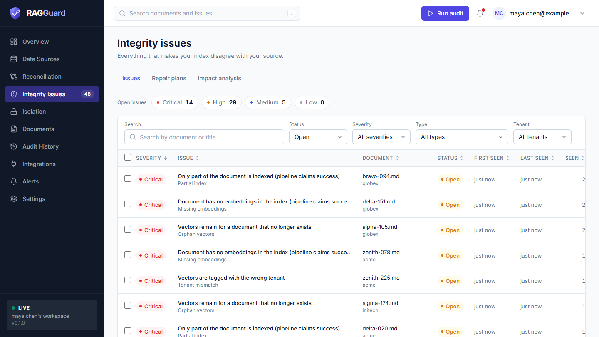
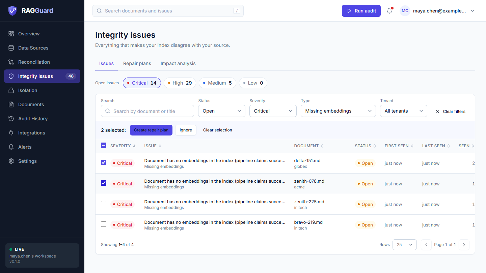
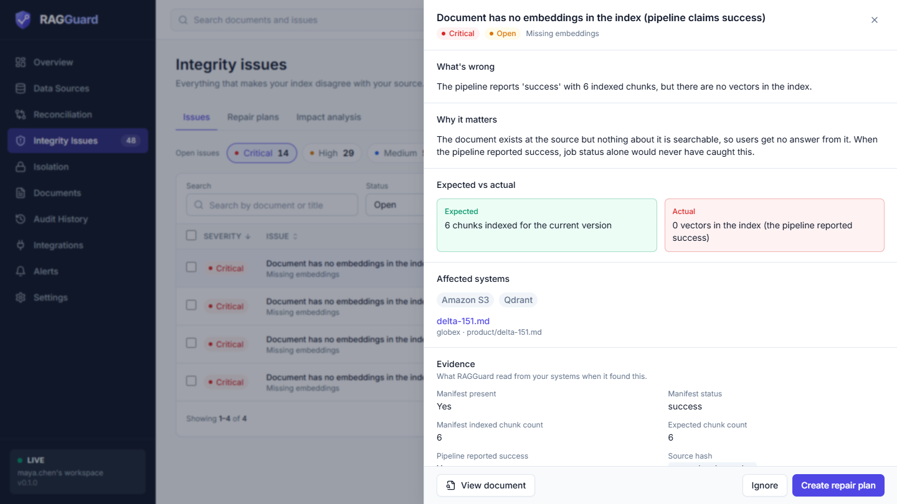
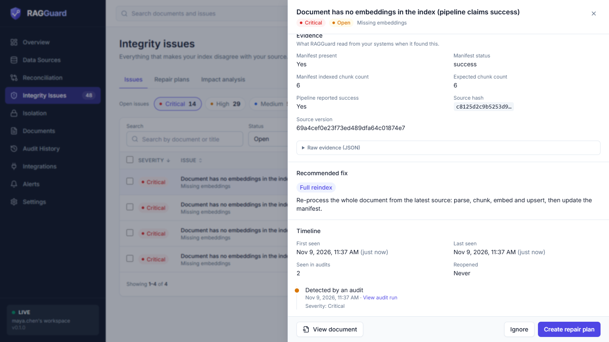
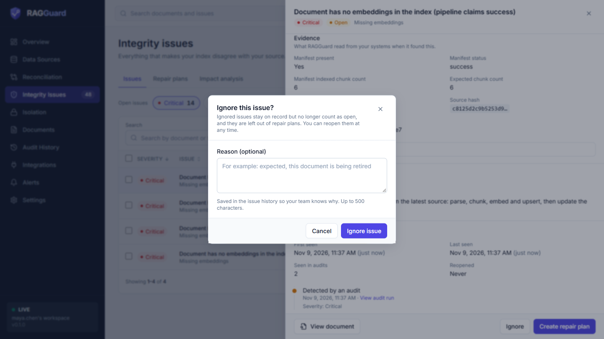

# Integrity issues

An **issue** is one specific way your vector index disagrees with your source documents or with your manifest, for example "this document was deleted from S3 but its vectors can still be searched". The Integrity Issues page lists every issue RAGGuard has found, lets you filter and sort them, and opens a panel for each one that explains what is wrong, why it matters to your users, the evidence RAGGuard collected and the fix it recommends. From here you also ignore issues you accept and create repair plans. The page has three tabs: **Issues** (this chapter), **Repair plans** ([Repair plans](08-repair-plans.md)) and **Impact analysis** ([Impact analysis](09-impact-analysis.md)). The second half of this chapter explains each of the 11 issue types in detail.

## On this page

- [Purpose and who needs it](#purpose-and-who-needs-it)
- [How to open it](#how-to-open-it)
- [The page at a glance](#the-page-at-a-glance)
- [Step-by-step tasks](#step-by-step-tasks)
- [The Issues tab](#the-issues-tab)
- [The issue panel](#the-issue-panel)
- [Ignoring and reopening issues](#ignoring-and-reopening-issues)
- [How an issue lives: open, resolved, ignored](#how-an-issue-lives-open-resolved-ignored)
- [The 11 issue types](#the-11-issue-types)
- [Severity quick reference](#severity-quick-reference)
- [Tips and common mistakes](#tips-and-common-mistakes)
- [Related chapters](#related-chapters)

## Purpose and who needs it

Use this page to decide what to fix first and to understand each problem well enough to fix it. It is for the person who owns the RAG pipeline (to find and fix the cause), for a team lead (to see how serious things are) and for a security or compliance owner (to check for deleted content that can still be searched, and for content in the wrong tenant).

Terms used here, all explained further in [Concepts you need](02-concepts.md):

- **Document**: one file in your source (Amazon S3). It is identified by its tenant and its document id, which is usually a folder path such as `policies/leave-policy.md`.
- **Tenant**: one customer, team or business unit whose documents are kept apart.
- **Manifest**: the PostgreSQL table where your ingestion pipeline records what it processed.
- **Index, vector, chunk**: the index (Qdrant) stores each document cut into pieces called chunks, and one searchable vector per chunk.
- **Audit**: a run that compares source, manifest and index and records what it found. See [Reconciliation](06-reconciliation.md).

## How to open it

- Click **Integrity Issues** in the left menu. A number next to it shows how many issues are open.
- Click a severity badge or a type name in the Results card on [Reconciliation](06-reconciliation.md), or the bell in the top bar and choose "View integrity issues".
- Use the search box in the top bar, type a word and choose "Integrity issues": it opens this page with that word in the search filter.
- Click a row in [Documents](10-documents.md) and open the Issues tab, or follow any issue link from a document or an audit.
- Click a row in the **Open findings** table on [Isolation](20-isolation.md): it opens that issue's panel.
- The address is `/issues`. An open issue is `/issues/<id>`. The tab is kept in the address as `?view=plans` or `?view=impact` (the Issues tab has no `view`). Filters are kept as `status`, `severity`, `type`, `tenant` and `q`, so you can bookmark or share a filtered list.

If your three systems are not connected yet, the page says "Connect your data sources first" with a **Go to Data Sources** button.

## The page at a glance

*The Issues tab: severity chips, the filter bar and the table.*

1. **Title**: "Integrity issues" with the sentence "Everything that makes your index disagree with your source."
2. **Tabs**: **Issues**, **Repair plans**, **Impact analysis**.
3. **Severity chips**: the number of open issues of each severity. Click one to filter.
4. **Filter bar**: Search, Status, Severity, Type, Tenant.
5. **Table**: one row per issue. Click a row to open its panel.

## Step-by-step tasks

### Work through the worst issues first

1. Open **Integrity Issues**. The list starts with the open issues, worst first.
2. Click the first row. Read **What's wrong**, **Why it matters** and **Expected vs actual** in the panel.
3. Scroll to **Evidence** and **Recommended fix**.
4. If the fix is a repair, click **Create repair plan** and continue in [Repair plans](08-repair-plans.md). If it is a human job ("Needs a human"), fix it in your own systems and run another audit.
5. After the next audit the issue turns **Resolved** when the problem is gone.

### Find the issues of one document, tenant or type

1. Type part of the document id or the title into **Search**.
2. Choose a **Tenant** or a **Type**.
3. To see everything about one document, you can also open it in [Documents](10-documents.md) and use its Issues tab.

### Create one repair plan from several issues

1. Tick the boxes in the first column of the issues you want to repair.
2. Click **Create repair plan** in the bar that appears.
3. The Repair plans tab opens with the new plan. See [Repair plans](08-repair-plans.md).

### Ignore issues you accept

1. Tick the issues, or open one and use its panel.
2. Click **Ignore**, optionally type a reason, and confirm with **Ignore issue** (or **Ignore N issues**).
3. To bring one back, set **Status** to Ignored, open it and click **Reopen**.

## The Issues tab

### Severity chips

Above the filters is a row that starts with the words "Open issues" and shows four chips: **Critical**, **High**, **Medium** and **Low**, each with a count of the **open** issues of that severity in the whole workspace. The counts do not change when you use the other filters. Click a chip to show only that severity (the chip is highlighted in the indigo brand colour and the Severity filter changes to match); click it again to remove the filter.

| Severity | Colour | What it means for you |
|---|---|---|
| **Critical** | red | Users can be served deleted content or another customer's content, or your pipeline reported success but wrote nothing. Act first. |
| **High** | amber | Content is missing, outdated or unusable. |
| **Medium** | blue | The index works but is untidy, or an incompleteness is only suspected. |
| **Low** | grey | Records are out of step with little effect on users. |

The exact rule for each issue type is in [The 11 issue types](#the-11-issue-types).

### Filters

All filters are combined (an issue must match all of them). **Clear filters** appears at the right when any filter differs from the default (default: Status Open and nothing else).

| Filter | Choices | What it does |
|---|---|---|
| **Search** (placeholder "Search by document or title") | Free text | Matches issues whose document id or issue title contains the text, ignoring capitals. It applies a moment after you stop typing. The small cross inside the box clears it. It does not search the explanation text. |
| **Status** | Open (default), Resolved, Ignored, All statuses | Open: still found by the latest audit that covered the document. Resolved: no longer found. Ignored: you chose to ignore it. |
| **Severity** | All severities, Critical, High, Medium, Low | Same as the chips. |
| **Type** | All types and the 11 type names | One issue type, for example "Orphan vectors". |
| **Tenant** | All tenants and each tenant | Only issues of that tenant. |

### The table

| Column | What it shows | How to read it |
|---|---|---|
| (tick box) | Selects the row. The box in the header selects all loaded rows. | See [Selecting rows](#selecting-rows-and-the-bulk-actions). |
| **Severity** | A coloured badge. | See the chips above. |
| **Issue** | The title of the issue in bold and its type name under it, for example "Document has no embeddings in the index" over "Missing embeddings". | The title is specific to the situation. The type tells you which of the 11 families it belongs to. |
| **Document** | The file name and, under it, the tenant. For a whole-collection finding it says "Whole collection". | Hover for the full document id. |
| **Status** | **Open** (amber), **Resolved** (green) or **Ignored** (grey). | |
| **First seen** | How long ago an audit first found it ("just now", "5 min ago", "3 h ago", "2 d ago"; after 30 days a date). Hover for the exact time. | Old and still open usually means nobody has acted on it. |
| **Last seen** | How long ago an audit last found it. | For a resolved issue, this is the last time it was still there. |
| **Seen** | How many audits found it. Hover for "Seen in N audits". | A high number means it has been there for a long time. Scoped and verification audits count too. |

### Sorting, paging and the 500-row note

### Repair everything that is open, in one step

To repair every open issue (or every high and critical one, or every issue of one tenant) without ticking rows, click **Repair all open issues** at the top right. A box shows what it would involve first, can send the plan to your repair worker in the same step and can email it. See [Repair plans](08-repair-plans.md#repair-everything-at-once).

- Click a column title to sort by it; click again to reverse. The first sort is **Severity**, worst first. Sorting happens in your browser over the rows that were loaded.
- The table shows 25 rows per page. The **Rows** drop-down offers 10, 25, 50 and 100. Use the arrows to move between pages ("Page 1 of 3"). The line under the table reads "Showing 1-25 of 60".
- The page loads at most 500 issues. When there are more matches you see "Showing the first 500 of N. Narrow the filters." Use the filters to reach the rest. Sorting and "select all" only work on the loaded rows.

### Selecting rows and the bulk actions

*Ticked rows and the bulk action bar.*

Tick the box at the start of a row to select it (this does not open the row). The box in the header selects every loaded row, on all pages, and shows a dash when only some are selected. Only rows that are still on screen count as selected, so changing a filter can never act on rows you cannot see.

When something is selected a bar appears with the text "N selected:" and three buttons.

| Button | What it does | When it is disabled |
|---|---|---|
| **Create repair plan** | Creates a repair plan from the selected issues that are open and belong to a specific document. Then it opens the plan in the Repair plans tab and shows a notice "Repair plan created" with the number of documents. Selected issues that are resolved, ignored or whole-collection are left out without a message. | When none of the selected issues qualifies. Tooltip: "Only open issues on a specific document can be repaired". |
| **Ignore** | Opens the Ignore dialog for the selected issues that are not yet ignored, see [Ignoring and reopening issues](#ignoring-and-reopening-issues). | When all selected issues are already ignored. Tooltip: "These issues are already ignored". |
| **Clear selection** | Unticks everything. | Never. |

### States you may see

| State | What you see | What to do |
|---|---|---|
| Loading | Grey placeholder rows. | Wait. |
| Error | "We couldn't load this" with the reason and **Try again**. | Try again, or see [Troubleshooting](18-troubleshooting.md). |
| No audit yet | "No audit has run yet": "Run your first audit to compare your source, manifest and index. Any differences show up here." and a **Run audit** button. | Click it, or use [Reconciliation](06-reconciliation.md). |
| Nothing open | "No open issues": "Your index matches your source. New findings appear here after each audit." | Nothing to do. This is the goal. |
| Filters match nothing | "No issues match these filters": "Try a different search, or remove a filter to see more." and a **Clear filters** button. | Clear the filters. |

## The issue panel

Click a row to open the issue in a panel on the right. The list stays behind it with your filters and your place. Press Escape or the cross to close it. The header shows the issue title, then its severity badge, status badge and type name.

*The top of the issue panel.*

### What's wrong

The plain-language description of this particular finding, written from the numbers the audit collected. For example: "The pipeline reports 'success' with 12 indexed chunks, but there are no vectors in the index." Read it first.

### Why it matters

A short explanation of what this kind of issue does to your users, the same for every issue of that type (the 11 explanations are in [The 11 issue types](#the-11-issue-types)).

### Expected vs actual

Two boxes side by side. The green **Expected** box says what the three systems should show. The red **Actual** box says what the audit found. Both are written from the stored evidence, for example "8 chunks indexed" next to "5 indexed, 3 missing". If a record is too old or unusual to describe, the Expected box says "The source, manifest and index agree" and the Actual box shows the issue title.

### Affected systems

Grey badges naming the systems involved in the disagreement: **Amazon S3**, **PostgreSQL**, **Qdrant**. Under them is a link to the document (file name, then "tenant · document id") that opens the document panel in [Documents](10-documents.md), and, if known, the index collection. For a whole-collection finding the text reads "This finding applies to the whole collection NAME, not to one document." and there is no link.

### Evidence

*Evidence, Recommended fix and Timeline.*

The heading reads **Evidence**, with the line "What RAGGuard read from your systems when it found this." It can contain up to six parts, shown only when they exist. If nothing was stored, it says "No evidence was recorded for this issue."

**Facts.** A grid of simple values. The label is the stored field name with underscores turned into spaces, for example "Manifest status", "Pipeline reported success", "Point count" or "Expected chunks". Numbers are formatted, true and false show as Yes and No, short lists show as small grey chips, and long text (over 48 characters, such as a file hash) is shortened and shows in full when you hover. At most 14 facts are shown. Facts that are lists of objects (for example a pipeline difference) appear only in the raw evidence.

**Retrieval probe.** Present on Orphan vectors, Tenant mismatch, Stale document version and Superseded vectors active findings when "Probe retrieval" was on (see [Reconciliation](06-reconciliation.md#scoped-audit)). The probe takes the stored vector of one affected chunk, queries your index with it, restricted to the owning tenant like a real search, and records what comes back.

| Field | Meaning |
|---|---|
| **Reachable** | Yes: at least one affected (old, orphan or wrong-tenant) vector came back in the results. No: none did. A dash means unknown. |
| **Rank in results** | The position of the first affected vector in the result list, where 1 is the best match. It reads "#3 of top 10", or "Not in the top 10" if it was absent, or "Not found" when the number of results is unknown. |
| **top_k** (it has no label of its own: it is the number after "top" in Rank in results) | How many results the probe asked the index for. The default is 10. A rank can only be found inside this window. |
| **Score** | The similarity score the index gave to that vector, shown with three decimals. How to read the scale depends on how your collection measures distance; compare it with the scores in the table below. In common setups a higher score means a closer match. |
| **Tenant filter** | The tenant the search was limited to. This shows the probe behaved like a real query for that tenant. |
| **Method** | A fixed sentence: "query by the stored vector of one affected chunk, filtered to the owning tenant". |

Below these values, a small table **Retrieval probe results** lists the top five results with their **Rank**, **Document** (file name), **Score** and **Stale content** (an amber "Stale content" badge when that result is an affected vector, otherwise "No"). If the probe could not run, a red box shows the error text, and the audit still completes.

How to read it: "Reachable: Yes" with a low rank number (1 to 3) means the bad content is among the first results users would see, so act quickly. This is why a reachable orphan vector is raised to Critical. "No" means the bad vector exists but did not compete for this one query; it is still wrong and still a risk for other queries. A probe tests one chunk of the document, so it is evidence, not a full measurement.

**Problems found.** For Metadata mismatch issues. A list where each row has a severity badge, a short code such as `acl_mismatch` and a sentence. Each code is explained under [Metadata mismatch](#7-metadata-mismatch).

**Vectors to remove.** For issues whose repair is removing vectors. It shows "N vectors in total" and, per collection, how many. These are the removal candidates. RAGGuard never deletes them itself; they are handed to your worker only after verification and approval, see [Repair plans](08-repair-plans.md). The evidence stores at most 5,000 vector ids per collection; the total is always the real number.

**Missing chunks.** For Partial index issues. Chips with the ids (or numbers) of the chunks that should be in the index but are not, the first 20 only with "+N more" for the rest. (The audit stores at most the first 50.) A chip like `kb_main:#3` means "chunk number 3 in the collection kb_main".

**Raw evidence (JSON).** A collapsible section with everything that was stored, for engineers and for support requests.

### Recommended fix

A badge in the brand colour (indigo) with the action name, and a sentence. There are five actions.

| Badge | Sentence in the panel | What it means |
|---|---|---|
| **Full reindex** | "Re-process the whole document from the latest source: parse, chunk, embed and upsert, then update the manifest." | Your pipeline rebuilds the document from scratch. |
| **Re-embed missing chunks** | "Re-embed only the missing chunks. A full rebuild of the document is also safe." | Cheaper than a full reindex. |
| **Remove old vectors** | "Remove the listed vectors, but only after their replacements are verified and an operator approves the removal." | Deleting vectors is never automatic. |
| **Fix metadata** | "Correct the manifest or payload metadata. No re-embedding is needed." | A record fix, no new vectors. |
| **Needs a human** | "Needs a human to look at it; there is no automatic repair." | Investigate and fix it in your own systems. |

For a whole-collection finding the panel adds "A whole-collection finding can't become an automatic repair plan. Fix it in your own systems, then run another audit."

### Timeline

First a block of facts, then the list of events.

| Fact | Meaning |
|---|---|
| **First seen** | Date and time of the first audit that found it, with "(5 d ago)". |
| **Last seen** | Date and time of the latest audit that found it. |
| **Seen in audits** | How many audits found it (the same number as the Seen column). |
| **Reopened** | "Never", or "1 time", "2 times": how often it came back after it was resolved. A number above zero suggests a recurring cause. |
| **Resolved** | Only for resolved issues: when it was resolved, with a **View audit run** link. |
| **Ignored because** | Only for ignored issues: the reason you typed, or "No reason given". |

Below the facts, the events appear newest first (up to 50). Each has a title, an optional line, a date and, where an audit caused it, a **View audit run** link.

| Event title | Colour | Meaning |
|---|---|---|
| "Detected by an audit" with "Severity: High" | amber | First found. |
| "Severity changed from Medium to High" | blue | The severity changed, for example because a probe confirmed the content is returned in search. |
| "Resolved: the index now matches the source" | green | An audit covering this document no longer found the problem. |
| "Came back after it was resolved" with "Severity: High" | red | It was resolved and then found again. |
| "Ignored" with "Reason: ..." | grey | Someone ignored it. |
| "Reopened by a user" | amber | Someone clicked Reopen. |

If there are no events it says "No events have been recorded yet."

### Buttons in the panel

At the bottom of the panel:

| Button | When shown | What it does |
|---|---|---|
| **View document** (left) | Issues on a specific document | Opens the document in [Documents](10-documents.md). |
| **Ignore** | The issue is open | Opens the Ignore dialog. |
| **Reopen** | The issue is resolved or ignored | Sets it back to open. A notice says "Issue reopened". |
| **Create repair plan** (the main button) | The issue is open and on a specific document | Creates a plan from this one issue, opens it in Repair plans, and says "Repair plan created: Review it, then trigger the repair." |

### Panel states

| State | What you see |
|---|---|
| Loading | Grey blocks. |
| "Issue not found" | "It may belong to another workspace, or it was removed. Go back to the list to pick another." with **Back to issues**. |
| "Couldn't load this issue" | The reason and **Try again**. |

## Ignoring and reopening issues

*The Ignore dialog.*

**Ignore** is for issues you have decided to live with, for example a document that is being retired, or an intentional difference. The dialog is titled "Ignore this issue?" (or "Ignore N issues?") and says: "Ignored issues stay on record but no longer count as open, and they are left out of repair plans. You can reopen them at any time."

| Part | Meaning |
|---|---|
| **Reason (optional)** | Free text, up to 500 characters, with the hint "Saved in the issue history so your team knows why." and the example "For example: expected, this document is being retired". It shows later as "Ignored because". |
| **Cancel** | Closes without changes. |
| **Ignore issue** / **Ignore N issues** | Confirms. When several are ignored they are processed one by one. If an error occurs part-way, the dialog stays open with "Ignored X of N before an error: ...". On success you see "Ignored N issues" (or "Issue ignored" from the panel). |

What ignoring does and does not do:

- The issue leaves the open list, the severity chips, the counts in the top bar, recommended work, repair plans, impact analysis and the report.
- Audits keep seeing it. Its Last seen and Seen numbers keep updating, but it stays ignored. If the problem disappears, an ignored issue stays ignored (it is not resolved).
- The document's status and the health score do **not** change, because they come from what the audit finds, not from what you chose to ignore.
- **Reopen** puts an ignored issue back to open and removes the reason.

If you click **Reopen** on a resolved issue it is also set back to open, until the next audit that covers its document runs. If the problem is still gone, that audit resolves it again. This is not the same as "Came back after it was resolved", which only an audit can record.

## How an issue lives: open, resolved, ignored

An issue is identified by its type, its tenant, its document and, for whole-collection findings, its collection. Because of that, the same problem found by two audits is the same issue, not two. That is why you see "Seen: 5".

| Status | How an issue gets there |
|---|---|
| **Open** | An audit finds a problem. |
| **Resolved** | A later audit that covers the document no longer finds the problem. A scoped audit only resolves issues inside its own scope. |
| **Open again** ("Reopened" count goes up) | A resolved problem is found again by an audit. |
| **Ignored** | You ignored it. Stays ignored until you reopen it. |

An issue's severity can change between audits (for example a confirmed probe, or a change in the data). Each change is an event in the Timeline.

## The 11 issue types

Every issue belongs to one of these 11 types. The table is a map; the sections below go through each one. In the table, "Fix" is the recommended action shown in the panel.

| # | Type name (filter and panel) | Short meaning | Usual severity | Fix |
|---|---|---|---|---|
| 1 | Missing embeddings | The document is in S3 but has no vectors at all. | High, Critical if the pipeline claims success | Full reindex |
| 2 | Partial index | Only some of the document's chunks are indexed. | High, Critical if the pipeline claims success, Medium if only suspected | Re-embed missing chunks |
| 3 | Stale document version | The source changed, but the index describes the old version. | High, Medium if the hash is unreliable | Full reindex |
| 4 | Superseded vectors active | The new version is indexed, but old vectors still answer queries. | Medium, High if a probe shows old content is returned | Remove old vectors |
| 5 | Orphan vectors | The document was deleted but its vectors are still searchable. | High, Critical if a probe confirms it is returned | Remove old vectors |
| 6 | Duplicate chunks | The same chunk is indexed more than once. | Medium | Remove old vectors |
| 7 | Metadata mismatch | Source, manifest and vector payloads disagree. | The highest of its problems | Fix metadata |
| 8 | Pipeline drift | Vectors were built with a different parser, chunker or embedding model than your target. | High or Medium, Critical for a collection size mismatch | Full reindex |
| 9 | Empty embeddings | Points exist with a missing or all-zero vector. | High | Full reindex |
| 10 | Tenant mismatch | Vectors are tagged with the wrong tenant. | Critical | Remove old vectors |
| 11 | Orphan manifest row | The manifest lists a document that no longer exists. | Low | Needs a human |

A few terms used below:

- **Current (live) vectors**: vectors whose content matches the current source document and your target pipeline, or whose version RAGGuard cannot tell. **Stale** vectors come from an older version of the document. **Outdated** vectors have current content but were built with an older pipeline setup. **Orphan** vectors belong to a document that no longer exists. You see these classes in the Chunks tab of [Documents](10-documents.md).
- **Pipeline reported success**: the manifest has a success-like status such as success, succeeded, indexed, completed, done, ready, ok or processed (for Missing embeddings, recording more than zero indexed chunks also counts). RAGGuard treats a document that the pipeline believes is fine but is not as the dangerous case and raises its severity.
- **Grace period**: a document changed, or marked as in progress in the manifest, within the grace period (10 minutes by default, set in [Settings](14-settings.md)) is not judged yet. It shows as Pending in the Documents table, and no issue is raised for it.

### 1. Missing embeddings

**What it is.** The document exists in S3, but the index holds zero vectors for it. Nothing about the document is searchable.

**Why it happens.** The pipeline never picked the document up (no manifest row); the job failed and was never retried; a job has been stuck "processing" for longer than the grace period; or the pipeline reported success but wrote nothing, for example because a write to the index failed silently or went to the wrong collection.

**What it means for users.** The assistant cannot find the document. Questions that only that document can answer get no answer or a worse one. When the pipeline reported success, the job status alone would never have caught it, which is the whole point of RAGGuard.

**How severity is decided.** High. Critical when the pipeline claimed success (the title then ends with "(pipeline claims success)"). Not raised during the grace period.

**What "What's wrong" can say.**
- "The document has never been picked up by the pipeline (no manifest row)."
- "The pipeline marked it 'failed' and it was never retried successfully."
- "The pipeline has had this document in 'processing' since ..."
- "The pipeline reports 'success' with N indexed chunks, but there are no vectors in the index."
- "The manifest has no completed indexing record for it."

**Expected and actual.** Expected: "N chunks indexed for the current version" (N is the manifest's expected chunk count), or "The current version fully indexed" if the count is unknown. Actual: "0 vectors in the index", adding "(the pipeline reported success)" when it did.

**Typical evidence facts.** Manifest present, Manifest status, Manifest indexed chunk count, Expected chunk count, Pipeline reported success, Source hash, Source version, and "Stuck in flight since" when the job is stuck.

**Recommended action.** Full reindex. Find out why the pipeline skipped or failed the document, then reprocess it ([Repair plans](08-repair-plans.md)).

### 2. Partial index

**What it is.** Some of the document's chunks are in the index, but not all of them.

**Why it happens.** Ingestion stopped half-way, some writes to the index failed, or a worker reported success but wrote only part of the chunks.

**What it means for users.** Answers can be silently incomplete. The chunks that are missing are exactly the ones nobody notices are gone: the assistant still answers, just without the missing part.

**How it is found.** RAGGuard looks only at the current vectors of the document, per collection, and compares them with what should be there, using the best information it has. The Evidence fact **Method** says which one was used:
- `chunk_manifest`: the exact list of chunks from your chunk-level manifest table. The most reliable.
- `expected_chunk_count`: the number of chunks the manifest says there should be.
- `index_gaps`: neither exists, so RAGGuard looks for holes in the chunk numbers (for example chunks 0, 1 and 3 are present, so 2 is missing). The **Confidence** fact then reads "suspected (gap in chunk indexes)", otherwise "confirmed".

It is skipped when the whole document is stale (the Stale document version issue covers it).

**How severity is decided.** High. Critical when the pipeline claimed success. Medium when it is only suspected from gaps.

**Expected and actual.** Expected: "N chunks indexed". Actual: "X indexed, Y missing".

**Typical evidence facts.** Method, Expected chunks, Indexed chunks, Missing count, Pipeline reported success, Confidence, Collections, Unexpected chunks (chunks in the index that the manifest does not list), plus the **Missing chunks** list.

**Recommended action.** Re-embed missing chunks. A full rebuild of the document is also safe. If the same document also has a full-reindex issue, a repair plan uses a full reindex for it.

### 3. Stale document version

**What it is.** The document was changed in S3, but every current vector still describes the previous version.

**Why it happens.** The pipeline did not notice the change, the re-ingestion job failed, or it has not run yet.

**What it means for users.** Users get out-of-date answers, delivered with full confidence. This is the classic "the policy changed last month but the assistant still quotes the old one".

**How it is found.** Each vector stores a hash (or version id) of the source it was built from. If all current vectors differ from the source's hash, the document is stale. If the vectors carry neither, RAGGuard falls back to the manifest: when the hash the manifest last indexed differs from the one in S3, the document is stale.

**How severity is decided.** High. Medium when the source hash is not reliable: S3 could only give a "multipart ETag", which is not a true hash of the content, so re-uploading identical content can look like a change (the Evidence fact **Hash reliable** says No). Not raised during the grace period.

**Expected and actual.** Expected: "Index built from source" followed by the first characters of the source hash. Actual: "Index built from" followed by the first characters of the indexed hash, or "Index built from an older version".

**Typical evidence facts.** Source hash, Source version, Hash reliable, Pipeline status, Outdated points, Indexed hashes (chips), Indexed versions, Point count, Collections, and **Vectors to remove** (the old vectors).

**Recommended action.** Full reindex. Expect a follow-up: once the new vectors are added, the old ones become a Superseded vectors active issue until they are removed (see below).

### 4. Superseded vectors active

**What it is.** The latest version of the document is indexed, but older vectors for it are still active next to the new ones. "Older" means built from an older version of the document, or built with an older pipeline setup.

**Why it happens.** A re-index added new vectors but, by design, did not delete the old ones (deleting too early is dangerous), or the new vectors got different ids than the old ones.

**What it means for users.** Old content can outrank the current content, so users may get the old answer even though the new version is in the index.

**How severity is decided.** Medium. High when a retrieval probe shows that the old content is returned for a matching query.

**Expected and actual.** Expected: "Only current-generation vectors are active". Actual: "N current and M superseded vectors active".

**Typical evidence facts.** Live points, Stale points, Outdated config points, Point count, Collections, and **Vectors to remove** with the retrieval probe.

**Recommended action.** Remove old vectors. This is the second phase of a repair: RAGGuard asks your worker to delete exactly these vectors only after the replacements are verified and you approve ([Repair plans](08-repair-plans.md)).

### 5. Orphan vectors

**What it is.** The document was deleted from your source, but its vectors are still in the index and searchable.

**Why it happens.** Deleting a file from S3 does not delete its vectors. Nothing in the pipeline reacts to deletions, or a delete job failed.

**What it means for users.** Deleted or withdrawn content, for example a retired policy or a document removed for legal reasons, can still be returned to users. This is often the most embarrassing finding.

**How it is found.** The index holds vectors for a document that is not in the source, and the same document id does not exist under another tenant (otherwise it is a Tenant mismatch).

**How severity is decided.** High. Critical when a retrieval probe confirms that the vectors are returned for a matching query; the detail then ends with "Confirmed: it is returned at rank N for a query matching it."

**Expected and actual.** Expected: "No vectors: the document no longer exists at the source". Actual: "N vectors still searchable".

**Typical evidence facts.** Point count, Chunks, Collections, Sample point ids, Manifest present, Manifest status, the **Vectors to remove** list and the **Retrieval probe**.

**Recommended action.** Remove old vectors, and also retire the manifest row of the deleted document. If you leave it, an Orphan manifest row issue appears next. (The reference worker described in [Repair plans](08-repair-plans.md) does both.) Orphan vectors are not reported when **Only audit documents found in the source (S3)** is on in [Settings](14-settings.md), because that setting ignores anything not found in S3.

### 6. Duplicate chunks

**What it is.** The same chunk is in the index more than once.

**Why it happens.** Typically a retried job, or ingestion that is not idempotent (the point ids are not stable, so a retry adds copies instead of overwriting).

**What it means for users.** Ranking is skewed: the same passage can fill several of the top results and push out other useful content. It also wastes storage and tokens.

**How it is found.** Two or more current vectors share one chunk id (or chunk number) in the same collection. RAGGuard keeps the first copy it saw and lists the others as removal candidates.

**How severity is decided.** Always Medium.

**Expected and actual.** Expected: "One vector per chunk". Actual: "N chunks indexed more than once (M extra vectors)".

**Typical evidence facts.** Duplicated chunks, Extra points, Example chunks (chips), Keep policy (`first_seen`), Point count, and **Vectors to remove**.

**Recommended action.** Remove old vectors (the extra copies), and make your pipeline write with stable ids.

### 7. Metadata mismatch

**What it is.** The source, the manifest and the vector payloads disagree about counts, versions, access-control hash or required fields. There is one issue per document that lists all its **problems**, and a separate whole-collection finding for vectors that carry no document id at all.

**Why it happens.** A manifest update was skipped after a successful write, a pipeline writes payloads without all required fields, a permission change was not copied into the vectors, or a job failed half-way.

**What it means for users.** Permission filters and freshness checks depend on this metadata. A wrong access-control hash can show users content they should not see, or hide content they should.

**How severity is decided.** The severity of the highest problem in the list.

| Problem code | Severity | Meaning |
|---|---|---|
| `missing_payload_fields` | Medium | Vectors lack required fields. By default the required fields are the document id and the source hash, plus the tenant id once you have several tenants (changeable under Audit policy in [Settings](14-settings.md)). |
| `untracked_in_manifest` | Medium | Vectors exist for a current document, but the pipeline has no manifest row for it. |
| `manifest_count_mismatch` | Medium | The manifest says N chunks are indexed, but the index holds a different number. Not shown when Partial index already explains the difference. |
| `acl_mismatch` | High | Some vectors carry a different access-control hash than the manifest, so permissions may be wrong at query time. |
| `manifest_lags_index` | Low | The index is current, but the manifest still records an older source hash. |
| `manifest_version_mismatch` | Low | The manifest's indexed version differs from the source version although the content hashes agree. |
| `status_failed_but_indexed` | Low | The manifest status says failed, but the document is indexed. |
| `unattributed_vectors` | High | Whole-collection finding: points that have no document id, so they cannot be matched to any source document. |

**Expected and actual.** Expected: "Source, manifest and payloads agree". Actual: the first problem's sentence, followed by "(+N more)" if there are more.

**Typical evidence facts.** Source hash, Source version, Hash reliable, Point count, Collections; the **Problems found** list shows each problem. For the whole-collection finding the facts are Collection, Points and Sample point ids.

**Recommended action.** Fix metadata: correct the manifest or the payloads. No re-embedding. The whole-collection finding says Needs a human.

### 8. Pipeline drift

**What it is.** Vectors were built with a different parser, chunker or embedding model than the pipeline you set as your target (the "Target pipeline" group in [Settings](14-settings.md)), or the vectors of one document disagree with each other.

**Why it happens.** You changed the embedding model or the chunking and only some documents were re-embedded, or different workers use different configurations.

**What it means for users.** Vectors from different embedding models live in different "spaces" and cannot be compared meaningfully. Retrieval gets worse in ways that are hard to see. A collection whose vector size does not match the model your queries use cannot match at all.

**Three forms.**
1. A document whose content is current but all its vectors were built with a different setup than the target.
2. A document whose own current vectors disagree (the Evidence fact **Varying fields** lists the fields).
3. A whole-collection finding: the target embedding dimension differs from the vector size of a collection ("Collection vector size does not match the target embedding model").

The first and third forms need a target pipeline in Settings; the second does not.

**How severity is decided.** High when the embedding model, its version or the dimensions differ. Medium for parser, chunking, chunk size, chunk overlap or preprocessing differences. Always Critical for the whole-collection dimension mismatch.

**Expected and actual.** Expected: "Vectors built with the target pipeline". Actual: a list such as "embedding model: model-a → model-b; chunk size: 512 → 800", or "Mixed configurations (field names)", or "Built with a different configuration". For the whole-collection form read the What's wrong text, which names the two dimensions.

**Typical evidence facts.** Outdated points, Varying fields, Point count, Collections; for the collection form: Collection, Collection vector size, Target embedding dim. The detailed differences are in the raw evidence.

**Recommended action.** Full reindex with the target pipeline. For the whole-collection finding: Needs a human (the collection must be recreated or the target corrected).

### 9. Empty embeddings

**What it is.** Points exist in the index, but their vector is missing, empty or all zeros.

**Why it happens.** The embedding call failed and a placeholder vector was stored, or a write was cut short.

**What it means for users.** These points can never be retrieved correctly. The content looks present in the index but is effectively invisible.

**How it is found.** Only when **Detect empty embeddings** is on for your Qdrant connection ([Connect your data sources](04-data-sources.md)), because RAGGuard has to fetch the vectors, which is slower. With the switch off you will never see this type.

**How severity is decided.** Always High.

**Expected and actual.** Expected: "A usable vector for every point". Actual: "N points with empty or all-zero vectors".

**Typical evidence facts.** Empty points, Sample point ids, Point count, Collections.

**Recommended action.** Full reindex.

### 10. Tenant mismatch

**What it is.** Vectors are tagged with one tenant, but the document does not exist under that tenant in the source; it exists under a different tenant.

**Why it happens.** A bug in the ingestion code uses the wrong tenant id, or content was copied between tenants.

**What it means for users.** One customer's content can be returned to another customer. **Treat this as a security incident**, not just a data quality issue.

**How it is found.** Vectors exist under tenant X for a document id that is not in X's source but is in another tenant's source. The check matches on the document id.

**How severity is decided.** Always Critical.

**Expected and actual.** Expected: "Vectors tagged with tenant" followed by the tenant(s) that own the document in the source. Actual: "N vectors tagged with another tenant".

**Typical evidence facts.** Expected tenants (chips), Point count, Chunks, Collections, Sample point ids, Manifest present, Manifest status, **Vectors to remove** and the **Retrieval probe**.

**Recommended action.** Remove old vectors (the wrongly tagged ones) through a repair plan, and fix the ingestion bug. Consider who may already have seen the content.

**See it per tenant.** The [Isolation](20-isolation.md) page summarises Tenant mismatch issues, and the `acl_mismatch` problem of Metadata mismatch, for every tenant, and can download them as an evidence report.

### 11. Orphan manifest row

**What it is.** The manifest lists a document that is gone from both the source and the index.

**Why it happens.** The document was deleted and its vectors were cleaned up, but the manifest row was left behind.

**What it means for users.** Nothing: users are not affected. It only clutters your records and can mislead reports.

**How it is found.** A manifest row exists, there is no source file and no vectors, and the row's status is not deleted, tombstoned or removed.

**How severity is decided.** Always Low.

**Expected and actual.** Expected: "No manifest row for a deleted document". Actual: "Row present (status X)".

**Typical evidence facts.** Manifest status, Source uri.

**Recommended action.** Needs a human: delete or mark the row as deleted in your manifest table. There is no automatic repair. After the next audit the issue is Resolved.

## Severity quick reference

| Type | Default | Raised when | Lowered when |
|---|---|---|---|
| Missing embeddings | High | Critical: pipeline claims success | |
| Partial index | High | Critical: pipeline claims success | Medium: only suspected from index gaps |
| Stale document version | High | | Medium: source hash is a multipart ETag |
| Superseded vectors active | Medium | High: probe shows old content is returned | |
| Orphan vectors | High | Critical: probe shows it is returned | |
| Duplicate chunks | Medium | | |
| Metadata mismatch | The highest of its problems | High if `acl_mismatch` or `unattributed_vectors` is present | Low if the only problems are `manifest_lags_index`, `manifest_version_mismatch` or `status_failed_but_indexed` |
| Pipeline drift | Medium | High: embedding model, version or dimension differs; Critical: collection size mismatch | |
| Empty embeddings | High | | |
| Tenant mismatch | Critical | | |
| Orphan manifest row | Low | | |

A document is **broken** when it has at least one High or Critical issue and **degraded** when it has only Medium or Low ones. See [Reconciliation](06-reconciliation.md).

## Tips and common mistakes

- **Start from Critical.** Orphan vectors and Tenant mismatch decide whether you have a content-exposure problem.
- **A repaired document may show a new issue.** After a re-index of a stale document, the old vectors become Superseded vectors active until you approve their removal. That is expected and safe.
- **Do not ignore to make a number go down.** Ignoring hides an issue from the open list but does not change the document's status or the health score. Use it for things you have decided to accept, and write the reason.
- **Resolved needs an audit.** An issue only becomes Resolved when an audit covers its document. After fixing something, run a scoped or full audit (see [Reconciliation](06-reconciliation.md)).
- **Metadata problems are not re-embedding problems.** If the fix says Fix metadata, you do not need to pay for new embeddings.
- **Empty embeddings is invisible unless you switch it on.** If you never see this type, check the Qdrant setting before assuming all is well.
- **Over 500 issues.** Filter by tenant or type to see the rest; sorting and select-all only work on loaded rows.

## Related chapters

- [Concepts you need](02-concepts.md)
- [Reconciliation](06-reconciliation.md)
- [Repair plans](08-repair-plans.md)
- [Impact analysis](09-impact-analysis.md)
- [Isolation](20-isolation.md)
- [Documents](10-documents.md)
- [Audit history](11-audit-history.md)
- [Settings](14-settings.md)
- [Reference: every value](17-reference.md)
