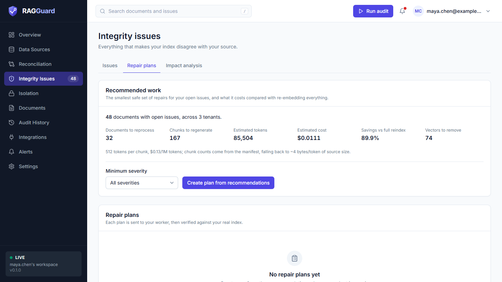
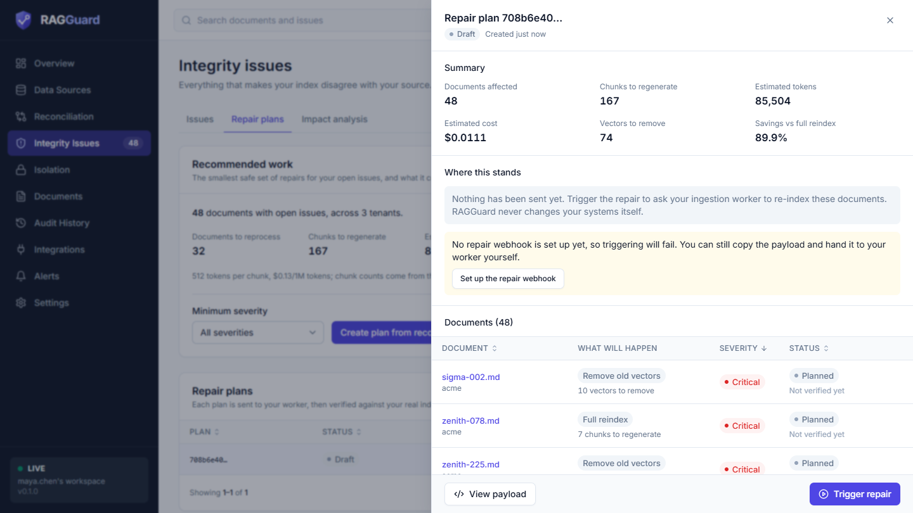
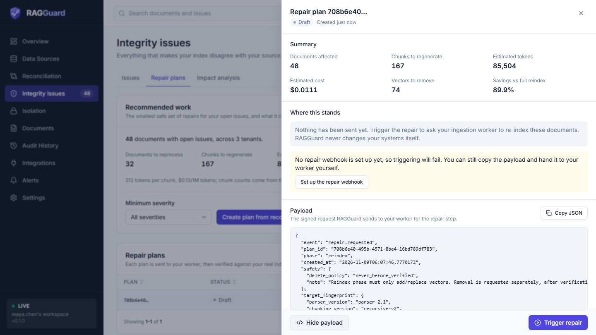
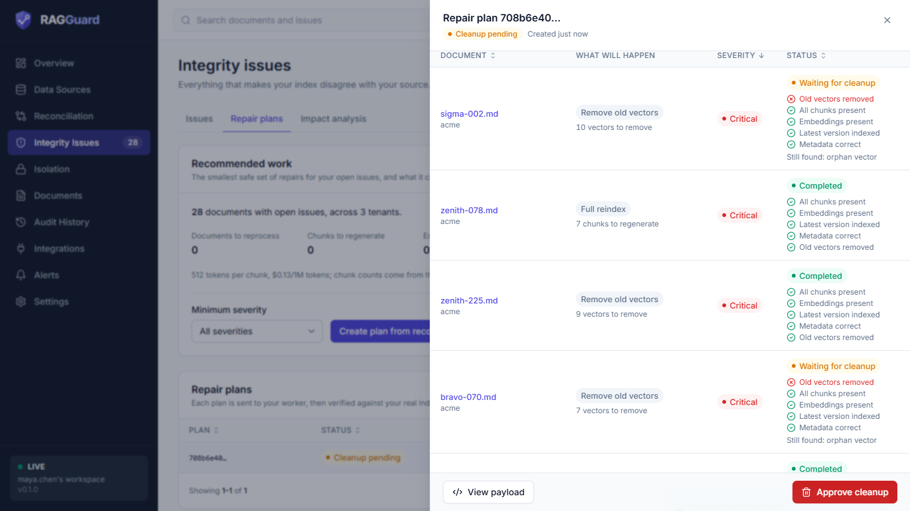
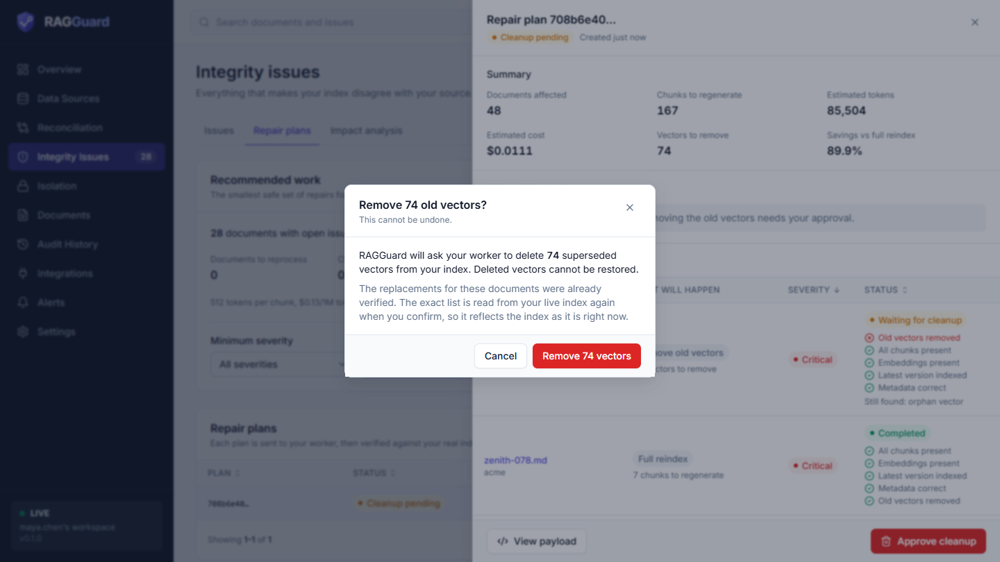
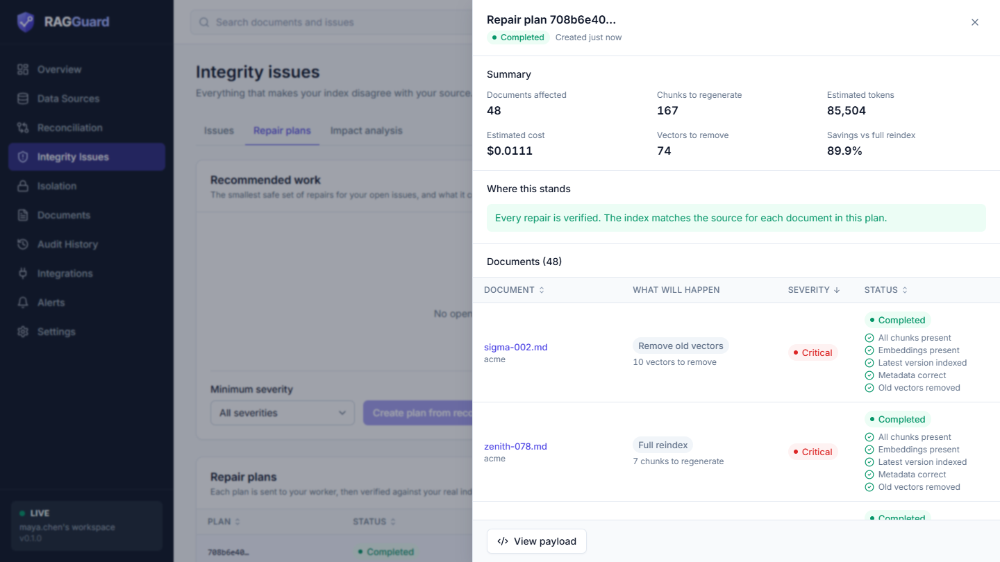

# Repair plans

A **repair plan** is a list of documents that need fixing, with what has to be done to each one. RAGGuard never changes your systems itself. When you trigger a plan, it sends a signed request to your own worker (the program that ingests your documents), your worker does the writing, and then RAGGuard checks your real index to see whether the repair really happened. Old vectors are only removed in a second step, after the new ones are verified and you have approved the removal. This chapter covers the **Repair plans** tab of the Integrity Issues page: the recommended work and its cost, the list of plans, the plan panel with all its buttons, and how a repair works from start to finish.

## On this page

- [Purpose and who needs it](#purpose-and-who-needs-it)
- [How to open it](#how-to-open-it)
- [How a repair really works](#how-a-repair-really-works)
- [The Repair plans tab at a glance](#the-repair-plans-tab-at-a-glance)
- [Step-by-step tasks](#step-by-step-tasks)
- [Recommended work](#recommended-work)
- [The Repair plans table](#the-repair-plans-table)
- [The plan panel](#the-plan-panel)
- [The plan status lifecycle](#the-plan-status-lifecycle)
- [Document statuses and the five checks](#document-statuses-and-the-five-checks)
- [What your worker receives](#what-your-worker-receives)
- [Messages you may see](#messages-you-may-see)
- [Tips and common mistakes](#tips-and-common-mistakes)
- [Related chapters](#related-chapters)

## Purpose and who needs it

Use repair plans to turn issues into action without re-embedding everything. For each affected document RAGGuard works out the smallest safe action, shows what it would cost compared with re-processing the whole corpus, hands the work to your worker and proves the result. It is for the engineer who owns the ingestion pipeline and for the person who approves deleting vectors.

You need a **repair webhook**: the address of your worker and a signing secret, set in [Integrations](12-integrations.md). Without it you can create plans and read their payload, but you cannot trigger them.

Words used here:
- **Worker**: your own ingestion program. It re-reads the document, cuts it into chunks, creates the vectors and writes them to the index and the manifest.
- **Reindex**: rebuilding the vectors of a document from its latest source.
- **Cleanup**: deleting vectors that should no longer exist (old versions, duplicates, deleted documents, vectors with the wrong tenant).
- **Verification**: a fresh, read-only audit of just the plan's documents, run by RAGGuard, not trusted from your worker.

See also [Concepts you need](02-concepts.md).

## How to open it

- Click **Integrity Issues** in the left menu, then the **Repair plans** tab. The address is `/issues?view=plans`. An open plan adds `&plan=<id>`, and the severity choice adds `&min=<severity>`.
- Click **Create repair plan** in an issue panel ([Integrity issues](07-integrity-issues.md)), in the bar that appears when you tick rows, or in a document panel ([Documents](10-documents.md)). Each of these creates a plan and opens it here.
- If your three systems are not connected yet, the page says "Connect your data sources first".

## How a repair really works

Read this section once. It explains why the buttons behave as they do.

**The principle: RAGGuard asks, your worker acts, RAGGuard checks.** RAGGuard connects to your systems read-only. It can never write a vector, change a manifest row or delete anything. Every change is made by your worker.

**Phase 1: reindex (add or replace only).**
1. You click **Trigger repair**. RAGGuard sends one signed HTTPS request to your webhook. The request lists the documents to reprocess and, for each one, the action (full reindex, re-embed the missing chunks, or fix metadata), the source location, the source version and hash, the expected chunk count and the target pipeline settings.
2. The request also carries a safety note: delete policy "never_before_verified". In this phase your worker must only add or replace vectors, using stable ids so a retry overwrites instead of duplicating. It must not delete anything.
3. Your worker answers "accepted" quickly, does the work in the background and, if the request contains a callback address, calls RAGGuard back when it is done (signed in the same way). The callback starts verification automatically. If there is no callback, you click **Verify now**.

**Verification.** RAGGuard runs a scoped audit of exactly the plan's documents and looks at the real index. Per document it applies five checks (see [below](#document-statuses-and-the-five-checks)). A worker that reports success but wrote half the chunks is caught here, because RAGGuard looks at the index, not at the worker's answer. Documents that fail stay in the plan and keep their old vectors.

**Phase 2: cleanup (explicit deletions, only with approval).** For the documents that passed verification, old vectors may still be in the index (a re-indexed document, for example, may now have both the new and the old vectors). Removing them is a separate step:
1. The plan reaches **Cleanup pending**.
2. You click **Approve cleanup** and confirm. (With the policy "auto" under Vector removal in the repair settings, this happens right after a successful verification without a click.)
3. RAGGuard re-reads your live index, recomputes the exact list of vectors to remove at that moment, and sends a second signed request that lists the exact point ids per document and collection. Your worker deletes exactly those, nothing else.
4. You verify again. When all old vectors are gone, the plan is **Completed**.

**Why vectors are never deleted before verification.**
- If the old vectors were removed first and the re-index then failed, users would be left with no answer at all.
- Your worker's report is not proof. Only the verification audit is.
- The list to delete is recomputed from the live index at approval time, so you delete what is wrong now, not what was wrong when the plan was written.
- Deleted vectors cannot be restored, so a person approves it.

## The Repair plans tab at a glance



*The Repair plans tab: the Recommended work card on top and the plans table below.*

The tab has two cards:
1. **Recommended work**: the smallest safe set of repairs for your open issues, what it costs, and the button **Create plan from recommendations**.
2. **Repair plans**: a table of all plans. Click one to open its panel.

## Step-by-step tasks

### Create a plan from the recommendations

1. In **Recommended work**, optionally choose a **Minimum severity**.
2. Check the numbers, then click **Create plan from recommendations**.
3. The plan panel opens with the status Draft. A notice says "Repair plan created" with the number of documents and "Review it, then trigger the repair."

### Create a plan from selected issues

1. In the Issues tab, tick the issues ([Integrity issues](07-integrity-issues.md)), or open one issue.
2. Click **Create repair plan**. Only open issues on a specific document are included.

### Send a plan to your worker and verify it

1. Open the plan, read the **Documents** table and **Where this stands**.
2. If you want to see exactly what will be sent, click **View payload**.
3. Click **Trigger repair**. A notice says "Repair sent to your worker".
4. Wait until your worker has finished.
5. Click **Verify now**. A notice tells you the result.

### Remove old vectors

1. When the status is **Cleanup pending**, click **Approve cleanup**.
2. Read the confirmation, then click **Remove N vectors**.
3. When your worker has deleted them, click **Verify now**.

### Retry what failed

1. When the status is **Partial** or **Failed**, read the Status column of the Documents table to see which checks failed.
2. Fix the cause in your worker or your data.
3. Click **Send repair again** (it sends only the documents that are still planned or failed), then **Verify now**.

## Recommended work

The card is titled **Recommended work**, with the line "The smallest safe set of repairs for your open issues, and what it costs compared with re-embedding everything."

It starts with a sentence such as "12 documents with open issues, across 3 tenants." That is every document that has at least one open issue on a specific document. (Whole-collection findings are not document repairs and are not counted. Ignored and resolved issues are not counted either.)

Then six numbers:

| Number | What it means |
|---|---|
| **Documents to reprocess** | Documents that need new vectors: a full reindex or a re-embed of missing chunks. Documents that only need a metadata fix, only need old vectors removed, or need a human are not in this number. |
| **Chunks to regenerate** | How many chunks your worker would have to create. For a full reindex it is the document's expected chunk count from the manifest (falling back to the indexed chunk count, then to an estimate from the file size). For a re-embed of missing chunks it is the number of missing chunks. |
| **Estimated tokens** | Chunks to regenerate multiplied by the tokens per chunk. |
| **Estimated cost** | Estimated tokens times your embedding price, in US dollars. Under one dollar it shows four decimals, for example "$0.0213"; above that it shows up to one decimal. |
| **Savings vs full reindex** | How much cheaper this targeted repair is than re-embedding every document in your latest audit whose source still exists, as a percentage. It is hidden when the comparison cannot be calculated. |
| **Vectors to remove** | The number of vectors that would be removed in the cleanup phase (old versions, duplicates, orphans, wrong-tenant vectors). Removal is never part of the cost estimate. |

Under the numbers, a small line states the assumptions, for example "512 tokens per chunk, $0.13/1M tokens; chunk counts come from the manifest, falling back to ~4 bytes/token of source size." The token and price values come from **Tokens per chunk (for estimates)** and **Embedding price (USD per 1M tokens)** under Audit policy in [Settings](14-settings.md); adjust them to your real embedding model to get real cost figures.

If there are more than 200 affected documents, a note says "The preview covers the most severe 200 documents. A plan includes every matching document." The numbers above still cover all of them.

**Minimum severity** (a drop-down below the numbers) limits both the recommendation and the plan you create: "All severities", "Critical and above", "High and above", "Medium and above", "Low and above". Use it to start with what hurts most.

**Create plan from recommendations** creates a plan for all matching documents. It is disabled while loading and when there is nothing to repair.

| State | What you see |
|---|---|
| Loading | A grey block. |
| Error | "We couldn't load this" with **Try again**. |
| Nothing to repair | "Nothing to repair": "No open issues need a repair. New findings show up here after the next audit." With a minimum chosen: "No open document issues at high severity or above. Choose a lower minimum to see more." |

## The Repair plans table

The card is titled **Repair plans** with the line "Each plan is sent to your worker, then verified against your real index." It lists up to your 50 most recent plans. Click a row to open it. Click a column title to sort; the first sort is by **Created**, newest first. The table shows 25 rows per page.

| Column | What it shows |
|---|---|
| **Plan** | The first 8 characters of the plan id. Hover for the full id. |
| **Status** | The plan status badge, see [the lifecycle](#the-plan-status-lifecycle). |
| **Created** | How long ago ("just now", "5 min ago", "2 h ago", "3 d ago"). Hover for the exact time. |
| **Documents** | How many documents are in the plan (documents affected). |
| **Chunks** | Chunks to regenerate. |
| **Est. cost** | Estimated cost of the plan. |

When there are no plans: "No repair plans yet": "Create one from the recommendations above, or select issues in the Issues tab and create a plan from them." A plan is a snapshot: its documents and numbers are fixed when you create it. New audits do not change the plan, but verification updates the status of each of its documents.

## The plan panel

Click a plan to open its panel on the right. Close it with the cross or Escape.



*A draft plan: the summary, where this stands and the documents.*

The title is "Repair plan" and the first 8 characters of the id. Under it are the status badge and "Created 5 min ago".

### Summary

| Value | Meaning |
|---|---|
| **Documents affected** | Documents in the plan. |
| **Chunks to regenerate** | As in Recommended work, for this plan. |
| **Estimated tokens** | As above. |
| **Estimated cost** | As above. |
| **Vectors to remove** | Vectors planned for the cleanup phase. |
| **Savings vs full reindex** | Shown when it can be calculated. |

### Where this stands

A coloured box that says in one or two sentences what is going on and what to do next. It changes with the status.

| Status | Text |
|---|---|
| Draft | "Nothing has been sent yet. Trigger the repair to ask your ingestion worker to re-index these documents. RAGGuard never changes your systems itself." |
| Triggered | "The repair was sent to your worker. When it has finished, verify to re-check the real index." |
| Partial | "Some documents are fixed and some are not. Verify again after your worker retries, or send the repair again." |
| Failed | "The index still has problems for these documents. Check the results below, then send the repair again." |
| Cleanup pending | "The replacements are verified. Removing the old vectors needs your approval." |
| Cleanup triggered | "Cleanup was sent to your worker. Verify to confirm the old vectors are gone." |
| Completed (green box) | "Every repair is verified. The index matches the source for each document in this plan." |

**The webhook warning.** On a Draft plan, when no repair webhook is set up on your server (and it is not the demo server), an amber box adds: "No repair webhook is set up yet, so triggering will fail. You can still copy the payload and hand it to your worker yourself." with a **Set up the repair webhook** button that opens [Integrations](12-integrations.md). If you click **Trigger repair** anyway and the server answers that no webhook is configured, a red box shows the server's message with the same button.

### View payload

The button **View payload** (bottom left) shows the exact request body RAGGuard would send for the reindex step. It is for transparency and for teams that move the work by hand.



*The Payload section.*

A section titled **Payload** appears with the line "The signed request RAGGuard sends to your worker for the repair step." and a **Copy JSON** button. The button changes to **Hide payload** while it is shown. The signature is added as HTTP headers when the request is really sent, so it is not part of the JSON you see. The payload lists only the documents that still have work to do (status planned or failed), so after a partial run it shrinks to the failed ones. The fields are explained in [What your worker receives](#what-your-worker-receives).

### The Documents table

The section title shows the count, for example "Documents (12)". It is a table with 10 rows per page, sorted by severity, worst first.

| Column | What it shows |
|---|---|
| **Document** | The file name as a link that opens the document panel, with the tenant under it. |
| **What will happen** | Grey badges for the actions, and a line of work under them. Actions: **Full reindex**, **Re-embed missing chunks**, **Fix metadata**, **Remove old vectors**. A document that needs none of these shows **Needs a human**. The work line reads, for example, "8 chunks to regenerate", "Whole document to regenerate" (when the expected count is unknown), "3 chunks to regenerate" and "12 vectors to remove" (or "Old vectors to remove"), joined with a middle dot. |
| **Severity** | The worst severity among this document's issues in the plan. |
| **Status** | The document's status badge (see below) and, once verified, a check list. Before verification it says "Not verified yet". Failed checks come first in red, passed ones have a green tick. If problems remain, "Still found:" lists the issue types. |

The five check names are **All chunks present**, **Embeddings present**, **Latest version indexed**, **Metadata correct** and **Old vectors removed**.



*A plan after verification: each document has a status and its five checks. Documents waiting for cleanup show the cleanup step as still to do.*

### History

A timeline, newest first, of everything that happened to the plan. If nothing has, it says "Nothing has happened to this plan yet."

| Event | Colour | Meaning |
|---|---|---|
| "Plan created" with "12 documents, 20 issues" | grey | The plan was created. |
| "Repair sent to your worker" with "12 documents to reprocess" | blue | Trigger succeeded: your worker accepted the request. |
| "Your worker reported back" | grey | Your worker called the callback address. Verification follows. |
| "Verified: every repair is in place" | green | Result completed. |
| "Verified: replacements are in place, old vectors await approval" | amber | Result cleanup pending. |
| "Verified: some documents still have issues" | amber | Result partial. |
| "Verified: the repairs are not in place yet" | red | Result failed. |
| "Cleanup sent to your worker" with "N vectors in N documents" | blue | Approve cleanup succeeded. |

The verified lines also say "N of M documents complete" and, when documents failed, "Still failing:" with up to three document ids and "and K more".

### The buttons and when they appear

The buttons are in the footer of the panel.

| Button | Shown when the status is | What it does |
|---|---|---|
| **View payload** / **Hide payload** | Always | Shows or hides the payload section. |
| **Trigger repair** | Draft | Sends the signed reindex request to your worker. The plan becomes Triggered. A notice says "Repair sent to your worker" with the number of documents to reprocess. |
| **Send repair again** | Partial, Failed | Sends the request again for the documents that are still planned or failed. The plan becomes Triggered. |
| **Verify now** | Triggered, Partial, Failed, Cleanup triggered | Runs the verification audit and updates every document and the plan. A notice says "Verified" ("Every repair is in place."), "Replacements verified" ("The old vectors are waiting for your approval.") or "Verified: not everything is fixed yet" ("Some documents still have issues. See the results in the plan."). |
| **Approve cleanup** (red) | Cleanup pending | Opens the confirmation. |

A button shows a spinner while it works. If something fails you get a notice such as "Couldn't send the repair", "Couldn't verify the plan" or "Couldn't create the repair plan" with the reason. See [Messages you may see](#messages-you-may-see).

The panel does not refresh by itself while you wait for your worker. If your worker calls back, close and reopen the plan (or reload the page) to see the new state.

Panel states: while it loads you see grey blocks. If the plan cannot be found you see "Repair plan not found": "It may belong to another workspace. Go back to the list to pick another." with **Back to plans**. If it fails to load you see "Couldn't load this plan" with the reason and **Try again**.

### The Approve cleanup confirmation



*The Approve cleanup confirmation.*

| Part | Text |
|---|---|
| Title | "Remove N old vectors?" |
| Subtitle | "This cannot be undone." |
| Text | "RAGGuard will ask your worker to delete N superseded vectors from your index. Deleted vectors cannot be restored." and "The replacements for these documents were already verified. The exact list is read from your live index again when you confirm, so it reflects the index as it is right now." |
| **Cancel** | Closes the dialog. Nothing is sent. |
| **Remove N vectors** (red) | Reads your live index, builds the exact removal list and sends it to your worker. A notice says "Cleanup sent to your worker", "N old vectors will be removed. Verify to confirm." |

N is the plan's own estimate. Because the real list is recomputed when you confirm, the number your worker receives can differ. If nothing is left to remove, the dialog stays open with "No superseded vectors found any more - run verify again."

## The plan status lifecycle



*A plan at the end of the loop, after cleanup was approved and verified.*

```
Draft --Trigger repair--> Triggered --Verify now--> Completed
                              |                 --> Cleanup pending --Approve cleanup--> Cleanup triggered --Verify now--> Completed
                              |                 --> Partial or Failed --Send repair again--> Triggered
```

| Status (badge colour) | What it means | What to do |
|---|---|---|
| **Draft** (grey) | The plan exists. Nothing was sent. | Review it and click **Trigger repair**. |
| **Triggered** (blue) | Your worker accepted the reindex request. | Wait for your worker, then click **Verify now**. |
| **Partial** (amber) | Verification found some documents fixed and some not. | Read the Status column, fix the cause, click **Send repair again**, then **Verify now**. |
| **Failed** (red) | Verification found every document still not fixed. | Check your worker's logs and the failed checks, then **Send repair again**. |
| **Cleanup pending** (amber) | Every document passed the four reindex checks. Old vectors are waiting for your approval. | Click **Approve cleanup**. |
| **Cleanup triggered** (blue) | The removal request was sent to your worker. | Wait, then **Verify now**. |
| **Completed** (green) | All documents passed all five checks. | Nothing. Run an audit later to confirm the issues are Resolved. |

How the status is decided after each verification:

- Every document completed: **Completed**.
- Otherwise, every document is completed or has its replacements verified (or is waiting for cleanup): **Cleanup pending**. If some old vectors are still there after a cleanup, the plan returns to this status.
- Otherwise, some documents failed and others did not: **Partial**.
- Otherwise: **Failed**.

If the repair settings use the policy "auto" under Vector removal, a plan that reaches Cleanup pending goes straight on to Cleanup triggered without waiting for you. The default is "manual".

Every verification also appears in [Audit history](11-audit-history.md) as an audit of type "verify". When it is made to prepare a cleanup, its trigger is "cleanup-prep", otherwise "repair-verify". Verification audits do not run retrieval probes.

## Document statuses and the five checks

After verification each document in the plan has one of these statuses (the Status column):

| Status badge | Colour | Meaning |
|---|---|---|
| **Planned** | grey | Not verified yet. |
| **Replacements verified** | amber | The new vectors are in place and correct, but old vectors are still waiting for cleanup. |
| **Waiting for cleanup** | amber | The document needed no re-indexing, only removal of vectors, and is ready for cleanup. |
| **Completed** | green | All five checks passed. |
| **Not fixed yet** | red | At least one of the first four checks failed. |

The five checks, each decided from what the verification audit finds on the document:

| Check | Passes when the document no longer has |
|---|---|
| **All chunks present** | Missing embeddings or Partial index |
| **Embeddings present** | Empty embeddings or Missing embeddings |
| **Latest version indexed** | Stale document version |
| **Metadata correct** | Metadata mismatch or Pipeline drift |
| **Old vectors removed** | Superseded vectors active, Duplicate chunks, Orphan vectors or Tenant mismatch |

A document is **Not fixed yet** if any of the first four fails. It is **Replacements verified** (or **Waiting for cleanup** if it had no re-index action) when the first four pass and the fifth does not. It is **Completed** when all five pass.

Note: the checks only cover the issue types listed above. A document whose only open issue is one that needs a human (an Orphan manifest row, or a whole-collection finding) is not covered, so it can show **Completed** while the line "Still found:" lists that issue. Trust the "Still found" line and the next audit.

## What your worker receives

RAGGuard sends an HTTPS POST with a JSON body. It waits at most 30 seconds for an answer. Any success answer (2xx) means "accepted". If the request fails, the plan stays in its previous status and you see "Repair webhook delivery failed: ...".

**Headers**

| Header | Value |
|---|---|
| `X-Ragi-Event` | `repair.requested` (reindex phase) or `cleanup.requested` (cleanup phase) |
| `X-Ragi-Timestamp` | The send time in unix seconds |
| `X-Ragi-Signature` | `sha256=` followed by the hex HMAC-SHA256 of the text `<timestamp>.<raw body>` with your signing secret |
| `X-Ragi-Delivery` | A unique id, useful to ignore duplicates |

Your worker must compute the same signature over the raw body, compare it in constant time and reject timestamps older than about 5 minutes. Nothing is sent until a signing secret is set.

**Reindex phase body** (shortened)

```json
{
  "event": "repair.requested",
  "plan_id": "...",
  "phase": "reindex",
  "created_at": "2026-11-09T10:15:00Z",
  "safety": { "delete_policy": "never_before_verified", "note": "..." },
  "callback_url": "https://your-ragguard-host/api/repairs/<plan_id>/callback",
  "target_fingerprint": { "chunking_version": "...", "embedding_model": "...", "embedding_dim": 1536 },
  "items": [
    {
      "tenant_id": "acme", "document_id": "policies/leave-policy.md",
      "source_uri": "s3://bucket/acme/policies/leave-policy.md",
      "source_version": "...", "source_hash": "...", "expected_chunk_count": 7,
      "actions": ["reindex_full"], "missing_chunks": [], "issue_ids": ["..."]
    }
  ]
}
```

- `items` contains only documents that have a re-index or metadata action and are still planned or failed.
- `actions` can be `reindex_full`, `reindex_chunks` (only the `missing_chunks` are required; a full rebuild is also fine) and `fix_metadata` (correct the manifest or payload, no re-embedding).
- `callback_url` is present only when RAGGuard knows its own public address and a signing secret is set.

**Cleanup phase body** (shortened)

```json
{
  "event": "cleanup.requested",
  "plan_id": "...",
  "phase": "cleanup",
  "cleanup": [
    { "tenant_id": "acme", "document_id": "policies/old.md", "collection": "kb_main",
      "reason": "orphan_vector", "point_ids": ["...", "..."] }
  ]
}
```

`reason` is one of `superseded_active`, `duplicate_chunk`, `orphan_vector` or `tenant_mismatch`. Your worker deletes exactly these point ids, with your own policy (soft delete, snapshot first, and so on). For a document that no longer exists it should also retire the manifest row, otherwise the next audit raises an Orphan manifest row issue.

**The reference worker.** A runnable example is in the repository at `examples/reference_worker/worker.py`. It checks the signature and timestamp, answers "accepted" immediately, then in the reindex phase re-reads the latest file from S3, rebuilds the chunks and vectors with stable ids, upserts them and rewrites the manifest row, and in the cleanup phase deletes exactly the listed point ids and removes the manifest rows of documents that no longer exist. Afterwards it signs and posts to `callback_url`. Replace its toy parsing and embedding with your real pipeline and keep the rest. The full contract is in `docs/repair-webhook.md`.

**Trying it on the demo server.** On the demo server there is a built-in demo worker, so you can run the whole flow without a webhook.

## Messages you may see

| Message | When | What to do |
|---|---|---|
| "No open document-level issues match that selection." | Creating a plan with nothing eligible (for example only ignored, resolved or whole-collection issues). | Choose different issues or a lower minimum severity. |
| "No repair webhook configured. ..." | **Trigger repair** with no webhook. | Set up the webhook in [Integrations](12-integrations.md), or hand the payload to your worker yourself. |
| "RAGI_REPAIR_WEBHOOK_SECRET must be set before payloads are sent to a real webhook." | A webhook address exists but there is no signing secret. | Add the signing secret in the repair settings. |
| "Repair webhook delivery failed: ..." | Your worker was unreachable, timed out or answered with an error. | Check the address and your worker's logs; try again. |
| "Plan is 'X'; only draft, partial or failed plans can be (re)triggered." | Triggering a plan that is already triggered, completed or in cleanup. | Use **Verify now** or the button that is shown. |
| "This plan has nothing to reprocess (cleanup only). Use approve-cleanup." | **Trigger repair** on a plan with only removal work. See the note below. | See the note below. |
| "Trigger the plan before verifying it." | Verifying a draft plan. | Trigger first. |
| "An audit is already running." | Verify or approve while another audit runs. | Wait for it to finish and try again. |
| "Cleanup can only be approved once replacements are verified (plan is 'X')." | Approve at the wrong moment. | Verify first. |
| "Nothing is eligible for cleanup yet: documents must first pass verification." | No document has verified replacements. | Fix and verify the documents first. |
| "No superseded vectors found any more - run verify again." | The vectors to remove are already gone. | Click **Verify now**. |

## Tips and common mistakes

- **Start small.** Create a plan with Minimum severity set to "Critical and above" or "High and above", check that your worker behaves, then do the rest.
- **Your worker must use stable vector ids.** If a retry creates new ids, you get Duplicate chunks and Superseded vectors active issues.
- **Do not skip Verify now.** A plan is not done because your worker said so. Only verification moves it to Completed.
- **Expect cleanup.** After re-indexing a stale or changed document, the old vectors remain until you approve their removal. That is on purpose.
- **Plans with only removal work.** A plan whose documents all need only removal of vectors (for example only Orphan vectors) has nothing for the first phase. As the product behaves today, Trigger repair is refused with the message above, and Approve cleanup only appears after a verification, which needs a triggered plan, so such a plan cannot move forward from the interface. If you have other open issues that do need re-indexing, create the plan from the recommendations so that it contains at least one such document; the removal-only documents then show **Waiting for cleanup** after verification. Otherwise remove those vectors with your own tools and run an audit, after which the issues are Resolved.
- **Without a webhook** RAGGuard cannot track a plan beyond Draft. After your team repairs the documents by hand, run a scoped or full audit ([Reconciliation](06-reconciliation.md)); fixed issues become Resolved.
- **Ignored issues are never in a plan.** Reopen an ignored issue first if you want it repaired ([Integrity issues](07-integrity-issues.md)).
- **Costs are estimates.** They depend on the chunk counts in your manifest and the tokens and price you set in [Settings](14-settings.md).

## Related chapters

- [Concepts you need](02-concepts.md)
- [Integrity issues](07-integrity-issues.md)
- [Impact analysis](09-impact-analysis.md)
- [Documents](10-documents.md)
- [Audit history](11-audit-history.md)
- [Integrations](12-integrations.md)
- [Settings](14-settings.md)
- [End-to-end journey](15-end-to-end-journey.md)
