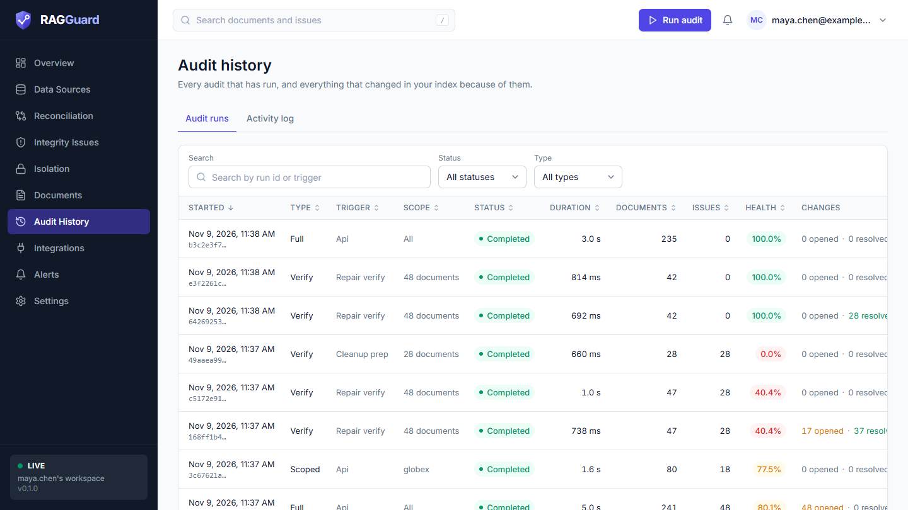
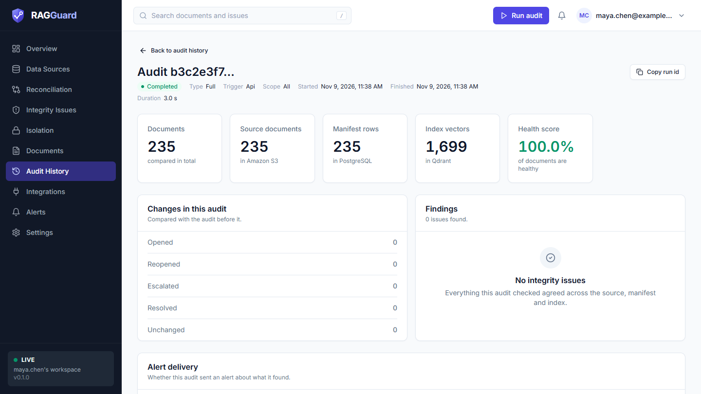
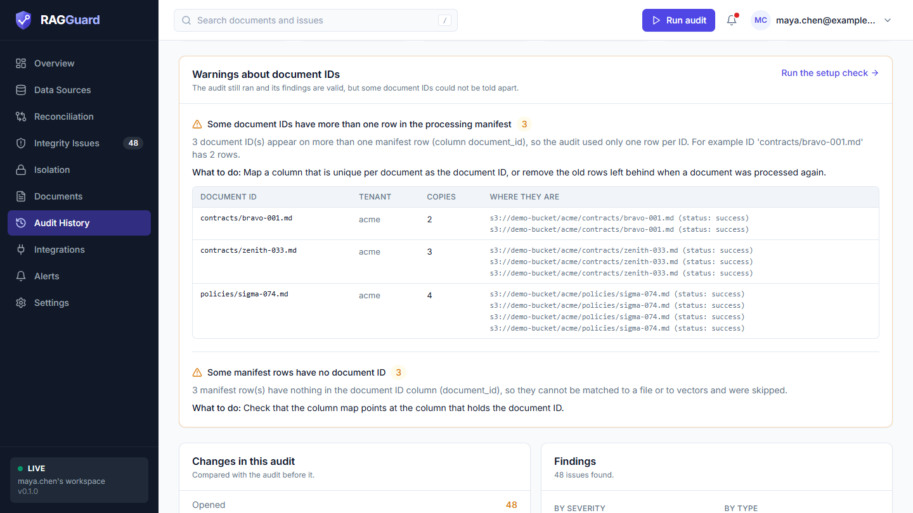
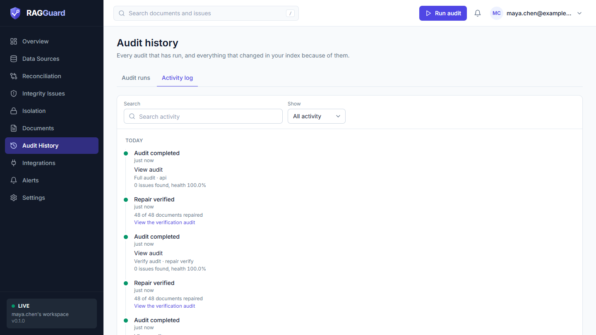

# Audit history

Audit history is RAGGuard's record of everything that has happened to your index. It has two tabs. **Audit runs** lists every audit that has ever run, with its type, trigger, scope, status, duration, results and what changed. **Activity log** is one timeline of every issue event, repair event and audit. Click an audit to see its own page: the statistics, what changed, the findings by severity and type, whether an alert went out, the reason it failed if it did, and exactly which issues it opened and resolved. This chapter explains every column, filter, number and message on these pages.

**On this page**

- [Purpose, audience and how to open it](#purpose-audience-and-how-to-open-it)
- [The page at a glance](#the-page-at-a-glance)
- [Step-by-step tasks](#step-by-step-tasks)
- [The Audit runs tab](#the-audit-runs-tab)
  - [Search and filters](#search-and-filters)
  - [The columns](#the-columns)
  - [Types and triggers](#types-and-triggers)
  - [Sorting, paging and opening a run](#sorting-paging-and-opening-a-run)
- [The run detail page](#the-run-detail-page)
  - [The header](#the-header)
  - [The running and failed notices](#the-running-and-failed-notices)
  - [The statistics tiles](#the-statistics-tiles)
  - [Warnings about document IDs](#warnings-about-document-ids)
  - [Changes in this audit](#changes-in-this-audit)
  - [Findings](#findings)
  - [Alert delivery](#alert-delivery)
  - [New in this run and Resolved in this run](#new-in-this-run-and-resolved-in-this-run)
  - [Why an audit fails](#why-an-audit-fails)
- [The Activity log tab](#the-activity-log-tab)
  - [Search and filter](#search-and-filter)
  - [How the log is laid out](#how-the-log-is-laid-out)
  - [Issue events](#issue-events)
  - [Repair events](#repair-events)
  - [Audit events](#audit-events)
  - [How rows link elsewhere](#how-rows-link-elsewhere)
- [States you may see](#states-you-may-see)
- [Tips and common mistakes](#tips-and-common-mistakes)
- [Related chapters](#related-chapters)

---

## Purpose, audience and how to open it

**Purpose.** To answer "what ran, what did it find, and what changed?" It is the audit trail for your index: you can prove when a problem appeared, when it was resolved, and which audit checked a repair.

**Who needs it.** Engineers investigating a failed audit or a sudden change, and team leads who want evidence of what happened and when.

**How to open it.** Choose **Audit History** in the sidebar (the page title reads "Audit history"), or click **Last audit** on the [Overview](05-overview.md), or use a **View audit** link from anywhere. The page title carries the line "Every audit that has run, and everything that changed in your index because of them."

---

## The page at a glance

| Part | What it is |
|---|---|
| Tab **Audit runs** | A table of every audit, newest first, with search and two filters. |
| Tab **Activity log** | A timeline of issue, repair and audit events, with search and one filter. |
| Run detail page (`/audit-history/<run id>`) | Everything about one audit. Open it by clicking a row of the table. |

*The Audit runs tab: search and filters on top, then one row per audit with its type, trigger, scope, status, duration, documents, issues, health and changes.*

The selected tab, the filters and the search words are kept in the address bar (for example `?tab=activity&kind=repair`), so you can share a filtered view. Switching tabs starts the new tab's filters from scratch.

---

## Step-by-step tasks

### Find out why an audit failed

1. Open **Audit History**. In **Status** choose **Failed**.
2. Click the run. A red panel titled **This audit failed** shows the reason.
3. Compare the reason with [Why an audit fails](#why-an-audit-fails), then fix the cause on **Data Sources** or in your own systems.
4. Press **Run audit** again.

### See what an audit changed

1. Click the audit's row.
2. Read **Changes in this audit** for the five counts.
3. Read the **New in this run** and **Resolved in this run** tables for the names of the issues.

### Check that a repair was verified

1. Open the **Activity log** tab and set **Show** to **Repairs**.
2. Find **Repair verified** for your plan. It says how many documents are repaired.
3. Click **View the verification audit** to open the audit that checked the real index.

### Find the audits for one tenant

1. In **Audit runs**, type the tenant's name in **Search**. It matches the tenant in a run's scope.
2. Or set **Type** to **Scoped** to see every audit that covered only part of your data.

### Share an audit

Copy the address from the browser, or press **Copy run id** on the audit's page and send the id. The person must be signed in to the same workspace, because audits belong to one workspace.

---

## The Audit runs tab

### Search and filters

| Control | What it does |
|---|---|
| **Search** (placeholder "Search by run id or trigger") | Narrows the table as you type. It matches any part of the full run id, the trigger, the type and the tenant name in the scope. The table updates after you stop typing for a moment. A small cross clears the box. |
| **Status** | **All statuses**, **Running**, **Completed** or **Failed**. |
| **Type** | **All types**, **Full**, **Scoped** or **Verify**. |
| **Clear filters** | Appears when any filter or search is active. Resets all three. |

Filters apply to the 100 most recent audits that the page loads. If you have more than that, the note "Showing the 100 most recent audits." appears under the table.

### The columns

| Column | What it shows | How to read it |
|---|---|---|
| **Started** | The date and time the audit began, in your browser's time zone, for example "Nov 9, 2026, 08:15 PM". Under it, the first 8 characters of the run id, followed by an ellipsis, in a small monospace font. Hover over it to see the full id. | The id is how you refer to one audit. |
| **Type** | **Full**, **Scoped** or **Verify**. | See [Types and triggers](#types-and-triggers). |
| **Trigger** | What started the audit, for example **Api** or **Schedule**. | See [Types and triggers](#types-and-triggers). |
| **Scope** | The tenant's name, or the number of documents (for example "3 documents" or "1 document"), or **All**. | **All** means the whole workspace. |
| **Status** | A coloured badge: **Running** (blue), **Completed** (green) or **Failed** (red). | A failed audit has a reason on its page. |
| **Duration** | How long the audit took, for example `850 ms`, `3.2 s` or `2m 5s`. A dash when not recorded. | Compare it with other full audits to spot slowdowns. |
| **Documents** | How many documents this audit compared. A dash for a running or failed audit. | For a scoped audit this is only the documents in its scope. |
| **Issues** | How many findings this audit reported (all severities, new or old), not how many are open now. A dash when not recorded. | This is the number of "issues found" in that run. |
| **Health** | That audit's own health score as a coloured badge: green at 90% or more, amber at 70% up to 90%, red below 70%. A dash when not recorded. | See [Concepts: health score](02-concepts.md#health-score). |
| **Changes** | "N opened" and "M resolved", separated by a dot. "opened" is amber when above zero, "resolved" is green when above zero. A dash when the audit recorded no changes. | A quick view of whether the audit made things better or worse. |

### Types and triggers

**Type** says how much of your data the audit covered. See [Concepts: audit](02-concepts.md#audit).

| Type | Covers | Started by |
|---|---|---|
| **Full** | Every document in the workspace | Your **Run audit** or **Run full audit** button, a script, or a schedule |
| **Scoped** | One tenant, or a list of documents | **Scoped audit** on [Reconciliation](06-reconciliation.md), or **Re-audit document** in a document's panel |
| **Verify** | The documents of one repair plan | RAGGuard itself, when it checks a repair ([Repair plans](08-repair-plans.md)) |

**Trigger** says what asked for the audit. The interface shows the trigger's name with a capital first letter and spaces instead of hyphens.

| Trigger shown | What started it |
|---|---|
| **Api** | A button in the web interface, or a script that uses an API key. The web interface starts audits through the same call that scripts use, so a run you start with **Run audit** also reads **Api**. |
| **Schedule** | The built-in schedule of a single-user server. |
| **Cli** | The `ragi audit` command-line tool. |
| **Bootstrap** | The first audit that a demo server runs by itself when it starts. |
| **Repair verify** | RAGGuard checking a repair plan, after you pressed **Verify now** or your worker called back. |
| **Cleanup prep** | RAGGuard recalculating the vectors to remove, just before it sends a cleanup request. |

### Sorting, paging and opening a run

- Click a column heading to sort by it. Click again to reverse the order. All columns sort except **Changes**. The table starts sorted by **Started**, newest first.
- The footer shows "Showing 1 to 25 of N", a **Rows** choice (10, 25, 50 or 100; 25 to start) and **Previous page** and **Next page** buttons with "Page X of Y".
- Click anywhere on a row to open that audit's page. With the keyboard, `Tab` to a row and press **Enter** or **Space**.

---

## The run detail page

Click a row to open `/audit-history/<run id>`. A **Back to audit history** link takes you back to the list.

### The header

The page title is "Audit" followed by the first 8 characters of the run id and an ellipsis. Under it, on one line:

| Item | Meaning |
|---|---|
| Status badge | **Running**, **Completed** or **Failed**. |
| **Type** | **Full**, **Scoped** or **Verify**. |
| **Trigger** | What started it. |
| **Scope** | The tenant, the number of documents, or **All**. |
| **Started** | Date and time it began. |
| **Finished** | Date and time it ended. Missing while it runs. |
| **Duration** | How long it took. Missing when not recorded. |

At the right, the **Copy run id** button copies the full id. A notice "Copied to clipboard" confirms it, and the button briefly reads **Copied**.

*One audit's page: the header, the statistics tiles, the changes and findings cards, and the tables of issues it opened and resolved.*

### The running and failed notices

- **While it runs**, a blue notice says "This audit is still running. It started 3 min ago, and this page updates when it finishes." The page refreshes itself every 3 seconds. The two issue tables are hidden until it finishes.
- **If it failed**, a red panel headed **This audit failed** shows the reason. If the run recorded no reason it says "The audit stopped without recording a reason." See [Why an audit fails](#why-an-audit-fails).

### The statistics tiles

Up to six tiles appear, only for numbers the audit recorded. A running or failed audit usually has none.

| Tile | Line under the number | What it counts |
|---|---|---|
| **Documents** | compared in total | Every document the audit compared: those in S3, in the manifest or with vectors. |
| **Source documents** | in Amazon S3 | Files RAGGuard found in S3 that match your key pattern, after files that share one document id are merged. A warning under the tiles says when that happened. |
| **Manifest rows** | in PostgreSQL | Rows read from your manifest table, merged in the same way. |
| **Index vectors** | in Qdrant | Vectors scanned in the index. Each document is split into chunks, so this is normally larger than the number of documents. |
| **Retrieval probes** | queries sent to the index | How many search probes the audit sent to check whether bad content can be returned ([Concepts: retrieval probe](02-concepts.md#retrieval-probe)). Present only when probing ran. |
| **Health score** | of documents are healthy | This audit's own score. Its number is coloured: green at 90% or more, amber at 70% up to 90%, red below. |

For a scoped audit, every count covers only that scope.

### Warnings about document IDs

*An audit that saw ambiguous IDs: the amber card under the statistics tiles, with example IDs and where their copies are.*

This card appears only when the audit recorded warnings. Most audits have none, and older audits (recorded before this existed) show nothing. It is amber because the audit still ran and **its findings are valid**: it could only follow one item for each ID, and the card tells you what it did not see. The top line is "The audit still ran and its findings are valid, but some document IDs could not be told apart." and, at the right, a link **Run the setup check** ([The Setup check](04-data-sources.md#the-setup-check)).

Each warning has a title with a count, a sentence with the real numbers, **What to do**, and, when IDs are involved, a table of up to five examples:

| Column | Meaning |
|---|---|
| **Document ID** | The ID that is shared |
| **Tenant** | Its tenant |
| **Copies** | How many files or rows carry it |
| **Where they are** | The S3 files, or the manifest rows (with their source address), that carry it |

The three warnings:

| Title | What happened | What the audit did |
|---|---|---|
| **Some document IDs belong to more than one file in S3** | Two files got the same ID. A common cause is a key pattern that captures only the file name when the same name exists in two folders | Looked at one file per ID. The others were not checked |
| **Some document IDs have more than one row in the processing manifest** | The manifest has several rows for one ID, often old rows left behind when a document was processed again | Used one row per ID |
| **Some manifest rows have no document ID** | The column mapped as the document ID is empty on those rows | Skipped them. They cannot be matched to a file or to vectors |

With **Only audit documents found in the source (S3)** on, duplicates among manifest rows for documents that are not in S3 are ignored, as those rows are. The same warnings are in the audit's statistics in the API (`stats.warnings`, an empty list when all is well).

### Changes in this audit

A card titled **Changes in this audit** with the line "Compared with the audit before it." Five rows:

| Row | Meaning |
|---|---|
| **Opened** | Issues found for the first time. |
| **Reopened** | Issues that had been resolved and came back. |
| **Escalated** | Open issues that became more severe in this audit. |
| **Resolved** | Issues that were open and are no longer found. |
| **Unchanged** | Issues that were already open and were found again. This also counts an issue whose severity changed. |

**Opened**, **Reopened** and **Escalated** are amber when above zero, **Resolved** is green when above zero, and everything at zero is grey. The comparison is with what RAGGuard already knew from earlier audits. A scoped audit can only change issues inside its own scope. See [Concepts: issue lifecycle](02-concepts.md#issue-lifecycle).

### Findings

A card titled **Findings**. Its line reads "N issues found" (or "1 issue found"), followed by " for tenant X" when the audit was limited to a tenant.

- If the number is zero the card shows **No integrity issues**: "Everything this audit checked agreed across the source, manifest and index."
- Otherwise two lists sit side by side:
  - **By severity**: a badge and a count for each severity that has findings.
  - **By type**: each issue type with its count, most first. Click one to open **Integrity Issues** filtered to that type.

### Alert delivery

A card titled **Alert delivery**, with the line "Whether this audit sent an alert about what it found." It appears only when the audit recorded an alert result.

| Field | Meaning |
|---|---|
| **Alerts sent** | How many alert messages went out. It is 0 or 1: one message carries all the issues. |
| **Issues included** | How many issues the message listed. Shown when a message was sent. |
| **Reason** | Why nothing was sent. For example "No new issues at or above the alert threshold", or "No RAGI ALERT WEBHOOK URL configured" when no alert webhook is saved. |
| **Delivery failed: ...** (red) | The webhook did not accept the message. The error follows, with the webhook address replaced by `<webhook>` (see [Alerts](13-alerts.md#outcomes-and-the-text-in-detail)). A failed delivery never fails the audit. |

Alerts cover only new, reopened or escalated issues at or above your minimum severity, so a quiet run with the reason "No new issues at or above the alert threshold" is normal. Set the webhook and threshold on [Alerts](13-alerts.md).

### New in this run and Resolved in this run

Two tables list the issues by name. They are hidden while the audit is still running.

| Table | Line | Lists |
|---|---|---|
| **New in this run** | "Issues this audit found for the first time." | Issues whose first audit was this one. |
| **Resolved in this run** | "Issues that were open before and that this audit no longer found." | Issues this audit resolved. |

Both have the same columns:

| Column | Shows |
|---|---|
| **Severity** | The issue's current severity badge. |
| **Issue** | Its title, and under it the issue type. |
| **Document** | The document's file name, or "Whole tenant" for a whole-collection issue. Hover for the full id. |
| **Tenant** | The tenant. |
| **Now** | The issue's status today (**Open**, **Resolved** or **Ignored**), which may differ from what it was when the audit ran. |

The tables sort by severity, worst first, show 10 rows a page and have the same page controls as other tables. Click a row to open the issue's panel. If you have more than 500 issues in total, a note "Based on the first N of M issues." warns that the tables were built from the first 500, so a very old audit may not list all its issues.

When there is nothing to list, you read **No new issues** ("This audit did not open any issue that was not already known.") or **Nothing resolved** ("This audit did not close any issue.").

Two things these tables do not show:

- **Reopened** and **escalated** issues are counted under **Changes in this audit** but are not listed, because they were not first found or resolved by this audit.
- If an audit resolved an issue and a later audit reopened it, the issue no longer appears under **Resolved in this run** of the earlier audit.

### Why an audit fails

A failed audit always records a reason. These are the kinds you may see:

| Reason | Meaning | What to do |
|---|---|---|
| A message about S3, such as "Could not connect to the S3 endpoint...", "Access denied: the key needs s3:ListBucket on the bucket and s3:GetObject on its objects..." or "The secret access key is wrong, or the region does not match the bucket." | RAGGuard could not read your bucket. | Open **Data Sources**, press **Test** on the Amazon S3 card and fix what it says. |
| A message about the manifest, such as "Authentication failed: check the user name and password in the connection string." or "Connection timed out...". | RAGGuard could not read your database. | Test the PostgreSQL card. |
| A message about Qdrant, such as "Qdrant rejected the API key (a read-capable key is required)." or "Qdrant timed out. Check the URL and port...". | RAGGuard could not read your index. | Test the Qdrant card. For very large collections, ask the cluster owner for a keyword index on the document id field. |
| "The audit ran out of time while reading the vector index (after N items). This corpus is too large to audit in one go here: audit one tenant at a time, narrow the source (for example the S3 key prefix), or run `ragi audit` on a machine without a request time limit." The part after "reading" names the step: the source bucket, the processing manifest, the chunk manifest or the vector index. | The audit used its time budget (270 seconds on serverless hosting). | Audit one tenant at a time with **Scoped audit**, narrow the **Key prefix**, or turn on **Look up files from the manifest**. |
| "abandoned: the process running it stopped (last step: reading the vector index (Qdrant), 41.0 s in)" | The server was stopped before the audit could record its result, for example a serverless function that was cut off. The text names the last step it reached: listing the source documents (S3), reading the processing manifest, looking up the files the manifest names (S3), reading the vector index (Qdrant), or comparing the three lists. RAGGuard marks such a run failed automatically after a while so it cannot keep **Run audit** disabled. | Run the audit again. If it repeats at the same step, narrow the scope as above. |
| An error name followed by a message, such as "ValueError: ...". | Something unexpected. The text names the kind of error and what it said. | Check the settings you changed most recently, then see [Troubleshooting](18-troubleshooting.md). |

---

## The Activity log tab

*The Activity log tab: events grouped by day, each with a coloured dot, a label, a time and its details.*

The **Activity log** tab merges three sources into one timeline, newest first:

- **Issue events**: an issue opened, reopened, resolved, ignored and so on.
- **Repair events**: a plan created, sent to your worker, verified and so on.
- **Audits**: each audit that finished or failed.

It shows the 200 most recent events. Audits that are still running are not listed until they end.

### Search and filter

| Control | What it does |
|---|---|
| **Search** (placeholder "Search activity") | Matches the event's label and its details: for issues the title, document id, tenant, issue id, type and run id; for repairs the word "repair", the event and the plan id; for audits the kind, trigger, run id, tenant and error. For example, search `failed` to find failed audits. |
| **Show** | **All activity**, **Issues**, **Repairs** or **Audits**. |
| **Clear filters** | Appears when a filter or search is active. |

### How the log is laid out

- Events are grouped under a heading for each day: **Today**, **Yesterday**, or a full date such as "Monday, November 9, 2026".
- Each event has a coloured dot, a bold label, how long ago it happened (hover for the exact date and time) and, underneath, its details. Issue events also show the issue's severity badge.
- The page shows 50 events at first. **Show more** adds 50 more.
- The footer says "Showing X of Y" for the events that match your filters, with "(the 200 most recent events)" added when the list is at its limit.

### Issue events

| Label | Dot colour | Meaning | Details line |
|---|---|---|---|
| **Issue opened** | Amber | An audit found the issue for the first time. | |
| **Issue reopened** | Amber | A resolved issue came back. | |
| **Issue escalated** | Red | The interface can show this label, but the product currently records a rise in severity as **Severity changed**, so you will normally see that label instead. | |
| **Severity changed** | Blue | The severity went up or down. | "From medium to high" |
| **Issue resolved** | Green | An audit no longer found the issue. | |
| **Issue ignored** | Grey | You ignored the issue. | "Reason: ..." when you gave one |
| **Issue unignored** | Blue | You reopened an ignored issue. | |

Every issue event shows the issue's title as a link, and a line with the document's file name, the tenant and the issue type, separated by dots.

### Repair events

| Label | Dot colour | Meaning | Details line |
|---|---|---|---|
| **Repair plan created** | Blue | You created a plan. | "N documents, M issues" |
| **Re-index requested** | Blue | The plan was sent to your worker. | "N documents sent to your worker" |
| **Repair verified** | Green when the plan completed or only cleanup remains, amber when some documents still fail, red when the repair failed | RAGGuard checked the real index. | "X of Y documents repaired" and ", Z failed" when some did; link **View the verification audit** |
| **Vector cleanup requested** | Blue | After your approval, the removal list was sent to your worker. | "N vectors to remove across M documents" |
| **Worker callback received** | Grey | Your worker reported back that it finished. | |

Repair events carry no link to the plan itself. Find plans in the **Repair plans** tab of **Integrity Issues** ([Repair plans](08-repair-plans.md)).

### Audit events

| Label | Dot colour | Meaning | Details lines |
|---|---|---|---|
| **Audit completed** | Green | An audit finished. | The kind and trigger, such as "Full audit · api", with "· tenant X" for a tenant audit; then "N issues found, health 96.0%" |
| **Audit failed** | Red | An audit failed. | The kind and trigger, then the error in red |

Every audit event has a link **View audit** that opens the audit's page. Verify audits that RAGGuard runs for a repair appear here too, for example "Verify audit · repair verify".

### How rows link elsewhere

| Event | What you can click |
|---|---|
| Issue event | The issue's title opens its panel on **Integrity Issues**. |
| Audit event | **View audit** opens that audit's page. |
| **Repair verified** | **View the verification audit** opens the verifying audit's page. |
| Other repair events | Nothing: they are information. |

---

## States you may see

| Where | State | What you see |
|---|---|---|
| Whole page | Not connected yet (hosted) | **No audits yet**: "Connect your S3 source, PostgreSQL manifest and Qdrant index, then run your first audit. Every audit is recorded here." with a **Go to Data Sources** button. The tabs are hidden. |
| Audit runs | Loading | A table of grey placeholder rows. |
| Audit runs | No audits | **No audits yet**: "Run your first audit to compare your source, manifest and index. Every audit is recorded here." with a **Go to Reconciliation** button. |
| Audit runs | Filters match nothing | **No audits match**: "Try a different search or clear the filters." |
| Audit runs | Error | "We couldn't load this", the reason, and **Try again**. |
| Activity log | Loading | Placeholder lines. |
| Activity log | No events | **No activity yet**: "Issues found, repairs requested and audits that ran are listed here as they happen." |
| Activity log | Filters match nothing | **No activity matches**: "Try a different search or clear the filters." |
| Run page | Loading | Grey placeholder tiles. |
| Run page | Unknown id | **Audit not found**: "No audit has this id. It may belong to another workspace, or the link may be wrong." with **Back to audit history**. |
| Run page | Other error | "We couldn't load this" with **Try again**. |

---

## Tips and common mistakes

- **Every audit I started from the interface says "Api".** That is how the interface works: it calls the same service as scripts. It does not mean a script ran it.
- **The "Issues" column is not my open-issue count.** It is how many findings that audit reported. The open count is on the Overview and in the sidebar badge.
- **A scoped audit's health score looks very different from the full audit's.** Its score covers only its own documents, and a run that compared no documents scores 100.0%. Do not compare it with a full audit's score.
- **An audit is stuck on Running.** RAGGuard retires a run whose process died after a while (the audit's time budget plus a short margin, or 15 minutes where no budget applies) and marks it failed with the step it reached. Refresh the page after that time.
- **I cannot find an issue under "New in this run".** Only issues first found by that audit are listed. A reopened or escalated issue is counted in **Changes in this audit** but not listed.
- **The Activity log stops at 200 events.** Older events are still on each issue's own timeline.
- **Audits from my colleagues are missing.** Audits belong to a workspace. Each account has its own workspace, so you only see your own.

---

## Related chapters

- [Overview](05-overview.md): the **Last audit** card and the trend chart
- [Reconciliation](06-reconciliation.md): start full and scoped audits
- [Integrity issues](07-integrity-issues.md): the issues the tables here point to
- [Repair plans](08-repair-plans.md): the repair events in the activity log
- [Alerts](13-alerts.md): what the **Alert delivery** card reports
- [Concepts you need](02-concepts.md): audit kinds, issue lifecycle and health score
- [Troubleshooting](18-troubleshooting.md): what to do about a failed audit
