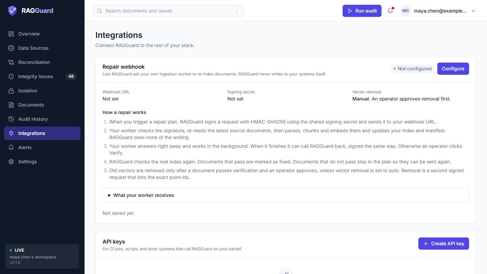
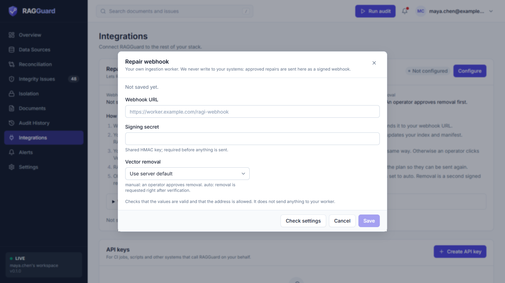
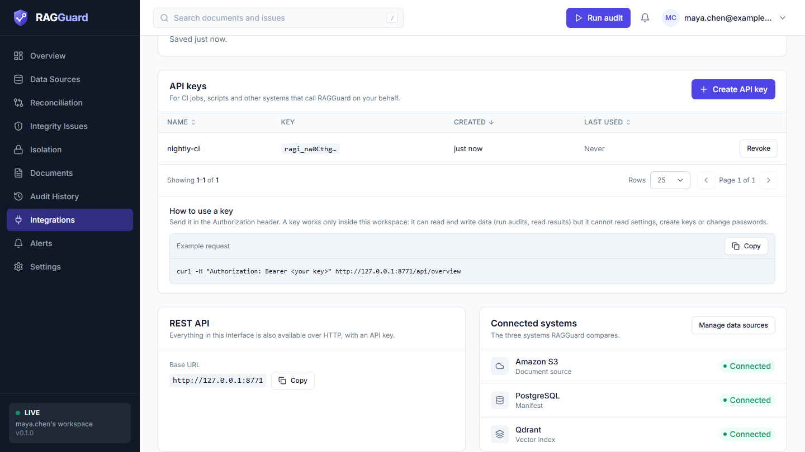
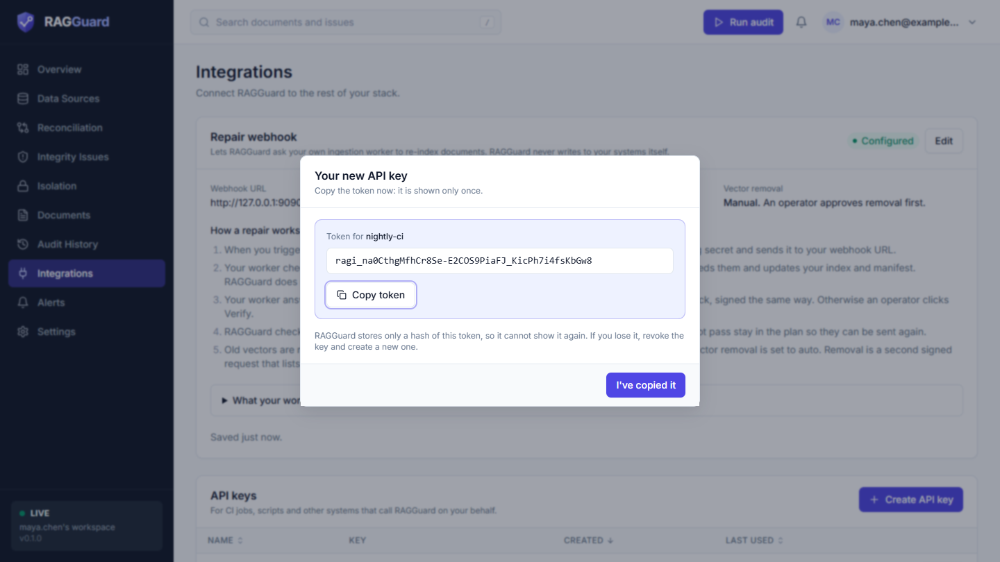
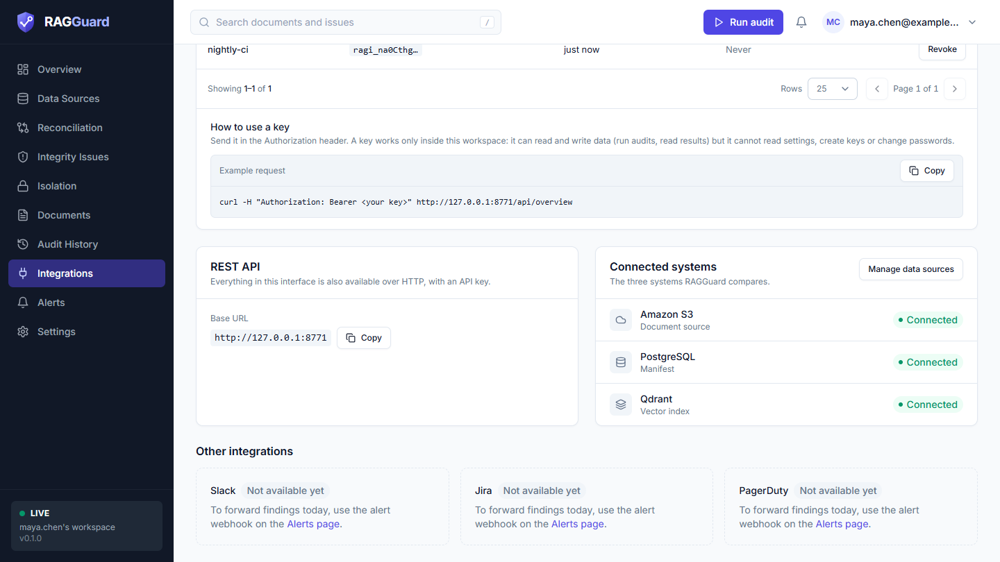

# Integrations

The Integrations page connects RAGGuard to the rest of your stack. It holds the **Repair webhook** (how RAGGuard asks your own ingestion worker to re-index documents, because RAGGuard never writes to your systems itself), **API keys** (so scripts and CI jobs can start audits and read results), the **REST API** address, a small **Connected systems** summary, and a row of integrations that do not exist yet. This chapter explains each card, every field and every button, the exact format of the signed requests your worker receives, and how to call RAGGuard with an API key.

**On this page**

- [Purpose, who needs it, how to open it](#purpose-who-needs-it-how-to-open-it)
- [The page at a glance](#the-page-at-a-glance)
- [Repair webhook](#repair-webhook)
- [API keys](#api-keys)
- [REST API card](#rest-api-card)
- [Connected systems card](#connected-systems-card)
- [Other integrations: not available yet](#other-integrations-not-available-yet)
- [Single-user mode](#single-user-mode)
- [States you may see](#states-you-may-see)
- [Tips and common mistakes](#tips-and-common-mistakes)
- [Related chapters](#related-chapters)

---

## Purpose, who needs it, how to open it

**Purpose.** Two jobs. First, let RAGGuard hand repair work to **your** worker (the program in your pipeline that reads documents, creates embeddings and writes to Qdrant). Second, let machines, such as a nightly job, call RAGGuard without a person signing in.

**Who needs it.** Someone who runs the ingestion pipeline (for the repair webhook) and someone who automates things (for API keys). You can use RAGGuard for finding problems without touching this page. You need it when you want to **repair** (see [Repair plans](08-repair-plans.md)) or to schedule audits.

**How to open it.** Choose **Integrations** in the left menu. The page header reads "Connect RAGGuard to the rest of your stack."

---

## The page at a glance

From top to bottom:

1. **Repair webhook** card.
2. **API keys** card.
3. Two cards side by side on a wide screen: **REST API** and **Connected systems**.
4. **Other integrations**: three dashed cards (Slack, Jira, PagerDuty), each marked **Not available yet**.



*The top of the Integrations page: the Repair webhook card.*

---

## Repair webhook

### What it is for

RAGGuard is read-only by design. When you ask it to repair a problem, it does not change your index. Instead it sends a **signed request** (a *webhook*: a message sent from one program to a web address of another) to a web address you provide. The program at that address is **your worker**. Your worker does the actual re-indexing, and RAGGuard then checks the real index to see whether it worked. You decide, in the settings, whether deleting old vectors needs a human to approve.

You only need this card if you want to use **Trigger repair** in a repair plan. Without it you can still see problems, create plans and copy a plan's payload to run elsewhere (see [Repair plans](08-repair-plans.md)).

### The card, element by element

| Element | What it shows | How to read it |
|---|---|---|
| **Title** | "Repair webhook", with the line "Lets RAGGuard ask your own ingestion worker to re-index documents. RAGGuard never writes to your systems itself." | |
| **Badge** | **Configured** (green) or **Not configured** (grey) | **Configured** means you have saved at least one value in the group. It does not prove the worker works. A group with only **Vector removal** saved also counts as configured |
| **Configure / Edit** button | **Configure** (blue) before the first save, **Edit** afterwards | Opens the dialog |
| **Webhook URL** | The saved address, or "Not set" | The address of your worker. Not a secret, so it is shown |
| **Signing secret** | **Saved** (green) or "Not set" | Whether a secret is stored. The secret itself is never shown |
| **Vector removal** | "Manual. An operator approves removal first." or "Automatic. Removal is requested right after a document passes verification." | The removal policy (see below) |
| **Warning** (amber) | "A signing secret is required before anything is sent. Open Edit and add one." | Shown when a URL is saved but no signing secret is |
| **How a repair works** | A numbered list of five steps | Explained below |
| **What your worker receives** | A collapsible panel | The headers, the two request bodies and a signature check. Explained below |
| **Saved line** | "Saved 3 h ago." or "Not saved yet." | When the group was last saved. No test history is kept for this group |

### Set it up

1. Build or deploy a worker that can receive a POST request, check its signature, re-index the documents it is told about and answer quickly. The product's source code includes a runnable example, `examples/reference_worker/worker.py`.
2. Press **Configure** (or **Edit**).
3. Enter the worker's address in **Webhook URL**.
4. Enter a long random string in **Signing secret** and put the **same** string into your worker's configuration.
5. Choose **Vector removal** (see below).
6. Press **Check settings**. A green "Test passed" with the line "Settings: valid" means the values are acceptable and the address is allowed. It sends **nothing** to your worker.
7. Press **Save**. A message "Repair worker saved" appears.



*The Repair webhook dialog. Below the form a note says that checking does not send anything to your worker.*

### The dialog and its buttons

The dialog is titled **Repair webhook**, with the description "Your own ingestion worker. We never write to your systems: approved repairs are sent here as a signed webhook." The saved line at the top says only "Saved ..." or "Not saved yet." because this group has no connection test history. A note under the fields reads "Checks that the values are valid and that the address is allowed. It does not send anything to your worker."

| Button | What it does |
|---|---|
| **Check settings** | Validates what you typed and checks that the address is a public one. Sends no request to your worker. The result panel shows **Test passed** and a line "Settings: valid", or the reason it failed. If you have saved nothing and typed nothing it says "Nothing to check yet. Fill in a field first." |
| **Cancel** | Closes the dialog and discards what you typed |
| **Save** | Stores the changed fields. Greyed out until something changed |

The shared form controls (required markers, secret boxes, **Remove saved value**, inline errors) work as described in [Connect your data sources](04-data-sources.md#the-configure-dialog-every-control).

### The fields

| Label | Required | Secret | Default | Example |
|---|---|---|---|---|
| **Webhook URL** | No | No | None | `https://worker.example.com/ragi-webhook` |
| **Signing secret** | No (but required before anything is sent) | Yes | None | a long random string, for example 40 or more characters |
| **Vector removal** | No | No | `manual` (shown as **Use server default**) | `manual` |

**Webhook URL**
- *What it is:* the web address of your worker's endpoint, which must accept `POST` requests with a JSON body.
- *What it changes:* where signed repair and removal requests are sent. With no address, **Trigger repair** fails with a message that no repair webhook is configured, and the plan panel offers a link back to this page.
- *Rules:* it must start with `https://` or `http://`, must not contain a user name or password, and must be a public address (see [public addresses](04-data-sources.md#hosted-mode-accepts-public-addresses-only)). A server that is on your office network is refused.
- *Common mistakes:* a `localhost` or private address; an address that needs you to log in first; putting the secret in the address; saving an address but no secret (nothing will be sent).

**Signing secret** (secret)
- *What it is:* a shared password for both sides. RAGGuard uses it to sign every request so your worker can prove the request really came from RAGGuard. It also checks the signature on your worker's completion callback.
- *What it changes:* without it, **nothing is sent**, and the request does not include a callback address. It is stored encrypted and never shown again. It can be removed with **Remove saved value**, but then sending stops.
- *Common mistakes:* a different value on the worker side (every request is then rejected as unsigned); changing it on one side only; reusing a secret from somewhere else.

**Vector removal** (drop-down)
- *What it is:* who decides when old vectors are deleted after a repair.
- *Choices:* **Use server default** (which means `manual`), `manual` and `auto`. See [the removal policies](#the-vector-removal-policies).

### How a repair works

The card explains it in five steps. In plain words:

1. **RAGGuard signs a request and sends it.** You trigger a repair plan. RAGGuard builds a request listing the documents to fix, signs it with HMAC-SHA256 (see [the signature](#the-signature)) using the shared secret and sends it to your **Webhook URL**.
2. **Your worker does the work.** It checks the signature, re-reads the latest source documents, parses, chunks and embeds them, and updates your index and manifest. RAGGuard writes nothing.
3. **Your worker answers right away and works in the background.** When finished it can call RAGGuard back (signed the same way). Otherwise an operator presses **Verify** in the plan.
4. **RAGGuard checks the real index again.** It re-audits the plan's documents. Documents that pass are marked as fixed. Documents that fail stay in the plan so they can be sent again.
5. **Old vectors are removed only after verification and approval.** Removal is a second signed request that lists the exact point ids to delete. It is sent only after a document passes verification **and** an operator approves, unless **Vector removal** is `auto`.

The plan statuses and the buttons (**Trigger repair**, **Verify now**, **Send repair again**, **Approve cleanup**, **View payload**) are explained in [Repair plans](08-repair-plans.md).

### What your worker receives

Open **What your worker receives** on the card to see this in the product.

**Headers** on every request:

| Header | Value |
|---|---|
| `X-Ragi-Event` | `repair.requested` for the re-index request, `cleanup.requested` for the removal request |
| `X-Ragi-Timestamp` | Unix time in seconds when the request was signed |
| `X-Ragi-Signature` | `sha256=` followed by the hex HMAC-SHA256 of the timestamp, a dot and the raw request body, using your signing secret |
| `X-Ragi-Delivery` | A unique id for this delivery. Use it to ignore repeats |

The `Content-Type` is `application/json`.

**The re-index request** (event `repair.requested`, phase `reindex`). Add or replace only. Never delete in this phase.

```json
{
  "event": "repair.requested",
  "phase": "reindex",
  "plan_id": "0b5e...",
  "created_at": "2026-11-09T10:15:00Z",
  "callback_url": "https://your-ragguard-address/api/repairs/0b5e.../callback",
  "safety": {
    "delete_policy": "never_before_verified",
    "note": "Reindex phase must only add/replace vectors. Removal is requested separately, after verification."
  },
  "target_fingerprint": { "chunking_version": "recursive-v2", "embedding_model": "my-embedding-model", "embedding_dim": 1536 },
  "items": [
    {
      "tenant_id": "acme",
      "document_id": "policies/leave.pdf",
      "source_uri": "s3://my-bucket/acme/policies/leave.pdf",
      "source_version": "...",
      "source_hash": "...",
      "expected_chunk_count": 7,
      "actions": ["reindex_full"],
      "missing_chunks": [],
      "issue_ids": ["..."]
    }
  ]
}
```

(The real body is written compactly, with its keys in alphabetical order. The example is spaced out for reading.)

| Top-level field | Meaning |
|---|---|
| `event`, `phase` | `repair.requested` and `reindex` |
| `plan_id` | The repair plan this belongs to |
| `created_at` | When the request was built |
| `callback_url` | Where to report completion. Present only when RAGGuard knows its own address and a signing secret is saved. It is the address you used to open RAGGuard, so your worker must be able to reach it |
| `safety` | A reminder that this phase must not delete anything |
| `target_fingerprint` | The expected pipeline from the Pipeline tab of Settings (parser, chunking, embedding model and so on), or an empty object if none is set |
| `items` | One entry per document to fix |

| Item field | Meaning |
|---|---|
| `tenant_id`, `document_id` | Which document |
| `source_uri`, `source_version`, `source_hash` | Where the latest source is and which version and hash it has |
| `expected_chunk_count` | How many chunks are expected |
| `actions` | What to do: `reindex_full` (process the whole document again), `reindex_chunks` (only the chunks listed in `missing_chunks` are required; a full rebuild is also fine) or `fix_metadata` (correct the manifest or payload, no re-embedding) |
| `missing_chunks` | Chunk ids (or positions) that are missing, up to 50 |
| `issue_ids` | The issues this item addresses |

Only documents that need work are included: those with at least one action whose status is planned or failed (documents that only need old vectors removed are not part of this request). Write vectors with **deterministic ids** (the same chunk always gets the same id) so a retry overwrites instead of duplicating.

**The removal request** (event `cleanup.requested`, phase `cleanup`). Sent only after verification and approval.

```json
{
  "event": "cleanup.requested",
  "phase": "cleanup",
  "plan_id": "0b5e...",
  "created_at": "2026-11-09T11:02:00Z",
  "safety": { "delete_policy": "never_before_verified", "note": "..." },
  "cleanup": [
    {
      "tenant_id": "acme",
      "document_id": "policies/old-leave.pdf",
      "collection": "kb_main",
      "reason": "orphan_vector",
      "point_ids": ["...", "..."]
    }
  ]
}
```

Each `cleanup` entry names the document, the Qdrant collection, a `reason` (`superseded_active`, `duplicate_chunk`, `orphan_vector` or `tenant_mismatch`) and the **exact point ids** to delete. RAGGuard works the list out again from the live index at the moment you approve, and one entry carries at most 5,000 point ids. For a document that no longer exists, also retire its manifest rows in your own system, or the next audit reports a "manifest orphan".

### The signature

RAGGuard builds the signature like this:

1. Take the request body exactly as sent (the raw bytes).
2. Put the timestamp, a dot and the body together: `<timestamp>.<body>`.
3. Compute HMAC-SHA256 of that with your signing secret as the key, as lowercase hex.
4. Send `sha256=<hex>` in `X-Ragi-Signature`.

Your worker must repeat this on the **raw bytes it received** (do not parse and re-serialise the JSON first), compare in constant time, and reject a timestamp older than about 5 minutes (300 seconds) to stop replays. The card shows this check:

```python
import hmac, hashlib, time

def verify(secret, timestamp, signature, raw_body: bytes) -> bool:
    if abs(time.time() - float(timestamp)) > 300:  # reject anything older than about 5 minutes
        return False
    mac = hmac.new(secret.encode(), timestamp.encode() + b"." + raw_body, hashlib.sha256).hexdigest()
    return hmac.compare_digest("sha256=" + mac, signature)
```

**Your answer.** Respond with a `2xx` status quickly (RAGGuard waits up to 30 seconds) and do the work in the background. A JSON answer is stored in the plan's history; anything else is recorded as accepted. A non-2xx status or a timeout is a failed delivery: RAGGuard shows "Repair webhook delivery failed: ..." and the plan keeps its status so you can try again.

**Your completion callback (optional).** When finished, post to `callback_url`, signed the same way: send `X-Ragi-Timestamp` and `X-Ragi-Signature` computed over the body you send, with the same secret. RAGGuard checks the signature (a wrong one gets "Invalid callback signature."), notes the callback in the plan's history and starts verification immediately. No login is needed for this call.

### The vector removal policies

The **Vector removal** drop-down has three entries. The setting decides what happens **after** replacements have been verified.

| Entry | In plain words |
|---|---|
| **Use server default** | You have not chosen. The product's default applies, which is `manual` |
| `manual` | An operator must press **Approve cleanup** in the plan panel before RAGGuard asks your worker to delete anything. Safest. The card shows "Manual. An operator approves removal first." |
| `auto` | RAGGuard requests removal automatically right after a plan's documents pass verification, with no one pressing a button. Use it only when you trust your worker and can recover deleted vectors. The card shows "Automatic. Removal is requested right after a document passes verification." |

Whatever you choose: deletion is always carried out by **your** worker, never by RAGGuard; the re-index request never deletes; and removal is requested only for documents that passed verification.

### What can go wrong

| Message | Meaning and what to do |
|---|---|
| "No repair webhook configured. ..." (it mentions environment variable names) | No **Webhook URL** is saved. Press **Configure** on this page |
| "... must be set before payloads are sent to a real webhook." (it mentions an environment variable name) | A URL is saved but no **Signing secret** is. Press **Edit** and add one |
| "Repair webhook delivery failed: ..." | Your worker returned an error or did not answer in 30 seconds. Check your worker's log, then press **Send repair again** in the plan |
| "Invalid callback signature." | The worker's callback was signed with a different secret or an old timestamp |
| "Webhook URL: ..." in the dialog | The address was rejected (not public, has credentials, not a URL) |

---

## API keys



*The API keys card: your keys, the Create API key button and a ready-made example request.*

### What an API key is

A key lets a program call RAGGuard on your behalf without a person signing in. Examples: a nightly job that starts an audit, or a CI pipeline that fails a build when critical issues exist. Keys belong to your workspace and work only inside it.

### The card, element by element

The header says "API keys" with the line "For CI jobs, scripts and other systems that call RAGGuard on your behalf." and a **Create API key** button.

| Column | What it shows | How to read it |
|---|---|---|
| **Name** | The name you gave the key | Name it after what will use it |
| **Key** | The first characters of the key followed by "...", for example `ragi_Ab12Cd3...` | Lets you recognise a key. The rest is not stored in readable form |
| **Created** | How long ago, for example "3 d ago" (hover for the exact date) | |
| **Last used** | How long ago a request with this key was last seen, or **Never** | Helps you find keys nobody uses. The time updates at most once every 10 minutes, so it can lag slightly |
| (no heading) **Revoke** | A red-outlined button | Deletes access immediately |

Click the **Name**, **Created** or **Last used** heading to sort. The table starts with the newest key first. When there are more rows than fit, use the paging controls under the table.

**Empty state.** With no keys you see "No API keys yet" and "Create a key to call RAGGuard from a CI job or a script." with a **Create API key** button.

Under the table, **How to use a key** says: "Send it in the Authorization header. A key works only inside this workspace: it can read and write data (run audits, read results) but it cannot read settings, create keys or change passwords." and shows a ready-to-copy example with a **Copy** button:

```
curl -H "Authorization: Bearer <your key>" https://your-ragguard-address/api/overview
```

### Create a key

1. Press **Create API key**. A dialog titled **Create API key** opens with the line "Name it after what will use it, such as a CI job or a nightly script."
2. Type a **Name** (required, up to 80 characters, for example "Nightly audit job"). If it is empty you see "Enter a name for the key."; if it is too long, "Use at most 80 characters."
3. Press **Create key** (or **Cancel**).
4. A second dialog, **Your new API key**, shows the **token** for that name and a **Copy token** button. It says "Copy the token now: it is shown only once." and "RAGGuard stores only a hash of this token, so it cannot show it again. If you lose it, revoke the key and create a new one."
5. Press **Copy token**, store it somewhere safe (a secret store, not a chat message), then press **I've copied it**.



*The token appears once, in this dialog.*

This dialog **cannot be closed** with the Escape key, by clicking outside it or with a close icon: the only way out is the **I've copied it** button, so you cannot lose the token by accident.

A token looks like `ragi_` followed by a long random string. Only a one-way hash of it is stored.

**The limit.** A workspace can have **20** keys. Beyond that, creating one shows "You can have at most 20 API keys. Revoke one first."

### Revoke a key

Press **Revoke** on the row. A confirmation, **Revoke this API key?**, shows the key's name and first characters and says "Anyone using this key loses access immediately. This cannot be undone." Press **Revoke key** to confirm (a message "API key revoked" appears) or **Cancel**. A revoked key stops working at once and disappears from the list. Revoke and replace any key you think has leaked.

### What a key can and cannot do

A key identifies your **workspace**, not a person.

- **It can** use the same data features as the web interface: start audits, list and read audits, list and read issues, ignore or reopen an issue, list and read documents, download the report, read recommendations and impact analysis, read the audit history, send retrieval logs, read connection health and the overview, and use the repair features: create a plan, preview its payload, trigger it, verify it and approve cleanup.
- **It cannot** read or change settings (connections, alerts, policy and so on), list, create or revoke API keys, or change a password. Those need a signed-in browser session, and a key gets "This action needs a signed-in session, not an API key."

Because a key can start repairs and approve the removal of old vectors (carried out by your worker), treat it like a password: store it in a secret store, give each system its own key, and revoke keys you no longer need.

### Use a key

Send the key in the `Authorization` header as a **Bearer** token. Replace the address with your own (the **REST API** card shows it).

**Read the overview:**

```bash
curl -H "Authorization: Bearer ragi_YOUR_KEY" https://your-ragguard-address/api/overview
```

The answer is JSON. It includes, for example, `documents` (document counts), `issues` (issue counts), `latest_run`, `latest_full_run`, `trend` (health after each full audit) and `audit_running`. See [Overview](05-overview.md) for what these numbers mean.

**Start an audit and wait for it to finish** (handy in CI):

```bash
curl -X POST https://your-ragguard-address/api/audits \
  -H "Authorization: Bearer ragi_YOUR_KEY" \
  -H "Content-Type: application/json" \
  -d '{"wait": true}'
```

The answer looks like `{"run_id": "...", "status": "completed", "stats": {...}}`.

**Start an audit and come back later** (no `wait`):

```bash
curl -X POST https://your-ragguard-address/api/audits \
  -H "Authorization: Bearer ragi_YOUR_KEY" \
  -H "Content-Type: application/json" \
  -d '{}'
```

The answer, with HTTP status 202, looks like `{"run_id": "...", "status": "running"}`. On servers that must finish the audit inside the request, the status is already `completed`. Read the run later:

```bash
curl -H "Authorization: Bearer ragi_YOUR_KEY" https://your-ragguard-address/api/audits/RUN_ID
```

**Audit only part of your data.** The body can also contain `"tenant": "acme"` (one tenant), `"documents": [{"tenant_id": "acme", "document_id": "policies/leave.pdf"}]` (specific documents, up to 5,000) and `"probe": true` or `false` (whether to confirm the worst findings with a live search; see [Reconciliation](06-reconciliation.md)).

**Count open critical issues** (for a CI gate):

```bash
curl -H "Authorization: Bearer ragi_YOUR_KEY" \
  "https://your-ragguard-address/api/issues?status=open&severity=critical&limit=1"
```

The answer has a `total` number and a list `items`. Fail your build when `total` is above zero.

Audits started with a key appear in [Audit history](11-audit-history.md) with the trigger `api`.

**Answers you may get**

| Status | Message | Meaning |
|---|---|---|
| 401 | "Sign in required." | The key is missing, mistyped, or revoked |
| 403 | "This action needs a signed-in session, not an API key." | You called settings, keys or password endpoints |
| 409 | "An audit is already running." | One audit at a time per workspace. Wait, then try again |
| 409 | A message that setup is incomplete | The three connections are not all saved yet |
| 504 | "The audit ran out of time while reading ..." | With `wait` set, the audit exceeded the server's time limit. Audit one tenant at a time |

Every endpoint, with who may call it, is listed in the technical reference, [GUIDE.md](../../GUIDE.md) section 9. Developers can also find the server's interactive reference at `/docs` on the same address; the interface does not link to it.

---

## REST API card

The **REST API** card says "Everything in this interface is also available over HTTP, with an API key." It shows one thing:

- **Base URL**: the address you are using right now (for example `https://your-ragguard-address`), with a **Copy** button. Put your API paths after it, and send your key as shown in the section above.



*The REST API and Connected systems cards, then the Other integrations row.*

---

## Connected systems card

The **Connected systems** card says "The three systems RAGGuard compares." and lists Amazon S3, PostgreSQL and Qdrant, each with its small label (Document source, Manifest, Vector index) and a status badge: **Connected**, **Not connected**, **Error**, **Checking** or **Status unavailable**. The badges mean exactly what they mean on the Data sources page (see [Connect your data sources](04-data-sources.md#status-badges-and-what-feeds-them)). The **Manage data sources** button opens that page.

---

## Other integrations: not available yet

Below the cards is a heading **Other integrations** with three dashed cards, **Slack**, **Jira** and **PagerDuty**. Each carries the label **Not available yet** and the text "To forward findings today, use the alert webhook on the Alerts page." There is no direct integration with any of the three. To get findings into a chat tool today, use the alert webhook (see [Alerts](13-alerts.md)). Nothing on these cards can be clicked except the link to Alerts.

---

## Single-user mode

On a server that runs for one team without accounts (live or demo mode), this page is read-only:

- The repair card shows "Configured by the server's environment variables (RAGI_*)" and says to set `RAGI_REPAIR_WEBHOOK_URL` and `RAGI_REPAIR_WEBHOOK_SECRET` (and `RAGI_CLEANUP_POLICY` for removal) on the server. Only the **Vector removal** row is shown, and there is no **Configure** button. (In demo mode a built-in demo worker stands in for a real one.)
- The **API keys** card is replaced by an **API access** card, "Single-user mode has no per-person API keys." It says either "This server requires its shared key (RAGI_API_KEY). Send it in the X-API-Key header or as a Bearer token." or "No API key is required on this server. Set RAGI_API_KEY to protect it."
- **REST API**, **Connected systems** and the three **Not available yet** cards work as described above.

---

## States you may see

| State | What you see | What to do |
|---|---|---|
| **Loading** | A tall grey placeholder where the repair card goes. Small grey bars inside the Connected systems card | Wait a moment |
| **Cannot load** | "We couldn't load this" with the reason and **Try again** | Press **Try again** |
| **No keys** | "No API keys yet" | Press **Create API key** if you need one |
| **Webhook set, no secret** | An amber note on the repair card | Press **Edit** and add a **Signing secret** |
| **Key limit reached** | "You can have at most 20 API keys. Revoke one first." | Revoke a key you do not use |

---

## Tips and common mistakes

- **Use a different key for each system.** Then you can revoke one without breaking the others, and **Last used** tells you what is active.
- **Never paste a token into a chat or a ticket.** If you did, revoke the key.
- **The signing secret must match on both sides.** If every repair fails with an authorisation error at the worker, compare the secrets first.
- **Verify the signature on the raw body.** Parsing the JSON and re-serialising it changes the bytes, and the signature will not match.
- **Answer quickly.** Respond `2xx` at once and do the work after. RAGGuard waits only 30 seconds.
- **Keep `manual` removal until you trust the flow.** Switch to `auto` only when your worker can restore deleted vectors.
- **A private worker address is refused.** Put the endpoint on a public address, secured by the signature.

---

## Related chapters

- [Repair plans](08-repair-plans.md): creating, triggering, verifying and approving repairs
- [Connect your data sources](04-data-sources.md): the three connections, the shared form controls, and public-address rules
- [Alerts](13-alerts.md): sending findings to a Slack-compatible webhook
- [Audit history](11-audit-history.md): where audits started by API keys and repair verifications appear
- [Settings](14-settings.md): the target pipeline that is sent to your worker
- [Troubleshooting](18-troubleshooting.md)
