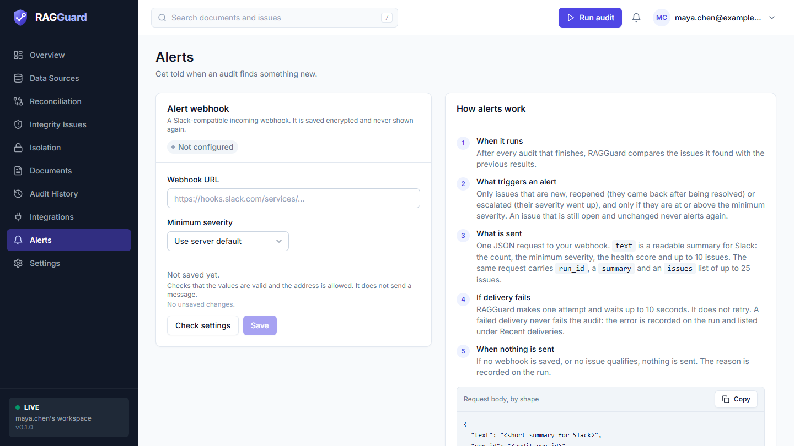
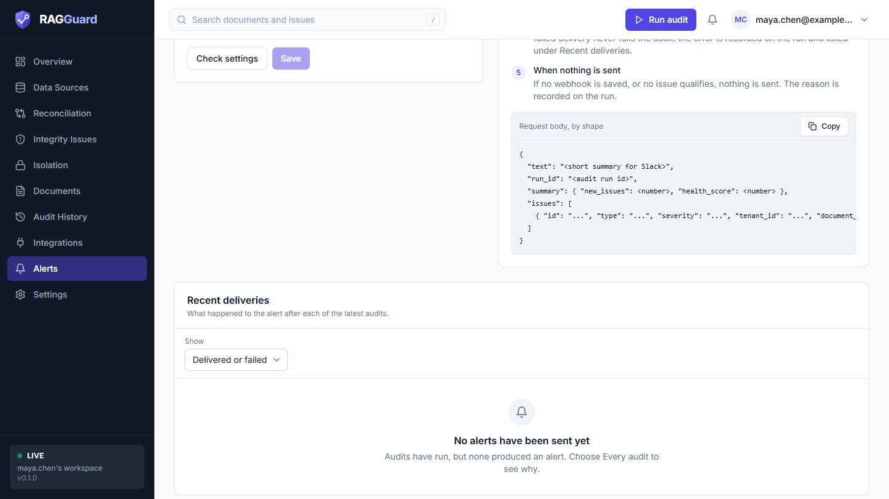
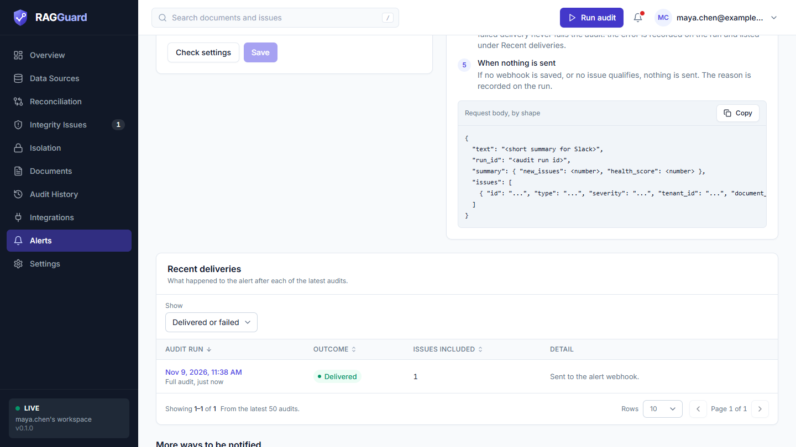

# Alerts

The Alerts page tells RAGGuard where to send a message when an audit finds something new, and shows what happened to every message. You give it one **alert webhook** (a web address that accepts messages, such as a Slack incoming webhook) and a **minimum severity**. After each finished audit RAGGuard sends one message listing the issues that are new, that came back, or that got worse and that are at or above that severity. This chapter explains the card, both fields, how to create a Slack webhook, exactly when a message is and is not sent, what the message contains, and how to read the **Recent deliveries** table.

**On this page**

- [Purpose, who needs it, how to open it](#purpose-who-needs-it-how-to-open-it)
- [The page at a glance](#the-page-at-a-glance)
- [The Alert webhook card](#the-alert-webhook-card)
- [Set up a Slack incoming webhook](#set-up-a-slack-incoming-webhook)
- [How alerts work](#how-alerts-work)
- [Recent deliveries](#recent-deliveries)
- [More ways to be notified: not available yet](#more-ways-to-be-notified-not-available-yet)
- [Single-user mode](#single-user-mode)
- [States you may see](#states-you-may-see)
- [Tips and common mistakes](#tips-and-common-mistakes)
- [Related chapters](#related-chapters)

---

## Purpose, who needs it, how to open it

**Purpose.** You should not have to open RAGGuard every day to learn that something broke. With an alert webhook, the news comes to the place your team already watches.

**Who needs it.** Anyone who wants to be told about new problems, usually the owner of the pipeline or an on-call channel.

**How to open it.** Choose **Alerts** in the left menu. The page header reads "Get told when an audit finds something new."

---

## The page at a glance



*The Alert webhook card on the left, with Webhook URL and Minimum severity.*

From top to bottom:

1. A two-column area on a wide screen (stacked on a narrow one): the **Alert webhook** card on the left and the **How alerts work** card on the right.
2. **Recent deliveries**: a table with a **Show** filter.
3. **More ways to be notified**: three dashed cards marked **Not available yet**.

---

## The Alert webhook card

The header reads "Alert webhook", with the line "A Slack-compatible incoming webhook. It is saved encrypted and never shown again." and a badge: **Configured** (green) or **Not configured** (grey). **Configured** means you have saved at least one value in this group. It does not prove the webhook works, and saving only **Minimum severity** also counts as configured.

The form is on the card itself (there is no dialog). Its parts, top to bottom:

| Element | What it does |
|---|---|
| **Webhook URL** | The address messages are posted to (secret) |
| **Minimum severity** | The lowest severity that triggers a message |
| **Saved line** | "Not saved yet." or "Saved 3 h ago." (hover for the exact time). No test history is kept for this group |
| **Note** | "Checks that the values are valid and the address is allowed. It does not send a message." |
| **"No unsaved changes."** | Appears when the form matches what is saved. It disappears as soon as you change something |
| **Check settings** | Validates the values without sending anything (see below) |
| **Save** | Stores your changes. Greyed out until something changed. A message "Alerts saved" appears when it works |

The shared form controls (required markers, the secret box and **Remove saved value**, inline errors) work as described in [Connect your data sources](04-data-sources.md#the-configure-dialog-every-control).

### The fields

| Label | Required | Secret | Default | Example |
|---|---|---|---|---|
| **Webhook URL** | No | Yes | None | `https://hooks.slack.com/services/T0000/B0000/XXXX` |
| **Minimum severity** | No | No | `high` (shown as **Use server default**) | `high` |

**Webhook URL** (secret)
- *What it is:* the address of a Slack-compatible incoming webhook. RAGGuard sends it one JSON message per audit (when there is something to say). It is treated as a secret because the address itself acts as the password: anyone who has it can post to your channel. It is stored encrypted and never shown again.
- *What it changes:* with an address, alerts are on. With none, alerts are off, and each audit records "No alert webhook was configured." To switch alerts off later, press **Remove saved value** under the field, then **Save**.
- *Rules:* it must start with `https://` or `http://`, must not contain a user name or password, and must point to a public host (see [public addresses](04-data-sources.md#hosted-mode-accepts-public-addresses-only)). Because the field is secret, the browser only checks that it is not empty; the server checks the format when you save or press **Check settings**, and a rejection appears in a red box starting with "Webhook URL: ".
- *Common mistakes:* pasting a Slack channel link instead of a webhook address; an address from a deleted or revoked webhook (deliveries then fail); a private address.

**Minimum severity** (drop-down: **Use server default**, `critical`, `high`, `medium`, `low`)
- *What it is:* the lowest severity that is worth a message. The order, highest first, is critical, high, medium, low.
- *What it changes:* an issue only triggers a message if its severity is at or above this level. `critical` means only the most serious. `low` means almost everything. The default, `high`, covers critical and high. If you leave the drop-down on **Use server default**, `high` applies.
- *Common mistakes:* choosing `low` and being flooded by minor bookkeeping issues; choosing `critical` and missing high-severity problems such as missing or stale vectors.

### Check settings

**Check settings** answers one question: "are these values acceptable?" It checks the format, and that the address is allowed. It does **not** post a message, so it cannot tell you whether Slack will accept the webhook. A pass shows a green **Test passed** panel with the line "Settings: valid". If you have saved nothing and typed nothing, you see "Nothing to check yet. Fill in a field first." A rejected value (for example a private address) shows a red message instead, for example "Webhook URL: localhost is not a public host name."

To prove that the whole chain works, post to your webhook yourself with the command in [Set up a Slack incoming webhook](#set-up-a-slack-incoming-webhook), or lower the minimum severity temporarily and run an audit that finds something new.

### What Save does

Only the fields you changed are stored. The webhook address is encrypted. A message "Alerts saved" appears, and the card's badge and saved line update. The new settings are used by the **next** audit.

---

## Set up a Slack incoming webhook

These steps use Slack's own screens, which may be named slightly differently over time. Slack's documentation for "incoming webhooks" is the authority.

1. In Slack, open the apps page (api.slack.com/apps) and create a new app **from scratch**. Give it a name such as "RAGGuard alerts" and choose your workspace.
2. In the app's settings, open **Incoming Webhooks** and turn the feature **on**.
3. Choose **Add New Webhook to Workspace**, pick the channel that should receive the alerts and allow it.
4. Copy the **Webhook URL**. It starts with `https://hooks.slack.com/services/`.
5. In RAGGuard, open **Alerts**, paste it into **Webhook URL**, choose a **Minimum severity**, press **Check settings**, then **Save**.
6. Optional: confirm that Slack accepts the address by posting a test message from a terminal (replace the address with yours):

```bash
curl -X POST -H "Content-Type: application/json" \
  -d '{"text": "Test message from my terminal"}' \
  "https://hooks.slack.com/services/T0000/B0000/XXXX"
```

If the message appears in the channel, the webhook works.

**Other tools.** Any tool that accepts Slack-style incoming webhooks (a POST with JSON that has a `text` field) can receive RAGGuard's alerts. Check that tool's documentation for how to create the address. RAGGuard also sends a few extra fields next to `text`; a tool that is strict about unknown fields may not accept them.

---

## How alerts work



*The How alerts work card: five points and the shape of the request body.*

The card lists five points. Here they are in plain words, with the details behind each.

### 1. When it runs

After **every audit that finishes**, RAGGuard compares the issues that audit found with the issues it already knew about. That includes full audits, scoped audits (one tenant or a few documents) and the verification audits that run after a repair. A scoped audit can only report on its own scope. An audit that fails does not alert.

### 2. What triggers an alert

Only issues that are **new**, **reopened** or **escalated**, and only if their severity is **at or above the minimum severity**. An issue that is still open and unchanged never alerts again.

| Situation | Alert? |
|---|---|
| An audit finds a problem RAGGuard has not recorded before, at or above the minimum severity | **Yes** (new) |
| A problem that was marked resolved is found again | **Yes** (reopened) |
| An open issue's severity goes up (for example medium to high) and the new severity is at or above the minimum | **Yes** (escalated) |
| An open issue stays open at the same severity | No |
| An open issue's severity goes down | No |
| An issue you ignored appears again | No |
| An issue is below the minimum severity | No |

"New" means new to RAGGuard's record, not new to your webhook. If earlier audits already recorded an issue, adding a webhook later does not make that issue alert. If you save the webhook **before** the first audit, that first audit treats everything it finds as new, so expect one larger message.

### 3. What is sent

One JSON request to your webhook. The `text` field is a readable summary for Slack:

```
*RAG Integrity*: 3 new issue(s) at or above `high` (health 87%)
• [CRITICAL] Document has no embeddings in the index (pipeline claims success) - `acme/policies/leave.pdf`
• [HIGH] Embeddings are from an older version of the document - `acme/runbooks/restart.md`
• [HIGH] ...
```

(The numbers, titles and document names here are only an example, and the product separates the title from the document with a long dash. The first line says how many issues, the minimum severity and the health score of that audit. After it come up to 10 issues, most severe first, each as the severity in capitals, the title and `tenant/document`. If there are more than 10 a last line says "and N more". The summary still uses the name RAG Integrity, the product's earlier name.)

The same request carries more structured data, for tools that read it:

```json
{
  "text": "<short summary for Slack>",
  "run_id": "<audit run id>",
  "summary": { "new_issues": 3, "health_score": 87 },
  "issues": [
    { "id": "...", "type": "...", "severity": "...", "tenant_id": "...", "document_id": "...", "title": "..." }
  ]
}
```

| Field | Meaning |
|---|---|
| `text` | The readable summary described above |
| `run_id` | The audit run that found these issues. Open it in [Audit history](11-audit-history.md) |
| `summary.new_issues` | How many issues qualified (not capped) |
| `summary.health_score` | The health score of that audit, as a percentage |
| `issues` | Up to 25 qualifying issues. Each has `id`, `type` (the issue type, for example `missing_embedding`), `severity`, `tenant_id`, `document_id` and `title` |

### 4. If delivery fails

RAGGuard makes **one attempt** and waits up to **10 seconds**. It does not retry. A failed delivery never fails the audit: the error is stored on the run and listed under **Recent deliveries**, and the audit and its results are unaffected. Fix the webhook and the next audit that has something new will deliver.

### 5. When nothing is sent

If no webhook is saved, or no issue qualifies, nothing is sent, and the reason is recorded on the run (it shows in the **Detail** column below).

---

## Recent deliveries



*Recent deliveries: what happened to the alert after each of the latest audits.*

This card shows "What happened to the alert after each of the latest audits." It reads the 50 most recent audits and lists the ones that recorded an alert result. An audit that failed has none, so it is not listed.

### The Show filter

One drop-down labelled **Show**:

| Choice | Lists |
|---|---|
| **Delivered or failed** (the default) | Audits where RAGGuard tried to send something and either succeeded or failed |
| **Every audit** | Every audit with an alert result, including those where nothing was sent. Use it to find out why nothing arrived |
| **Delivered** | Only successful deliveries |
| **Failed** | Only failed deliveries |
| **Not sent** | Audits where nothing was attempted |

When the filter is not the default, a **Clear filters** button appears. The choice is kept in the page address (as `outcome`), so you can bookmark or share a view.

### The columns

| Column | What it shows | How to read it |
|---|---|---|
| **Audit run** | The date and time the audit started, as a link, with a line under it such as "Full audit, 5 min ago" (the kind is Full, Scoped or Verify) | Click the date to open that run in [Audit history](11-audit-history.md). Sortable. The table starts with the newest first |
| **Outcome** | A badge: **Delivered** (green), **Failed** (red) or **Not sent** (grey) | See below. Sortable |
| **Issues included** | The number of issues in the message, or "None" | How many issues the alert listed. Sortable |
| **Detail** | A sentence | The reason or the error. Red for a failure |

### Outcomes and the text in Detail

| Outcome | Meaning | Text in **Detail** |
|---|---|---|
| **Delivered** | The webhook accepted the message | "Sent to the alert webhook." |
| **Failed** | RAGGuard tried and the webhook did not accept it, or could not be reached, or took longer than 10 seconds | The error: its type, then the first part of its message, for example a status code from the webhook. See the caution below |
| **Not sent** | Nothing was attempted | "No alert webhook was configured." (no address was saved), or "No new issues at or above the minimum severity." (the audit found nothing that qualifies), or the recorded reason, or "Nothing to send." |

**Common reasons for a failure.** A revoked or deleted Slack webhook (the webhook answers with an error status), a mistyped address (not found), a network problem, or a slow endpoint (more than 10 seconds).

**Caution.** The error text of a failed delivery can contain the address RAGGuard called, which is a secret. Do not share a screenshot of the **Detail** column without checking it first.

### Paging and counts

Under the table: "Showing 1 to 10 of N" and the note "From the latest 50 audits.", a **Rows** drop-down (10, 25, 50 or 100; it starts at 10) and **Previous page** and **Next page** arrows with "Page 1 of N".

### Empty states

| Where | What you see |
|---|---|
| No audit has an alert result at all | "No alerts have been sent yet": "After every audit RAGGuard checks for new issues. Once an alert webhook is saved and an audit finds something new, each delivery is listed here." |
| Audits exist, but none attempted an alert, and the filter is the default | "No alerts have been sent yet": "Audits have run, but none produced an alert. Choose Every audit to see why." |
| You chose another filter and nothing matches | "No audits match this filter": "Choose another outcome to see more." |
| The audits could not be loaded | "We couldn't load this" with a **Try again** button |

While loading, grey placeholder rows are shown.

---

## More ways to be notified: not available yet

Three dashed cards at the bottom are each marked **Not available yet**. Nothing here can be configured.

| Card | What it says |
|---|---|
| **Email alerts** | "Alerts go to a webhook only." |
| **Per-issue-type rules** | "The only filter is the minimum severity." |
| **Digest and quiet hours** | "An alert is sent right after each audit that finds something new." |

---

## Single-user mode

On a server that runs for one team without accounts (live or demo mode) the card is read-only. It shows "Alert webhook" with the line "A Slack-compatible incoming webhook." and the note "Configured by the server's environment variables (RAGI_*)": "Set RAGI_ALERT_WEBHOOK_URL to turn alerts on, and RAGI_ALERT_MIN_SEVERITY to choose the minimum severity." **How alerts work**, **Recent deliveries** and the **Not available yet** cards work the same way.

---

## States you may see

| State | What you see | What to do |
|---|---|---|
| **Loading** | A tall grey placeholder where the card goes, and grey rows in the table | Wait a moment |
| **Not configured** | A grey **Not configured** badge, and every audit records "No alert webhook was configured." | Paste a webhook address and **Save** |
| **Configured** | A green badge | Check **Recent deliveries** after the next audit |
| **A rejected value** | A red box under the form beginning with "Webhook URL: " | Fix the address |
| **Cannot load** | "We couldn't load this" and **Try again** | Press **Try again** |

---

## Tips and common mistakes

- **Start with `high`.** It keeps the channel quiet enough that people read it. Lower it only if you want to see everything.
- **A steady state is silent.** If your channel is quiet, either nothing new happened or nothing reached the minimum severity. Choose **Every audit** under **Show** to see which.
- **Check settings does not send anything.** To test delivery, use the `curl` command above.
- **The webhook address is a secret.** If it leaks, delete the webhook in Slack, create a new one and replace it here.
- **Hosted RAGGuard does not run audits on a timer.** To get alerts every morning, schedule a call to the API with an API key (see [Integrations](12-integrations.md#use-a-key)).
- **To switch alerts off,** use **Remove saved value** under **Webhook URL**, then **Save**.

---

## Related chapters

- [Integrations](12-integrations.md): API keys for scheduling audits, and the repair webhook
- [Integrity issues](07-integrity-issues.md): what the issue types and severities mean
- [Audit history](11-audit-history.md): open the run that produced an alert
- [Connect your data sources](04-data-sources.md): the shared form controls and the public-address rule
- [Settings](14-settings.md)
- [Troubleshooting](18-troubleshooting.md)
