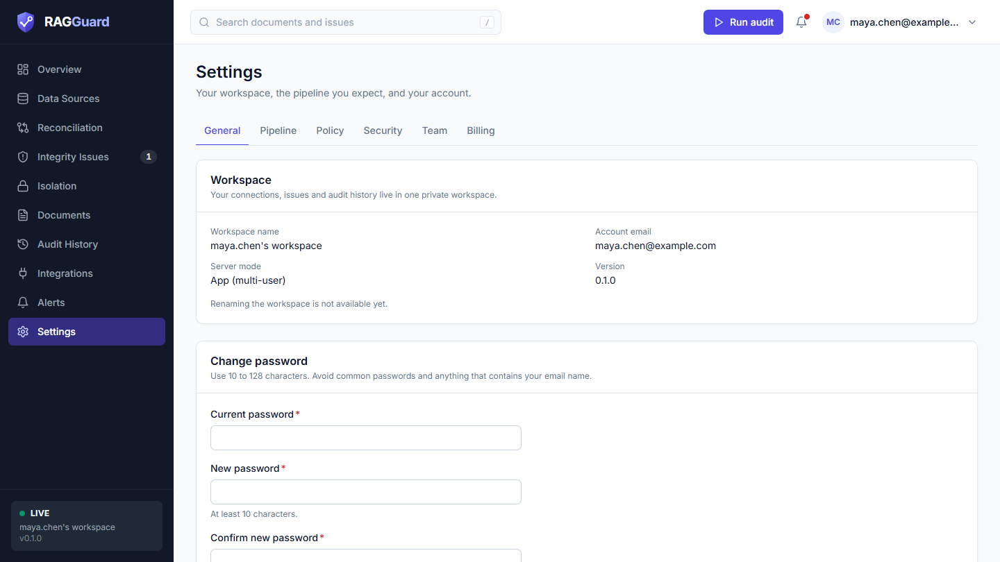
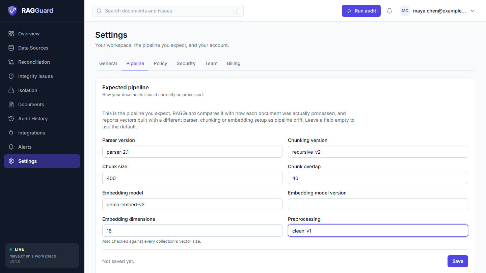
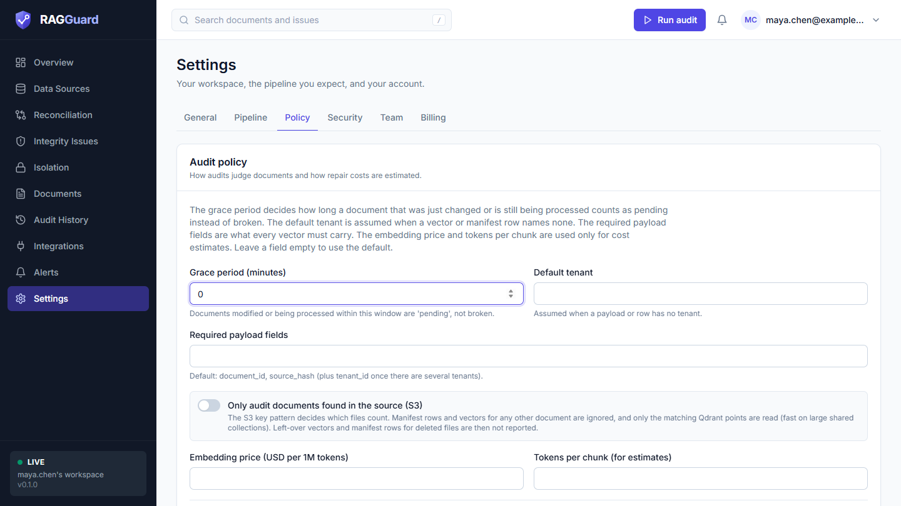
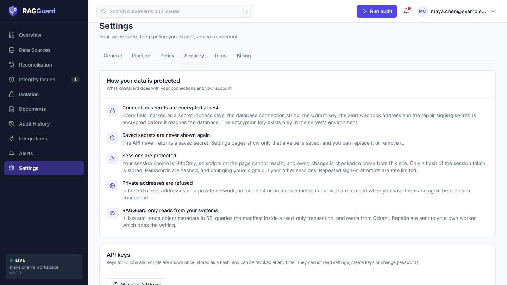
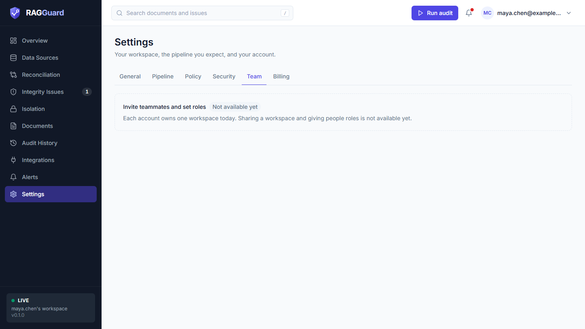
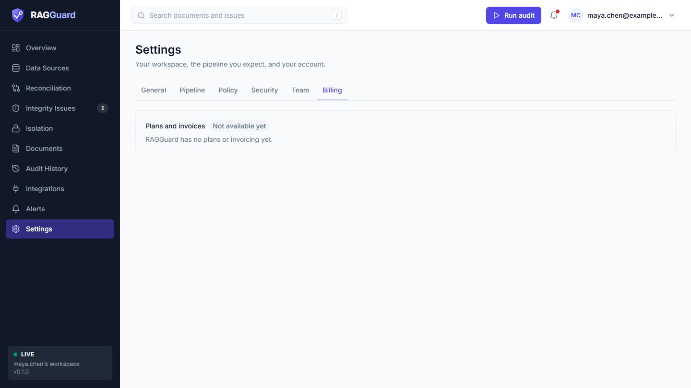

# Settings

The Settings page is where you look after your workspace and your account, and where you tell RAGGuard what "correct" means for your pipeline. It has six tabs: **General** (your workspace, your account email, the server mode and version, and **Change password**), **Pipeline** (the *target pipeline*: how your documents are supposed to be processed, which is how RAGGuard spots *pipeline drift*), **Policy** (the audit rules: grace period, default tenant, required payload fields, and the numbers behind cost estimates), **Security** (how your data is protected), and **Team** and **Billing** (both **Not available yet**). This chapter explains every tab, every field, what each one changes in your audit results or cost estimates, and the messages you may see.

**On this page**

- [Purpose, who needs it, how to open it](#purpose-who-needs-it-how-to-open-it)
- [The page at a glance](#the-page-at-a-glance)
- [General tab](#general-tab)
- [Pipeline tab: the target pipeline](#pipeline-tab-the-target-pipeline)
- [Policy tab: audit rules and cost estimates](#policy-tab-audit-rules-and-cost-estimates)
- [Security tab](#security-tab)
- [Team tab and Billing tab: not available yet](#team-tab-and-billing-tab-not-available-yet)
- [Single-user mode](#single-user-mode)
- [States you may see](#states-you-may-see)
- [Tips and common mistakes](#tips-and-common-mistakes)
- [Related chapters](#related-chapters)

---

## Purpose, who needs it, how to open it

**Purpose.** Three things: manage your account (change your password), describe the pipeline you expect so that RAGGuard can tell when vectors were built differently, and tune how audits judge documents.

**Who needs it.** Everyone should visit **General** once. Whoever knows how the ingestion pipeline is configured should fill in **Pipeline**. Whoever owns the audit rules (usually the same person) decides **Policy**.

**How to open it.** Choose **Settings** in the left menu, or **Settings** in the account menu at the top right (see [Sign in and find your way around](03-interface-and-sign-in.md)).

---

## The page at a glance

The header reads "Settings" with the line "Your workspace, the pipeline you expect, and your account." Under it is a row of six tabs: **General**, **Pipeline**, **Policy**, **Security**, **Team** and **Billing**. The tab you are on is kept in the page address (for example `?tab=policy`), so you can bookmark it or refresh without losing your place. An unknown tab name opens **General**. While your session loads you see a grey placeholder.

The connections to your S3 bucket, manifest database and Qdrant are **not** here. They are on the Data sources page (see [Connect your data sources](04-data-sources.md)). The repair webhook and API keys are on [Integrations](12-integrations.md), and the alert webhook is on [Alerts](13-alerts.md).

The **Pipeline** and **Policy** tabs are forms. They share these behaviours (the shared controls are explained in [Connect your data sources](04-data-sources.md#the-configure-dialog-every-control)):

- Fields start from the saved values. An empty field means "use the default".
- **Save** is greyed out until you change something. The text "No unsaved changes." sits under the form while the form matches what is saved.
- The line above the buttons says "Not saved yet." or "Saved 3 h ago." (hover for the exact time).
- There is no test button. These groups connect to nothing, so there is nothing to test.
- After a successful save a message appears: "Target pipeline saved" or "Audit policy saved". The new values are used by the **next** audit. Past results are not recalculated.
- Numbers are checked by the server: a value out of range shows a red message such as "Chunk size: must be between 1 and 1000000".

---

## General tab

*The General tab of a hosted workspace: the Workspace card and the Change password card.*

### The Workspace card

Title **Workspace**, with the line "Your connections, issues and audit history live in one private workspace." It lists four values:

| Row | What it shows | How to read it |
|---|---|---|
| **Workspace name** | The name of your private workspace. It starts as the part of your email address before the `@`, followed by "'s workspace" | Your connections, issues, audit history and repair plans are stored in this workspace, and nobody else can see them |
| **Account email** | The email you signed in with | There is no control on this page to change it |
| **Server mode** | **App (multi-user)** in hosted mode. Other servers show **Live (single-user)** or **Demo (single-user)** | Tells you whether you are on a server with accounts. See [Concepts you need](02-concepts.md) |
| **Version** | The version of RAGGuard the server runs | Quote it when you report a problem |

Under the values: "Renaming the workspace is not available yet."

### The Change password card

Title **Change password**, with the line "Use 10 to 128 characters. Avoid common passwords and anything that contains your email name."

| Field | Required | What to enter | Help text |
|---|---|---|---|
| **Current password** | Yes | The password you use now | none |
| **New password** | Yes | Your new password | "At least 10 characters." |
| **Confirm new password** | Yes | The same new password again | none |

Press **Update password**. The button shows a spinner while it works.

**The rules for a new password**

- 10 to 128 characters.
- Not an easy-to-guess password: not one of a list of very common passwords, and not made of fewer than four different characters (capital letters do not count as different).
- Must not contain the part of your email address before the `@` (when that part is at least 4 characters long), in any capitalisation.
- Must differ from the current password.

**Messages**

| Message | Where | Cause |
|---|---|---|
| "Enter your current password." | Under **Current password** | The field is empty |
| "Use at least 10 characters." / "Use at most 128 characters." | Under **New password** | Length |
| "Choose a password that is different from the current one." | Under **New password** | Same as the current password |
| "The two passwords do not match." | Under **Confirm new password** | The confirmation differs |
| "Your current password is incorrect." | Under **Current password** | The server did not accept it |
| "Password must be at least 10 characters." / "Password must be at most 128 characters." | Red box above the button | The server's length check |
| "That password is too easy to guess." | Red box above the button | A common password, or too few different characters |
| "Password must not contain your email name." | Red box above the button | See the rules |
| "Too many attempts. Try again later." | Red box above the button | More than 10 attempts in 15 minutes. Wait and try again |

**What happens when it works.** A message appears: **Password updated**, with "Your other signed-in sessions were signed out." The three boxes are cleared. You stay signed in on this browser. Every other browser or device that was signed in to your account is signed out and must sign in with the new password. Do this if you think someone else has your password.

### The Demo data card (demo servers only)

On a demo server (not on the hosted product) a third card, **Demo data**, says "This server runs on synthetic data so you can explore the product." and has a red-outlined **Reset demo data** button. Pressing it asks **Reset demo data?** ("This regenerates the synthetic demo data and clears the current results.") with **Cancel** and a red **Reset demo data** button. If you confirm, a message appears: **Demo data reset**, "New synthetic data is loading." Use it to start a demo again.

---

## Pipeline tab: the target pipeline

*The Pipeline tab: eight optional fields that describe how documents should be processed.*

### What a target pipeline is

When your pipeline turns a document into vectors it makes choices: which parser reads the file, how the text is cut into chunks, which embedding model produces the vectors, and so on. Together these choices are the **fingerprint** of how a document was processed. The **target pipeline** is the fingerprint you **expect right now**: "this is how documents should currently be processed."

Why it matters: pipelines change. You upgrade the parser or switch the embedding model, but documents that were processed before the change keep their old vectors. Vectors built with an older recipe may no longer match searches made with the new one. RAGGuard cannot see your intentions, so you tell it, and it flags every document that was built differently. The card is titled **Expected pipeline**, with the line "How your documents should currently be processed." The text on the card says: "This is the pipeline you expect. RAGGuard compares it with how each document was actually processed, and reports vectors built with a different parser, chunking or embedding setup as pipeline drift. Leave a field empty to use the default."

**All eight fields are optional.** With none filled in there is no target, and RAGGuard only reports documents whose own chunks disagree with each other.

### How a mismatch becomes pipeline drift

During every audit RAGGuard reads each vector's recorded fingerprint from its Qdrant payload and compares it with your target:

1. **Where does RAGGuard learn how a vector was built?** From the vector's own payload fields (`parser_version`, `chunking_version`, `chunk_size`, `chunk_overlap`, `embedding_model`, `embedding_model_version`, `embedding_dim`, `preprocessing`). If a vector lacks a value, RAGGuard takes it from the document's manifest row (the same column names). If neither knows a value, that value cannot conflict.
2. **What counts as a mismatch?** A field where **both** the target and the vector know a value and the values differ. A field you left empty in the target is never checked. Values are compared as text, so `1536` and `"1536"` are the same.
3. **What does a mismatch do?** A vector whose content is current but whose recipe conflicts with the target is called **outdated**. Then:
   - If a document has outdated vectors and no current ones, it gets a **pipeline drift** issue that lists the differences, for example "embedding_model (old-model -> new-model)". Severity is **high** when the embedding model, its version or the dimensions differ, and **medium** for chunking, parser or preprocessing differences.
   - If a document has current vectors and outdated ones side by side, it gets a *superseded vectors still active* issue (medium), because old vectors still answer queries.
   - Even without a target, a document whose live vectors disagree with each other on any fingerprint field gets a pipeline drift issue.
4. **Vector size.** If you set **Embedding dimensions**, RAGGuard also compares it with the vector size of every Qdrant collection it audits. A mismatch is a **critical** collection-level issue: "Collection vector size does not match the target embedding model". Queries made with the new model cannot match that collection at all.

See [Integrity issues](07-integrity-issues.md) for what to do about each issue type, and [Impact analysis](09-impact-analysis.md) for the **Pipeline change** scenario that shows the effect of a change before you make it.

**A warning about changing the target.** Changing a field flags every document that was built with the old value and has not been re-embedded yet. That is the purpose, but expect a lot of drift issues the moment you change the embedding model or chunking. Use **Impact analysis** first to see the size of it and its estimated cost.

### The fields

| Label | Required | Secret | Default | Allowed values | Example |
|---|---|---|---|---|---|
| **Parser version** | No | No | None | Text, up to 64 characters | `parser-2.1` |
| **Chunking version** | No | No | None | Text, up to 64 characters | `recursive-v2` |
| **Chunk size** | No | No | None | Whole number, 1 to 1,000,000 | `512` |
| **Chunk overlap** | No | No | None | Whole number, 0 to 1,000,000 | `64` |
| **Embedding model** | No | No | None | Text, up to 128 characters | `text-embedding-3-large` |
| **Embedding model version** | No | No | None | Text, up to 64 characters | `2024-01` |
| **Embedding dimensions** | No | No | None | Whole number, 1 to 65,536 | `3072` |
| **Preprocessing** | No | No | None | Text, up to 128 characters | `strip-html-v1` |

**Parser version.** The version or name of the parser that reads your files. *Changes:* documents whose recorded parser differs are reported as drift (medium). *Mistake:* a label that your pipeline does not actually write into the manifest or payload. RAGGuard cannot compare what nobody records.

**Chunking version.** The version or name of your chunking method. *Changes:* a difference is reported as drift (medium). *Mistake:* writing `recursive-v2` here while the pipeline records `recursive_v2`. Spelling must match exactly.

**Chunk size.** How big each chunk should be, in the same unit your pipeline records (tokens or characters). *Changes:* a difference is reported as drift (medium). *Mistake:* confusing it with **Tokens per chunk (for estimates)** on the Policy tab. That one only affects cost estimates. This one affects drift.

**Chunk overlap.** How much neighbouring chunks overlap, in the same unit. *Changes:* a difference is reported as drift (medium). *Mistake:* using a different unit from chunk size.

**Embedding model.** The name of the model that produces the vectors. *Changes:* a difference is reported as drift (**high**), because the vectors live in a different space. *Mistake:* a short name where the pipeline records the full one.

**Embedding model version.** The version of that model. *Changes:* a difference is reported as drift (**high**).

**Embedding dimensions.** The length of each vector. *Changes:* it is compared with every vector's recorded dimension (drift, high) and with every collection's real vector size (critical). Setting it is a strong, cheap safety check. *Mistake:* entering the dimension of a different model than the one in **Embedding model**.

**Preprocessing.** A label for the cleaning step before chunking (for example HTML stripping). *Changes:* a difference is reported as drift (medium).

**Leave a field empty** when you have no expectation. To remove a value you saved, clear the box and press **Save**.

---

## Policy tab: audit rules and cost estimates

*The Policy tab: the grace period, default tenant, required payload fields, the source-only switch and the two numbers used for cost estimates.*

The card is titled **Audit policy**, with the line "How audits judge documents and how repair costs are estimated." and the text: "The grace period decides how long a document that was just changed or is still being processed counts as pending instead of broken. The default tenant is assumed when a vector or manifest row names none. The required payload fields are what every vector must carry. The embedding price and tokens per chunk are used only for cost estimates. Leave a field empty to use the default."

### The fields

| Label | Required | Secret | Default | Allowed values | Example |
|---|---|---|---|---|---|
| **Grace period (minutes)** | No | No | 10 | Whole number, 0 to 1,440 | `10` |
| **Default tenant** | No | No | `default` | Text, up to 64 characters | `main` |
| **Required payload fields** | No | No | Empty (see below) | Comma-separated names (letters, digits, `_`, `-`, `.`) | `document_id,source_hash,tenant_id,chunk_id` |
| **Only audit documents found in the source (S3)** | No | No | Off | Switch | On |
| **Embedding price (USD per 1M tokens)** | No | No | 0.13 | Number, 0 to 10,000 | `0.13` |
| **Tokens per chunk (for estimates)** | No | No | 512 | Whole number, 1 to 100,000 | `512` |

**Grace period (minutes)**
- *What it is:* how long a document that was just changed, or that your pipeline is still working on, is allowed to be unfinished before RAGGuard calls it broken.
- *What it changes:* a document is shown as **pending**, not broken, in these cases: (1) it has no vectors yet and its source file was modified within this many minutes, or the manifest says it is in progress and was updated within this many minutes (or has no update time); (2) all its vectors are old but its source changed within this many minutes. A document that stays "in progress" longer than the grace period is reported as missing, with a note that the pipeline has had it in that status since a given time. With `0` the grace period is off and fresh changes are reported at once.
- *Example:* your pipeline usually needs 5 minutes per document. With the default 10, a file uploaded two minutes ago is pending. Raise it if your pipeline is slower.
- *Common mistakes:* `0` on a busy pipeline (every upload briefly looks broken, and alerts fire); a huge value such as 1,440 (a day), which hides real failures for that long.

**Default tenant**
- *What it is:* the tenant name assumed when a **manifest row** or a **Qdrant point** has no tenant.
- *What it changes:* which tenant those rows and vectors belong to. It must be the same name the S3 side uses, or documents will look present in one system and missing in the others.
- *Common mistakes:* confusing it with the S3 **Default tenant** on the Data sources page (see [Connect your data sources](04-data-sources.md)). They are two settings: the S3 one is used for object keys without a tenant, this one for manifest rows and vectors without one. When your data has no tenants, set both to the same name.

**Required payload fields**
- *What it is:* the payload fields that every vector in Qdrant must carry, as a comma-separated list. Use the payload field names listed in [Connect your data sources](04-data-sources.md#the-payload-fields-ragguard-reads).
- *What it changes:* a vector that lacks a required field raises a "Metadata disagrees between systems" issue that names the missing fields. When the box is empty the required set is `document_id` and `source_hash`, plus `tenant_id` once RAGGuard knows of more than one tenant (counting those it saw in earlier audits). Writing your own list replaces that set completely, so include these three if you still want them.
- *Common mistakes:* listing a field your vectors do not carry (every vector is then flagged, which can mean thousands of findings); listing a name that is not one of the fields RAGGuard reads, which can never be present; forgetting that your own list replaces the default.

**Only audit documents found in the source (S3)** (switch)
- *What it is:* the S3 listing decides what is audited. The **Key pattern** on the Data sources page chooses which files count.
- *What it changes:* manifest rows and vectors for any document that is **not** in that listing are ignored, and RAGGuard reads only the matching Qdrant points (a server-side filter), which is much faster on a large collection that holds more than your bucket. The cost: findings that depend on seeing things the source no longer has are **not reported**: left-over vectors for deleted files (orphan vectors), manifest rows for deleted files (manifest orphans) and vectors filed under the wrong tenant (tenant mismatch). If the S3 listing is empty, Qdrant is not read at all.
- *When to use it:* the manifest table or the Qdrant collection is shared with more than this bucket covers.
- *Common mistakes:* turning it on and then expecting to find deleted-file leftovers; combining it with a key pattern that matches few files (almost nothing is audited). A Qdrant cluster in strict mode may refuse to filter on a field without a payload index; the message says so (see [Connect your data sources](04-data-sources.md#what-test-connection-checks-qdrant)).

**Embedding price (USD per 1M tokens)**
- *What it is:* what you pay to create embeddings, in US dollars per million tokens.
- *What it changes:* **only the cost estimates** (see below). It never changes which issues are found.
- *Common mistakes:* entering the price per thousand tokens.

**Tokens per chunk (for estimates)**
- *What it is:* the typical size of one chunk, in tokens.
- *What it changes:* **only the estimates**. It is not the same as **Chunk size** on the Pipeline tab.
- *Common mistakes:* confusing it with the target **Chunk size**.

### How the cost estimates use the last two fields

Where you see them: the **Recommended work** card and plans in [Repair plans](08-repair-plans.md), and the results in [Impact analysis](09-impact-analysis.md).

- **Chunks to regenerate**: for each document that needs a full reindex, its expected chunk count from the manifest (or its indexed count). If neither is known, RAGGuard estimates from the source size: about 4 bytes per token, divided by **Tokens per chunk**, rounded up, at least 1. For a partial index, the number of missing chunks.
- **Estimated tokens** = chunks to regenerate x **Tokens per chunk (for estimates)**.
- **Estimated cost (USD)** = estimated tokens divided by 1,000,000 x **Embedding price (USD per 1M tokens)**.
- The same method is applied to the whole corpus to show the saving compared with re-embedding everything. The small print on the cards reads, for example, "512 tokens per chunk, $0.13/1M tokens".

Example: 200 chunks to regenerate x 512 tokens = 102,400 tokens. At 0.13 dollars per million tokens that is about $0.013.

---

## Security tab

*The Security tab: the protection statements, a link to API keys, and the two features that do not exist yet.*

The tab has a card titled **How your data is protected** ("What RAGGuard does with your connections and your account."), an **API keys** card, and two **Not available yet** cards. On a hosted workspace the first card lists five statements. Here is each one, exactly as the page says it, with what it means for you.

| Statement | What the page says | What it means for you |
|---|---|---|
| **Connection secrets are encrypted at rest** | "Every field marked as a secret (access keys, the database connection string, the Qdrant key, the alert webhook address and the repair signing secret) is encrypted before it reaches the database. The encryption key exists only in the server's environment." | Anyone who copied RAGGuard's database would still not be able to read your credentials without the server's separate key |
| **Saved secrets are never shown again** | "The API never returns a saved secret. Settings pages show only that a value is saved, and you can replace it or remove it." | You cannot read a saved secret back, even yourself. If you lose one, create a new credential at its source |
| **Sessions are protected** | "Your session cookie is HttpOnly, so scripts on the page cannot read it, and every change is checked to come from this site. Only a hash of the session token is stored. Passwords are hashed, and changing yours signs out your other sessions. Repeated sign-in attempts are rate limited." | Your sign-in is kept in a cookie that page scripts cannot read, other websites cannot make changes in your name, the server stores no readable password or session token, and repeated wrong guesses are slowed down |
| **Private addresses are refused** | "In hosted mode, addresses on a private network, on localhost or on a cloud metadata service are refused when you save them and again before each connection." | RAGGuard cannot be pointed at internal systems. See [Connect your data sources](04-data-sources.md#hosted-mode-accepts-public-addresses-only) |
| **RAGGuard only reads from your systems** | "It lists and reads object metadata in S3, queries the manifest inside a read-only transaction, and reads from Qdrant. Repairs are sent to your own worker, which does the writing." | RAGGuard has no way to change your bucket, your manifest or your index |

The **API keys** card says "Keys for CI jobs and scripts are shown once, stored as a hash, and can be revoked at any time. They cannot read settings, create keys or change passwords." and has a **Manage API keys** button that opens the Integrations page (see [Integrations](12-integrations.md#api-keys)).

Two dashed cards are marked **Not available yet**:

| Card | What it says |
|---|---|
| **Two-factor authentication** | "Sign-in uses an email and a password only." |
| **Single sign-on** | "Accounts are created with an email and a password." |

Neither exists in this version. Do not rely on them.

---

## Team tab and Billing tab: not available yet

*The Team tab: one card, marked Not available yet.*

**Team** shows one card, **Invite teammates and set roles**, marked **Not available yet**, with the text "Each account owns one workspace today. Sharing a workspace and giving people roles is not available yet." Today each person has their own account and their own private workspace. Two people cannot share one.

*The Billing tab: one card, marked Not available yet.*

**Billing** shows one card, **Plans and invoices**, marked **Not available yet**, with the text "RAGGuard has no plans or invoicing yet."

Nothing on either tab can be clicked or configured.

---

## Single-user mode

On a server that runs for one team without sign-in accounts (live or demo mode; see [Concepts you need](02-concepts.md)), the tabs change:

| Tab | What you see |
|---|---|
| **General** | A **Server** card ("This RAGGuard server runs for one team without sign-in accounts.") with **Server mode** (**Live (single-user)** or **Demo (single-user)**) and **Version**, and the note "Configured by the server's environment variables (RAGI_*)". There is no **Change password**. On a demo server the **Demo data** card with **Reset demo data** appears |
| **Pipeline** | An **Expected pipeline** card ("The settings your documents should have been processed with.") with the note "Set the RAGI_TARGET_* variables on the server to change what is expected." Below it, the values that are set (**Parser version**, **Chunking version**, **Chunk size**, **Chunk overlap**, **Embedding model**, **Embedding model version**, **Embedding dim**, **Preprocessing**), or, if none is set, "No expected pipeline is set": "Without one, RAGGuard cannot report vectors built with a different parser, chunking or embedding setup." |
| **Policy** | An **Audit policy** card with the note "The grace period, default tenant, required payload fields and embedding price come from the server's configuration, not from this page." |
| **Security** | The statement "RAGGuard only reads from your systems", then an **Access to this server** card ("Single-user mode has no accounts or sessions.") that says either "Access is protected by one shared API key (RAGI_API_KEY) that the server's operator sets." or "No API key is required to use this server. Set RAGI_API_KEY in the server's environment to protect it.", and the two **Not available yet** cards |
| **Team**, **Billing** | The same **Not available yet** cards |

To change anything on such a server, ask whoever runs it.

---

## States you may see

| State | What you see | What to do |
|---|---|---|
| **Loading** | A grey placeholder while your session loads; a tall grey block while a form's saved values load | Wait a moment |
| **Cannot load a form** | "We couldn't load this" with the reason and **Try again** | Press **Try again** |
| **Nothing to save** | **Save** greyed out and "No unsaved changes." | Change a field |
| **A rejected value** | A red box under the form beginning with the field label | Fix that field |
| **Saved** | A message "Target pipeline saved" or "Audit policy saved", and the saved line updates | Run an audit to apply it |
| **Not available yet** | A dashed card with a grey **Not available yet** badge | Nothing: the feature does not exist |

---

## Tips and common mistakes

- **Set the target pipeline once you know it.** Even **Embedding model** and **Embedding dimensions** alone catch the most expensive mistakes.
- **Change the target when you change the pipeline, not before.** Otherwise RAGGuard flags documents that are correct for the old recipe.
- **Keep the grace period a little longer than your pipeline's slowest run.**
- **Set both default tenants.** The S3 **Default tenant** (Data sources) and the Policy **Default tenant** are separate.
- **Do not list payload fields you do not have** in **Required payload fields**.
- **Remember the trade-off of the source-only switch.** It speeds up audits by ignoring leftovers, so deleted-file leftovers are no longer reported.
- **Cost numbers are estimates.** They use your price and your tokens-per-chunk guess. Adjust the two policy numbers to match your invoices.
- **After a password change**, other devices are signed out. Sign in again on them.

---

## Related chapters

- [Connect your data sources](04-data-sources.md): connections, payload fields, and the S3 default tenant
- [Integrity issues](07-integrity-issues.md): pipeline drift, metadata and the other issue types
- [Repair plans](08-repair-plans.md): where the cost estimates appear
- [Impact analysis](09-impact-analysis.md): the Pipeline change scenario
- [Integrations](12-integrations.md): API keys and the repair webhook
- [Alerts](13-alerts.md): the alert webhook
- [Sign in and find your way around](03-interface-and-sign-in.md): the account menu and signing out
- [Reference: every value](17-reference.md)
